import PlanarMechanicsComments from '../../../../components/planar-mechanics/PlanarMechanicsComments.astro';
import TawkWidget from '../../../../components/TawkWidget.astro';
import UniversalContentContributors from '../../../../components/UniversalContentContributors.astro';
import InArticleAd from '../../../../components/InArticleAd.astro';
import Copyright from '../../../../components/Copyright.astro';
import BionicText from '../../../../components/BionicText.astro';
import TailwindWrapper from '../../../../components/TailwindWrapper.jsx';
import { Tabs, TabItem } from '@astrojs/starlight/components';
import { Card, CardGrid, Badge, Steps, LinkButton, FileTree } from '@astrojs/starlight/components';

<UniversalContentContributors 
  contributors={frontmatter.contributors}
/>

A machine that runs quietly at low speed can shake its mounts loose at high speed, and a velocity analysis gives no warning. The cause is acceleration. Velocity says how fast a part moves. Acceleration says how quickly that velocity changes, and every change needs a force. A piston at 6000 rpm goes up and down 100 times a second, and the force that stops it and sends it back passes through the engine structure. In this lesson you find the acceleration of every part of a mechanism with an acceleration polygon. Then you turn those accelerations into the inertia forces that load the bearings and the shaking forces that reach the mounts. #AccelerationAnalysis #InertiaForces #EngineBalancing

## Learning Objectives

By the end of this lesson, you will be able to:

1. **Differentiate** the velocity loop to find accelerations, and split each into a part towards the centre (normal) and a part along the path (tangential)
2. **Construct** acceleration polygons for the slider-crank and four-bar
3. **Convert** accelerations into inertia forces and shaking forces with d'Alembert's principle
4. **Predict** the primary and secondary shaking forces that engine balancing must cancel, and verify each result in a simulator

## Real-World System Problem: the forces that shake an engine

<InArticleAd />

An engine, compressor or pump runs at a steady speed, but its piston does not. The piston stops and reverses at each end of its stroke. The force needed to reverse it is large: at high speed it can be greater than the force of the gas pressure.

That force passes through the connecting rod, the crank and the bearings to the engine mounts, where it is felt as vibration. A designer needs these accelerations to size the bearings and to balance the machine.

### The acceleration problem

> **Engineering Question:** Given the input speed, what is the acceleration of every part, and what inertia forces do those accelerations create?

## Fundamental Theory: acceleration by differentiating the loop

<InArticleAd />

### One more derivative

Start with a stone on a string. Swing it in a circle at a steady speed. The string stays tight: it pulls the stone towards your hand the whole time. Release the string and the stone leaves in a straight line. So the stone accelerates even at a steady speed, because its direction changes at every instant, and that acceleration points towards the centre.

Now swing the stone faster and faster. While its speed rises, something must also push it forward along its circle. That is a second acceleration, along the path, and it exists only while the speed changes.

Every point on a turning link behaves like that stone. The link is the string.

<Card title="Normal and tangential components" icon="document">
Take a point at a distance $r$ (mm) from the pivot of a link. The link turns with angular velocity $\omega$ (rad/s), which is how fast it turns. Its angular acceleration is $\alpha$ (rad/s²), which is how quickly that turning speeds up or slows down.

- The **normal** (centripetal) part points along the link towards the pivot. Its size is the angular velocity squared, times the distance. It exists whenever the link turns, even at constant speed: the pull of the string.
- The **tangential** part lies across the link, along the path of the point. Its size is the angular acceleration times the distance. It exists only while the link speeds up or slows down.

$$a^n = \omega^2 r, \qquad a^t = \alpha r$$

With $r$ in mm, both are in mm/s². The two parts are at right angles, so the total is the diagonal of their rectangle: $a = \sqrt{(a^n)^2 + (a^t)^2}$.
</Card>

  <TailwindWrapper>
	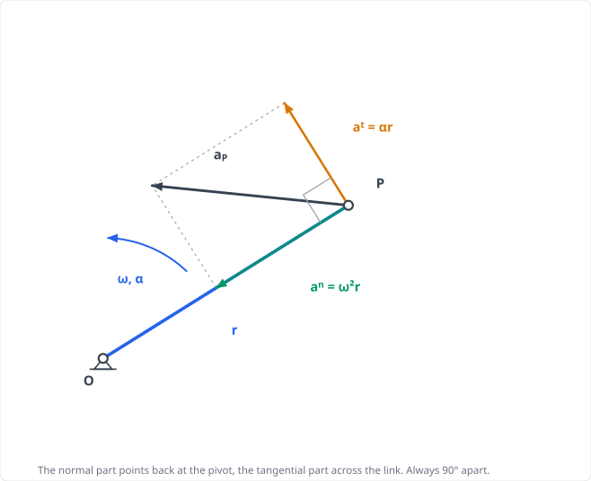
  </TailwindWrapper>

When a problem says **constant crank speed**, the angular acceleration is zero for the crank and for no other link. The crank pulls the other links through a geometry that changes, so their angular speeds rise and fall. In the slider-crank at $\theta = 60\degree$ the tangential part of the rod is nearly **ten times** its normal part.

| Part of the mechanism | Turning? | Its own $\omega$ constant? | $a^n = \omega^2 r$ | $a^t = \alpha r$ |
|---|:---:|:---:|:---:|:---:|
| Crank, driven at constant speed | yes | yes, by assumption | yes | no |
| Coupler, rod or follower | yes | no, it is dragged | yes | yes |
| Piston or slider | no, it translates | not applicable | no | no |

People forget the piston row. A part that only slides has neither part: its acceleration is one vector along the slide.

### Two points on one link

A connecting rod has no fixed pivot: it moves as a whole and also turns. Take one end $A$, whose acceleration you know, and add the acceleration of the other end $B$ as seen from $A$. Seen from $A$, point $B$ only goes round $A$ in a circle, so that added acceleration has the same two parts as the stone.

<Card title="The relative-acceleration equation" icon="document">
For two points $A$ and $B$ on the same rigid link of length $L_{AB}$ (mm):

$$\vec a_B = \vec a_A + \vec a_{B/A}^{\,n} + \vec a_{B/A}^{\,t}$$

- $\vec a_{B/A}^{\,n}$ has the size $\omega^2 L_{AB}$ and points from $B$ to $A$.
- $\vec a_{B/A}^{\,t}$ has the size $\alpha L_{AB}$ and is at right angles to $AB$.

Here $\omega$ and $\alpha$ are the angular velocity and angular acceleration of that link.
</Card>

The acceleration polygon is this equation drawn to scale. Each term on the right is one arrow. Draw the arrows one after another, each starting where the last one ended, from a starting point called the pole $o'$. The arrow from the pole to the last point is $\vec a_B$.

  <TailwindWrapper>
	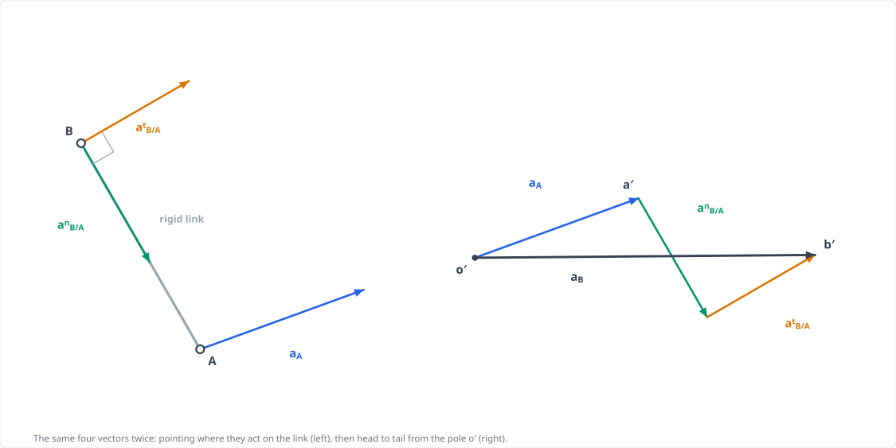
  </TailwindWrapper>

### The acceleration polygon

Acceleration uses the same [methods](/education/planar-mechanics/position-analysis-planar-linkages/#methods-of-kinematic-analysis) as position and velocity: draw, solve, simulate.

You build the polygon like the velocity polygon, to a chosen acceleration scale (for example $1 \text{ cm} = 10 \text{ mm/s}^2$). Each link now adds up to two arrows:

1. First the **normal** part. You know its size, $\omega^2 L$, from the velocity analysis, and its direction, along the link towards the centre it turns about.
2. Then the **tangential** part. You know only its direction, at right angles to the link. Draw it as a long thin construction line.

The polygon closes where the construction lines cross, and you **measure** the unknown tangential parts and the output acceleration from the drawing.

:::note[The Coriolis component: when a part slides along a turning link]
Walk from the centre of a turning roundabout to its edge. You walk straight at a steady pace, and still you feel a push to one side. A point that **slides along a link while the link turns** (a block in a turning slot) has that sideways acceleration. It is a **third** part, the **Coriolis** component: twice the angular velocity $\omega$ (rad/s) of the slotted link, times the sliding speed $v_\text{slip}$ (mm/s) along the slot.

$$a^{c} = 2\,\omega\,v_\text{slip}$$

It is at right angles to the slot: the slip velocity turned $90\degree$ the way the link turns. In this lesson only the quick-return shaper of Application 5 has such a joint.
:::

#### Where the factor of 2 comes from

Let a point sit at distance $s$ along a link that turns at $\omega$. A dot over a symbol means its rate of change with time, so $\dot s$ is the sliding speed. Put the unit direction $\hat u$ along the link and $\hat n$ at right angles to it. Both turn with the link:

$$\dot{\hat u} = \omega\,\hat n, \qquad \dot{\hat n} = -\omega\,\hat u$$

The position is $\vec r = s\,\hat u$. Differentiate once with the product rule:

$$\vec v = \dot s\,\hat u + s\,\dot{\hat u} = \underbrace{\dot s\,\hat u}_{\text{slip}} + \underbrace{s\omega\,\hat n}_{\text{transport}}$$

Differentiate again, with the product rule on **both** terms:

$$\vec a = \ddot s\,\hat u + \dot s\,\dot{\hat u} + \dot s\omega\,\hat n + s\dot\omega\,\hat n + s\omega\,\dot{\hat n} = \ddot s\,\hat u + \dot s\omega\,\hat n + \dot s\omega\,\hat n + s\alpha\,\hat n - s\omega^2\,\hat u$$

Collect the terms:

$$\vec a = \underbrace{-s\omega^2\,\hat u}_{\text{normal}} + \underbrace{s\alpha\,\hat n}_{\text{tangential}} + \underbrace{2\dot s\omega\,\hat n}_{\text{Coriolis}} + \underbrace{\ddot s\,\hat u}_{\text{slip}}$$

The term $\dot s\omega\,\hat n$ appears **twice**: once from the slip term, because the direction $\hat u$ turns, and once from the transport term, because the distance $s$ changes. Their sum gives the $2$. This is also the test for any mechanism: the Coriolis part exists only when something slides ($\dot s \ne 0$) **and** the part it slides on turns ($\omega \ne 0$). A piston slides in a cylinder that does not turn, and at a pin joint nothing slides, so neither has it.

### From acceleration to force: d'Alembert

When a car accelerates, the seat pushes you forward, and you feel pressed back into it. That feeling is the idea of an inertia force.

<Card title="Inertia force and d'Alembert's principle" icon="document">
Newton's second law says that the sum of the forces on a part equals its mass $m$ (kg) times its acceleration $a$ (m/s²): $\sum \vec F = m\vec a$.

D'Alembert's principle writes the same law as a balance. Add one imaginary force to the part, the **inertia force**, equal to the mass times the acceleration and pointing against the acceleration. Then all the forces sum to zero, as if the part stood still:

$$\sum \vec F + (-m\vec a) = 0$$

The inertia force acts through the centre of mass. A link whose turning speed changes also gets an inertia torque $-I\alpha$, where $I$ (kg·m²) is its mass moment of inertia. The [force analysis](/education/planar-mechanics/force-analysis-mechanism-synthesis/) lesson then finds the bearing loads with an ordinary force balance.
</Card>

## Application 1: Piston acceleration of the slider-crank

<InArticleAd />

Two names are used throughout: **top dead centre** (TDC) is the crank position where the piston is farthest from the crank centre, and **bottom dead centre** (BDC) is where it is nearest.

<Card title="Simulator and hands-on lab" icon="rocket">

  <LinkButton href="/product-development/crank-slider-mechanism-simulator/" target="_blank" variant="primary" icon="rocket" iconPlacement="start">Open the Crank-Slider Simulator</LinkButton>

**Hands-on lab:** Continue in the [Crank-Slider Experiments](/education/mechanism-design-simulation/crank-slider-experiments/) lab ([siwit.co/CSM](https://siwit.co/CSM)). The acceleration chart there plots the profile derived below.
</Card>

:::note[System Problem Statement]
- **Configuration:** In-line slider-crank, offset $e = 0$
- **Task:** Find the piston acceleration over a full rotation and locate its peak
- **Geometry:** crank $r = 50$ mm, connecting rod $l = 150$ mm ($l/r = 3$)
- **Input:** constant crank speed $\omega$, so the crank has no angular acceleration. The drawings use $\omega = 1$ rad/s, and Step 4 converts to a real speed.

**Key Question:** Where is the piston acceleration largest, and why is it larger at one end of the stroke than at the other?
:::

### Step 1: Redraw the space diagram and the velocity polygon

The normal parts are $\omega^2 L$, so each needs an angular velocity from the velocity polygon. That polygon needs the directions of the links from the space diagram, the scale drawing of the mechanism. Keep the three drawings on one sheet.

**Click to reveal the two drawings the acceleration polygon is built on**

<Steps>

1. **Space diagram.** Choose and mark a length scale, say $1 \text{ cm} = 20 \text{ mm}$. Draw the crank $OA = r = 50$ mm at $\theta = 60\degree$. With compasses set to $l = 150$ mm, draw an arc from $A$ that cuts the centre-line at the piston $B$. Measure the rod angle: $\phi = 16.8\degree$ below the centre-line. ✅

   

     <TailwindWrapper>
   	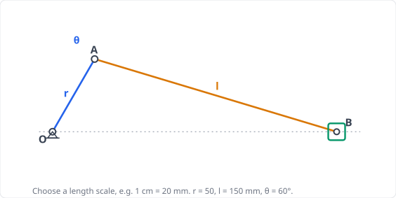
     </TailwindWrapper>
   

2. **Velocity polygon.** On a chosen velocity scale, say $1 \text{ cm} = 10 \text{ mm/s}$, draw $oa = v_A = r\omega = 50 \times 1 = 50$ mm/s at right angles to the crank. From $a$ draw a line at right angles to the rod. Through $o$ draw the horizontal line along which the piston must move. The two lines meet at $b$. ✅

   

     <TailwindWrapper>
   	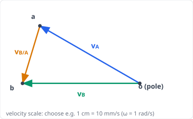
     </TailwindWrapper>
   

3. **Take the one number the next drawing needs.** The polygon measures $v_B = 50.8$ mm/s and $v_{B/A} = 26.1$ mm/s. The second value gives the angular velocity of the rod, which is its speed round $A$ divided by its length: ✅

   $$\omega_3 = \frac{v_{B/A}}{l} = \frac{26.1 \text{ mm/s}}{150 \text{ mm}} = 0.174 \text{ rad/s}$$

   The rod turns about six times more slowly than the crank, so its normal acceleration will be small in Step 2. ✅

</Steps>

### Step 2: Build the acceleration polygon

Draw it beside the velocity polygon of Step 1, at the same instant $\theta = 60\degree$, to a chosen acceleration scale (say $1 \text{ cm} = 10 \text{ mm/s}^2$).

**Click to reveal the acceleration-polygon construction**

<Steps>

1. **Crank-pin acceleration.** The crank turns at constant speed, so the crank pin $A$ has only a normal acceleration, $a_A = \omega^2 r = 1^2 \times 50 = 50 \text{ mm/s}^2$, pointing from $A$ towards the centre $O$. From the pole $o'$ draw $o'a' = a_A$. ✅

2. **Normal part of the rod.** This part is $a_{B/A}^{\,n} = \omega_3^2\,l$, pointing from $B$ towards $A$. It uses the $\omega_3$ of Step 1: ✅

   $$a_{B/A}^{\,n} = (0.174 \text{ rad/s})^2 \times 150 \text{ mm} = 4.5 \text{ mm/s}^2$$

   Add it from $a'$. It is about a **tenth** of $a_A$, so it is hard to see on the drawing. Do not leave it out: it moves the end point of the polygon. ✅

3. **Tangential part and closure.** From the end of the normal part, draw the tangential direction, at right angles to the rod. Its size $\alpha_3 l$ is unknown, so draw a long construction line. The piston can only slide, so its acceleration $a_B$ is horizontal: draw the horizontal through $o'$. The two lines cross at $b'$, and that one point gives both unknowns. ✅

4. **Measure.** $o'b' = a_B$ is the piston acceleration. It reads about $16.7 \text{ mm/s}^2$ towards the crank, which is $0.33\,r\omega^2$. Step 3 gets the same number from a formula. ✅

</Steps>

  <TailwindWrapper>
	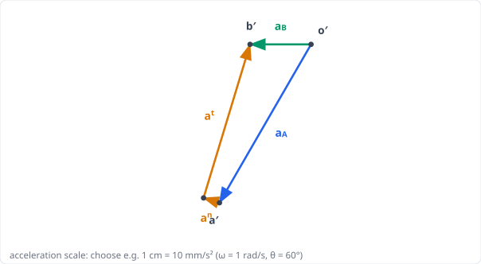
  </TailwindWrapper>

### Step 3: Confirm by differentiation

**Click to reveal the closed-form piston acceleration**

<Steps>

1. **Start from the exact piston position** $x$, measured from the crank centre along the centre-line. The crank gives $r\cos\theta$ and the rod gives the rest: ✅

   $$x = r\cos\theta + \sqrt{l^2 - r^2\sin^2\theta}$$

2. **Make the square root easy to differentiate.** The ratio $r/l$ is small, so $\sqrt{l^2 - r^2\sin^2\theta} = l\sqrt{1 - (r/l)^2\sin^2\theta} \approx l - \dfrac{r^2}{2l}\sin^2\theta$, which keeps the first two terms of the binomial expansion. Then use $\sin^2\theta = \tfrac{1}{2}(1 - \cos 2\theta)$. This step brings in a term in $2\theta$: ✅

   $$x \approx r\cos\theta + l - \frac{r^2}{4l}\left(1 - \cos 2\theta\right)$$

3. **Differentiate twice with respect to $\theta$**, then multiply by $\omega^2$. The speed $\omega$ is constant, so $\dfrac{d}{dt} = \omega\dfrac{d}{d\theta}$ and no other terms appear: ✅

   $$\frac{dx}{d\theta} = -r\sin\theta - \frac{r^2}{2l}\sin 2\theta, \qquad \frac{d^2x}{d\theta^2} = -r\cos\theta - \frac{r^2}{l}\cos 2\theta$$

   $$a_P = \omega^2\frac{d^2x}{d\theta^2} = -r\omega^2\left(\cos\theta + \frac{r}{l}\cos 2\theta\right)$$ ✅

   Here $a_P$ is the piston acceleration (the $a_B$ of the polygon), in mm/s² when $r$ is in mm and $\omega$ in rad/s. The first term repeats once in each turn of the crank: the **primary** part. The second repeats twice in each turn: the **secondary** part. Such parts are called harmonics. The secondary part exists only because the rod has a limited length: with a very long rod, $r/l$ goes to zero and so does this part.

   :::note[How good is the approximation?]
   For $l/r = 3$ the result stays within about **1.5% of the peak acceleration** over the whole turn, and it is exact at TDC and BDC. The largest gap is near $\theta = 90\degree$, where the exact value is $0.354\,r\omega^2$ and this formula gives $0.333\,r\omega^2$. The simulator solves the exact form, so a reading of $0.35$ there is correct.
   :::

4. **Tabulate** $a_P/(r\omega^2)$ for $l/r = 3$: ✅

   | Crank $\theta$ | $a_P/(r\omega^2)$ |
   |:---:|:---:|
   | $0^\circ$ (TDC) | **-1.333** (peak) |
   | $30^\circ$ | -1.033 |
   | $60^\circ$ | -0.333 |
   | $90^\circ$ | +0.333 |
   | $120^\circ$ | +0.667 |
   | $180^\circ$ (BDC) | +0.667 |

5. **Read the peaks.** The largest acceleration is at **TDC**: $a_P = (1 + r/l)\,r\omega^2 = (1 + \tfrac{1}{3})\,r\omega^2 = 1.33\,r\omega^2$ in size. At BDC it is $(1 - r/l)\,r\omega^2 = 0.67\,r\omega^2$. The two ends differ because the secondary part adds to the primary part at TDC and subtracts from it at BDC. At $\theta = 60\degree$, $a_P = -(0.5 + \tfrac{1}{3} \times (-0.5))\,r\omega^2 = -0.33\,r\omega^2$, the same as the polygon. ✅

</Steps>

### Step 4: Verify in the simulator

The results above are multiples of $r\omega^2$, so they hold for any speed. The simulator plots $\text{mm/s}^2$.

**Click to reveal the simulator check**

<Steps>

1. **Set it up and choose a speed.** Open the simulator ([siwit.co/CSM](https://siwit.co/CSM)) and set $r = 50$, $l = 150$, $e = 0$ and $60$ RPM. Convert the speed to rad/s, then find $r\omega^2$: ✅

   $$\omega = \frac{2\pi \times 60}{60 \text{ s}} = 6.283 \text{ rad/s}, \qquad r\omega^2 = 50 \text{ mm} \times (6.283 \text{ rad/s})^2 = 1974 \text{ mm/s}^2$$

   Every result of this application, times $1974$, is a value on the chart. ✅

2. **Predict before you look.** Multiply the values already found by $1974$: ✅

   | Where | This lesson | The chart should read |
   |---|---|---|
   | TDC ($\theta = 0\degree$) | $-1.333\,r\omega^2$ | $-2632 \text{ mm/s}^2$ |
   | BDC ($\theta = 180\degree$) | $+0.667\,r\omega^2$ | $+1316 \text{ mm/s}^2$ |
   | $\theta = 60\degree$ | $-0.333\,r\omega^2$ | $-659 \text{ mm/s}^2$ |

3. **Check which readout is which.** The panel reports **Maximum Acceleration** and **Minimum Acceleration**. The TDC value is *negative*, so the largest acceleration in the machine appears under **Minimum**: ✅

   $$\text{Minimum Acceleration} = -2632 \text{ mm/s}^2 \quad (\text{the TDC peak, the one that sizes the parts})$$

   $$\text{Maximum Acceleration} = +1377 \text{ mm/s}^2 \quad (\text{a hump at } 138\degree, \textbf{not} \text{ the BDC value})$$

   **Peak-to-Peak** then reads about $4009 \text{ mm/s}^2$, the distance between the two. ✅

4. **Read the sign as a direction.** Negative means the acceleration points towards the crank centre. At TDC the piston is stopped and sent back, so the value there is negative and also the largest. ✅

5. **Find the two humps.** On the positive side the chart has two peaks with a shallow dip between them at BDC. The formula of Step 3 has turning points where $\sin\theta\,(1 + \tfrac{4}{3}\cos\theta) = 0$: at the dead centres, and at $\cos\theta = -3/4$, which is $138.6\degree$ and $221.4\degree$. Students often take this dip for an error in the simulator. It is correct. ✅

</Steps>

  <TailwindWrapper>
	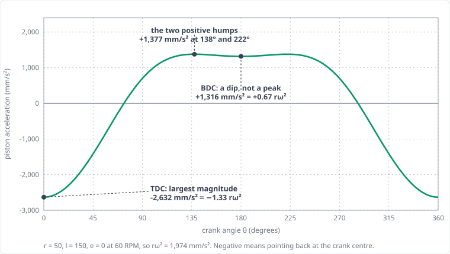
  </TailwindWrapper>

<Steps>

6. **Lengthen the rod.** A larger $l/r$ makes the secondary part smaller, so the two ends of the stroke become more alike. Look at **Peak-to-Peak**: it falls. ✅

</Steps>

## Application 2: Angular accelerations of the four-bar

<InArticleAd />

The four-bar has three moving links: the driven crank, the follower on the other fixed pivot, and the coupler that joins them. The polygon gives the angular accelerations of the coupler, $\alpha_3$, and the follower, $\alpha_4$.

<Card title="Simulator and hands-on lab" icon="rocket">

  <LinkButton href="/product-development/four-bar-linkage-simulator/" target="_blank" variant="primary" icon="rocket" iconPlacement="start">Open the Four-Bar Linkage Simulator</LinkButton>

**Hands-on lab:** Continue in the [Four-Bar Linkage Experiments](/education/mechanism-design-simulation/four-bar-linkage-experiments/) lab ([siwit.co/FBL](https://siwit.co/FBL)). Experiment 7 covers the angular accelerations and inertia forces.
</Card>

:::note[System Problem Statement]
- **Configuration:** Crank-rocker four-bar (the standard four-bar geometry), constant crank speed
- **Task:** Find the coupler and follower angular accelerations $\alpha_3$, $\alpha_4$
- **Link lengths:** crank $a = 40$, coupler $b = 120$, follower $c = 80$, ground $d = 100$ mm
- **Input:** crank angle $\theta_2 = 120\degree$, crank speed $\omega_2 = 1$ rad/s. From the velocity analysis $\omega_3/\omega_2 = 0.139$ and $\omega_4/\omega_2 = 0.514$
:::

### Step 1: Redraw the space diagram and the velocity polygon

**Click to reveal the two drawings the acceleration polygon is built on**

<Steps>

1. **Space diagram.** Choose and mark a length scale, say $1 \text{ cm} = 20 \text{ mm}$. Draw the ground $O_2O_4 = 100$ mm and the crank $O_2A = 40$ mm at $\theta_2 = 120\degree$. Draw an arc of $b = 120$ mm from $A$ and an arc of $c = 80$ mm from $O_4$. The arcs cross at two points, and the upper one is $B$. Measure the coupler angle $\theta_3 = 22.0\degree$ and the follower angle $\theta_4 = 96.3\degree$. ✅

   

     <TailwindWrapper>
   	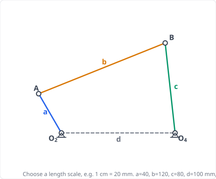
     </TailwindWrapper>
   

2. **Velocity polygon.** Draw $oa = v_A = a\omega_2 = 40 \times 1 = 40$ mm/s at right angles to the crank. From $a$ draw a line at right angles to the coupler. From $o$ draw a line at right angles to the follower. Mark $b$ where the two lines cross. ✅

   

     <TailwindWrapper>
   	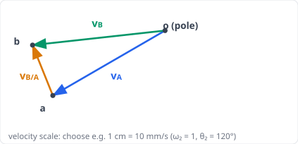
     </TailwindWrapper>
   

3. **Take the two numbers the next drawing needs.** The polygon measures $v_{B/A} = 16.7$ mm/s and $v_B = 41.1$ mm/s. Divide each by the length of its link: ✅

   $$\omega_3 = \frac{v_{B/A}}{b} = \frac{16.7 \text{ mm/s}}{120 \text{ mm}} = 0.139 \text{ rad/s}, \qquad \omega_4 = \frac{v_B}{c} = \frac{41.1 \text{ mm/s}}{80 \text{ mm}} = 0.514 \text{ rad/s}$$

   The follower turns almost four times faster than the coupler. After squaring, the normal part of the follower is nearly ten times that of the coupler, so the acceleration polygon has one long normal arrow and one very short one. ✅

</Steps>

### Step 2: Build the acceleration polygon

**Click to reveal the acceleration-polygon construction**

<Steps>

1. **Crank pin.** The crank speed is constant, so $a_A = \omega_2^2\,a = 1^2 \times 40 = 40 \text{ mm/s}^2$, pointing from $A$ to $O_2$. Draw $o'a'$. ✅

2. **Coupler normal.** From $a'$, add $a_{B/A}^{\,n} = \omega_3^2\,b = (0.139)^2 \times 120 = 2.3 \text{ mm/s}^2$, pointing from $B$ to $A$. ✅

3. **Follower normal.** From the pole, draw $a_B^{\,n} = \omega_4^2\,c = (0.514)^2 \times 80 = 21.2 \text{ mm/s}^2$, pointing from $B$ to $O_4$. ✅

4. **The tangential parts close it.** Two sizes are still unknown, and two construction lines give them. Draw one at right angles to the coupler from the end of the coupler normal. Draw the other at right angles to the follower from the end of the follower normal. They cross at $b'$. ✅

5. **Measure and convert.** The two tangential lengths read $a_{B/A}^{\,t} = 16.7$ and $a_{B}^{\,t} = 9.3 \text{ mm/s}^2$. Divide each by the length of its link to get an angular acceleration: ✅

   $$\alpha_3 = \frac{16.7 \text{ mm/s}^2}{120 \text{ mm}} = 0.139 \text{ rad/s}^2, \qquad \alpha_4 = \frac{9.3 \text{ mm/s}^2}{80 \text{ mm}} = 0.117 \text{ rad/s}^2$$

   The drawing gives sizes. The direction of each tangential arrow gives the sign. Here the tangential arrow of the follower points against $\omega_4$, so $\alpha_4$ is negative. Step 3 confirms this and explains it. ✅

</Steps>

  <TailwindWrapper>
	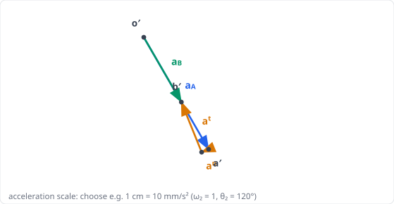
  </TailwindWrapper>

The note printed inside this picture says that both normal parts start at $o'$. Only the follower normal starts there. The coupler normal starts at $a'$, as in step 2.

### Step 3: Confirm by the acceleration loop

**Click to reveal the closed-form angular accelerations**

<Steps>

1. **Start from the position loop.** Go from $O_2$ to $B$ by the crank and the coupler, or by the ground and the follower: both ways end at the same point. With each link written as a length and a direction $e^{i\theta}$, this is one line, and every equation below is a derivative of it: ✅

   $$a\,e^{i\theta_2} + b\,e^{i\theta_3} = d + c\,e^{i\theta_4}$$

2. **Differentiate once** for velocity. Each $\theta$ depends on time, so the chain rule gives a factor $i\dot\theta = i\omega$: ✅

   $$i\,a\omega_2 e^{i\theta_2} + i\,b\omega_3 e^{i\theta_3} = i\,c\omega_4 e^{i\theta_4}$$

3. **Differentiate again** for acceleration, with the product rule on each term. Each term gives two: one from $\omega$ (it gives $\alpha$) and one from $e^{i\theta}$ (it gives $-\omega^2$, because $i \times i = -1$). With $\alpha_2 = 0$ the crank keeps only its $-\omega^2$ term: ✅

   $$\underbrace{-a\omega_2^2 e^{i\theta_2}}_{\text{crank, normal only}} + \underbrace{i\,b\alpha_3 e^{i\theta_3} - b\omega_3^2 e^{i\theta_3}}_{\text{coupler: tangential} + \text{normal}} = \underbrace{i\,c\alpha_4 e^{i\theta_4} - c\omega_4^2 e^{i\theta_4}}_{\text{follower: tangential} + \text{normal}}$$

   These five terms are the five arrows of the polygon in Step 2. The $-\omega^2$ terms are the normal parts, which you drew at once. The $i\alpha$ terms are the tangential parts, which you found by closing the figure.

4. **Split into real and imaginary parts** with $e^{i\theta} = \cos\theta + i\sin\theta$, and put the two unknowns on the left. Multiplying by $i$ exchanges sine and cosine, so the $\alpha$ terms carry the other function from the $\omega^2$ terms: ✅

   $$-b\,\alpha_3\sin\theta_3 + c\,\alpha_4\sin\theta_4 = a\omega_2^2\cos\theta_2 + b\omega_3^2\cos\theta_3 - c\omega_4^2\cos\theta_4$$
   $$b\,\alpha_3\cos\theta_3 - c\,\alpha_4\cos\theta_4 = a\omega_2^2\sin\theta_2 + b\omega_3^2\sin\theta_3 - c\omega_4^2\sin\theta_4$$

   Everything on the right is known. These are two linear equations in two unknowns, as in the velocity analysis. ✅

5. **Solve** at $\theta_2 = 120\degree$ ($\omega_2 = 1$ rad/s), with $\theta_3 = 21.96\degree$, $\theta_4 = 96.25\degree$, $\omega_3 = 0.139$, $\omega_4 = 0.514$:

   $$\alpha_3 = +0.139 \text{ rad/s}^2, \qquad \alpha_4 = -0.117 \text{ rad/s}^2$$ ✅

   These agree with the $16.7$ and $9.3 \text{ mm/s}^2$ measured from the polygon, divided by $b$ and $c$. ✅

   :::tip[A positive ω₄ with a negative α₄ is not an error]
   $\omega_4 = +0.514$ rad/s: the follower turns **counterclockwise**. $\alpha_4 = -0.117 \text{ rad/s}^2$: its angular acceleration is **clockwise**. Both are correct. The follower still turns counterclockwise but is **slowing down**, like a car that moves forward with the brakes on.

   The rule: **same sign means speeding up, opposite signs mean slowing down.**
   :::

</Steps>

### Step 4: Verify in the simulator

**Click to reveal the simulator check**

<Steps>

1. **Set it up and choose a speed.** Open the simulator ([siwit.co/FBL](https://siwit.co/FBL)), set $a = 40$, $b = 120$, $c = 80$, $d = 100$, the assembly to **open**, and $60$ RPM, so $\omega_2 = 6.283$ rad/s and $\omega_2^2 = 39.48$. These two factors convert the work above, done at 1 rad/s. The crossed assembly is a different linkage, with another $\alpha_4$, so check that setting first. ✅

2. **Check the velocities first.** The $\omega_3$ and $\omega_4$ charts are tabs in the simulator. At $\theta_2 = 120\degree$ they read about ✅

   $$\omega_3 = 0.876 \text{ rad/s}, \qquad \omega_4 = 3.231 \text{ rad/s}$$

   Divide each by $\omega_2 = 6.283$: the results are the $0.139$ and $0.514$ of Step 1. ✅

3. **Open the angular-acceleration tabs.** The simulator also plots $\alpha_3$ and $\alpha_4$ against crank angle. Select the $\alpha_3$ tab, then $\alpha_4$. For exact numbers, the CSV file that the simulator can download has the same values as `Alpha3 (rad/s2)` and `Alpha4 (rad/s2)`. ✅

4. **Read the value at 120 degrees.** Expect ✅

   $$\alpha_3 \approx +5.50 \text{ rad/s}^2, \qquad \alpha_4 \approx -4.61 \text{ rad/s}^2$$

   Divide by $\omega_2^2 = 39.48$ to get $+0.139$ and $-0.117 \text{ rad/s}^2$, the loop solution. The signs do not change, so the follower still slows down while it turns forward. ✅

   Angular acceleration grows with the **square** of the crank speed: at twice the RPM every one of these numbers is four times larger. ✅

</Steps>

:::note[Engineering Insight]
Each angular acceleration gives an inertia torque, and each acceleration of a centre of mass gives an inertia force. So the acceleration polygon is the input to the [dynamic force analysis](/education/planar-mechanics/force-analysis-mechanism-synthesis/), a force balance that includes the inertia forces. A static force analysis leaves them out.
:::

## Application 3: Platform acceleration of the scissor lift

<InArticleAd />

In a scissor lift, crossed arms open like scissors and push a platform straight up. Here the arms turn at a steady rate and the platform still accelerates, for the same reason as the stone on the string.

<Card title="Simulator and hands-on lab" icon="rocket">

  <LinkButton href="/product-development/scissor-lift-mechanism-simulator/" target="_blank" variant="primary" icon="rocket" iconPlacement="start">Open the Scissor Lift Simulator</LinkButton>

**Hands-on lab:** Continue in the [Scissor Lift Experiments](/education/mechanism-design-simulation/scissor-lift-experiments/) lab ([siwit.co/SLM](https://siwit.co/SLM)). The acceleration and power charts plot the relation below.
</Card>

:::note[System Problem Statement]
- **Configuration:** Single-stage scissor lift, arm $L = 300$ mm, $n = 1$
- **Task:** Relate the platform acceleration to the rate at which the arms turn, and to the change of that rate
:::

### Step 1: Differentiate the height twice

The platform height is $h = nL\sin\theta$, with $n$ the number of stages, $L$ the arm length (mm) and $\theta$ the angle of the arms above the base. Two derivatives of this one equation replace the polygon.

**Click to reveal the platform acceleration**

<Steps>

1. **From the platform velocity** $v = nL\cos\theta\,\dot\theta$, where $\dot\theta$ (rad/s) is the rate at which the arms turn, differentiate again. $\ddot\theta$ (rad/s²) is the rate of change of $\dot\theta$:

   $$a_\text{platform} = nL\left(\cos\theta\,\ddot\theta - \sin\theta\,\dot\theta^2\right)$$ ✅

2. **Read the two terms.** The first, $nL\cos\theta\,\ddot\theta$, is the tangential part. It exists only while the arms turn faster or slower. The second, $-nL\sin\theta\,\dot\theta^2$, is a normal part. It exists **even at a constant rate** ($\ddot\theta = 0$), and it always points down. So a platform raised with the arms turning at a steady rate still slows down as it nears full height. ✅

3. **What it means for the actuator.** The actuator (the cylinder or screw that drives the lift) must supply the weight on the platform and also the inertia force $m\,a_\text{platform}$. Near the flat position the mechanical advantage, the output force divided by the input force, is poor (see the [force analysis](/education/planar-mechanics/force-analysis-mechanism-synthesis/)), so this added load matters most there. ✅

</Steps>

  <TailwindWrapper>
	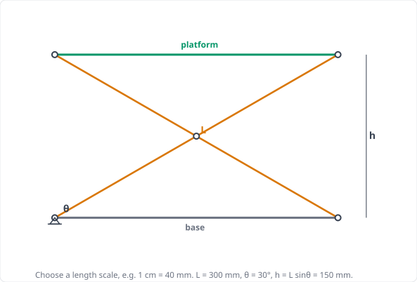
  </TailwindWrapper>

### Step 2: Verify in the simulator

**Click to reveal the simulator check**

<Steps>

1. **Open the simulator** ([siwit.co/SLM](https://siwit.co/SLM)) and run it at a fixed actuator speed. ✅

2. **Look at the acceleration chart.** The platform acceleration is not zero, although the actuator speed is constant: the geometry alone accelerates the platform. The power chart is highest where acceleration and velocity are both large. ✅

</Steps>

## Application 4: Inertia and shaking forces

<InArticleAd />

Newton's second law, $F = ma$, turns acceleration into force. For the slider-crank the result is the shaking force, the force that the moving piston puts on the engine block. Engine balancing exists to cancel it.

<Card title="Simulator and hands-on lab" icon="rocket">

  <LinkButton href="/product-development/crank-slider-mechanism-simulator/" target="_blank" variant="primary" icon="rocket" iconPlacement="start">Open the Crank-Slider Simulator</LinkButton>

**Hands-on lab:** Continue in the [Crank-Slider Experiments](/education/mechanism-design-simulation/crank-slider-experiments/) lab ([siwit.co/CSM](https://siwit.co/CSM)). Experiment 6 (force analysis and motor sizing) builds on the inertia forces below.
</Card>

:::note[System Problem Statement]
- **Configuration:** Slider-crank with a reciprocating mass $m$ (kg) at the piston, constant crank speed. The reciprocating mass is the mass that moves up and down with the piston
- **Task:** Find the shaking force along the cylinder axis, and its primary and secondary parts
:::

### Step 1: From acceleration to shaking force

**Click to reveal the shaking-force harmonics**

<Steps>

1. **Apply d'Alembert** to the reciprocating mass, with the piston acceleration of Application 1. The rod must push on the piston with the force $m\,a_P$ to accelerate it. The piston pushes back on the engine with an equal and opposite force, the inertia force $-m\,a_P$. That is the shaking force: ✅

   $$F_\text{shake} = -m\,a_P = m r\omega^2\left(\cos\theta + \frac{r}{l}\cos 2\theta\right)$$

   With $m$ in kg, $r$ in metres and $\omega$ in rad/s, the force is in newtons. The minus sign has a meaning. At TDC $a_P$ is most negative, so $F_\text{shake}$ is at its **positive** peak: the piston is pulled down hardest at the instant when it pulls the engine up hardest. The mounts feel that force. ✅

2. **Split it into its two parts:**

   $$F_\text{primary} = m r\omega^2\cos\theta \quad (\text{once per rev}), \qquad F_\text{secondary} = m r\omega^2\frac{r}{l}\cos 2\theta \quad (\text{twice per rev})$$ ✅

3. **Balancing.** A counterweight on the crank can cancel most of the **primary** force, because the counterweight also goes round once in each turn. The **secondary** force repeats twice in each turn, so no weight on the crank can follow it. Inline four-cylinder engines therefore use **balance shafts**, weighted shafts geared to turn at twice the crank speed. The secondary force is smaller than the primary by the factor $r/l$, so a longer rod also reduces it. ✅

</Steps>

  <TailwindWrapper>
	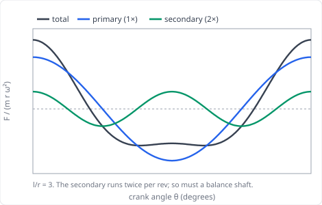
  </TailwindWrapper>

As in Application 1, the total reaches $1.33\,mr\omega^2$ at TDC and only $0.67\,mr\omega^2$, in the opposite direction, at BDC ($\theta = 180\degree$).

### Step 2: Verify in the simulator

**Click to reveal the simulator check**

<Steps>

1. **Open the simulator** ([siwit.co/CSM](https://siwit.co/CSM)) and read the force chart and the crank-torque chart. ✅

2. **Look for two things in the force chart.** Its peak is at TDC, where the acceleration peaks. Its shape is one large wave in each turn with a smaller wave of twice the frequency added: the primary and the secondary parts. ✅

</Steps>

## Application 5: Coriolis acceleration of the quick-return shaper

<InArticleAd />

A shaper is a machine tool whose cutting tool sits on a ram that slides forward and back. Its drive, from the [velocity analysis](/education/planar-mechanics/velocity-analysis-instantaneous-centers/#application-5-ram-velocity-of-the-quick-return-shaper), is the one mechanism in this course whose acceleration is *wrong* with normal and tangential parts alone. Its crank pin carries a **block that slides in a turning slot**, so the **Coriolis** component must be added.

<Card title="Hands-on lab" icon="rocket">

  <LinkButton href="/product-development/crank-slider-mechanism-simulator/" target="_blank" variant="primary" icon="rocket" iconPlacement="start">Open the Crank-Slider Simulator</LinkButton>

**Hands-on lab:** This mechanism has no simulator of its own. The drawing and the calculation check each other.
</Card>

:::note[System Problem Statement]
- **Configuration:** Crank and slotted lever quick-return, the drive of a shaper ram. The lever swings about the fixed pivot $A$. The crank turns about the fixed centre $C$, and the block $B$ on its pin slides in the slot of the lever. The far end $P$ of the lever drives the ram
- **Task:** Find the acceleration of $P$ at the instant drawn, and show the share of the Coriolis part
- **Geometry:** crank $r = CB = 120$ mm, $AC = 300$ mm, $AP = 450$ mm, and $AB = 205$ mm at this instant
- **Input:** constant crank speed $\omega_2 = 1$ rad/s ($\alpha_2 = 0$). From the velocity analysis the lever turns at $\omega_\text{lever} = 0.399$ rad/s and the block slides at $v_\text{slip} = 87.8$ mm/s
:::

### Step 1: Redraw the space diagram and the velocity polygon

The Coriolis part is $2\,\omega\,v_\text{slip}$, and **both** of those numbers are measured from the velocity polygon. So the velocity must be drawn first.

**Click to reveal the two drawings the acceleration polygon is built on**

<Steps>

1. **Space diagram.** Choose and mark a length scale, say $1 \text{ cm} = 40 \text{ mm}$. Mark the fixed centres $A$ and $C$ with $AC = 300$ mm. Draw the crank $CB = 120$ mm at the angle of the picture, then draw the lever from $A$ through the block $B$ to the driving point $P$ at $AP = 450$ mm. Measure $AB = 205$ mm. ✅

   

     <TailwindWrapper>
   	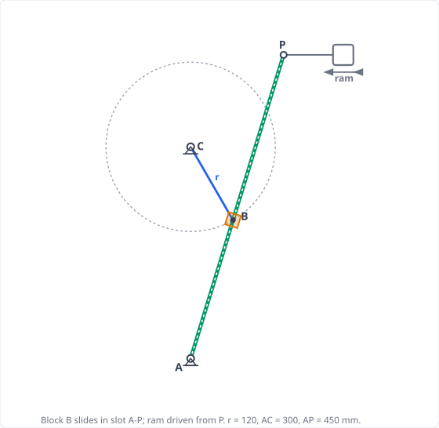
     </TailwindWrapper>
   

2. **Velocity polygon.** The block and the lever touch at $B$, but they move differently. Call the point on the block $B_2$ and the point of the lever under it $B_3$. Draw $ob_2 = r\omega_2 = 120 \times 1 = 120$ mm/s at right angles to the crank. Through $o$ draw a line at right angles to the lever: $B_3$ can only move that way. Through $b_2$ draw a line parallel to the slot: the block can only slide that way. The lines cross at $b_3$. ✅

   

     <TailwindWrapper>
   	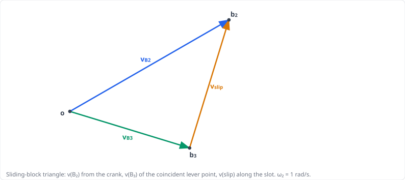
     </TailwindWrapper>
   

3. **Take the two numbers the Coriolis part needs.** The polygon measures $v_{B_3} = 81.8$ mm/s and $v_\text{slip} = 87.8$ mm/s, so $\omega_\text{lever} = 81.8/205 = 0.399$ rad/s. ✅

   Check before you continue. The two velocities are at right angles, one across the lever and one along it, so $\sqrt{81.8^2 + 87.8^2}$ must equal the speed of the crank pin, $120$ mm/s. It does. If your polygon fails this check, the error is in the drawing. ✅

</Steps>

### Step 2: Build the acceleration polygon with the Coriolis term

Four arrows from the pole $o'$ must end at the crank-pin acceleration: the **normal** and **tangential** parts of the lever point, the **Coriolis** part and the **slip** part.

**Click to reveal the acceleration-polygon construction**

<Steps>

1. **Crank-pin acceleration (the target).** The crank speed is constant, so the block has only a normal acceleration $a_{B_2} = \omega_2^2\,r = 1^2 \times 120 = 120 \text{ mm/s}^2$, pointing from $B$ towards $C$. The construction must end on this vector. ✅

2. **Normal part of the lever point.** $a_{B_3}^{\,n} = \omega_\text{lever}^2 \times AB = 0.399^2 \times 205 \approx 32.6 \text{ mm/s}^2$, pointing from $B$ towards the pivot $A$. Draw it from $o'$. ✅

3. **Coriolis part.** $a^{c} = 2\,\omega_\text{lever}\,v_\text{slip} = 2 \times 0.399 \text{ rad/s} \times 87.8 \text{ mm/s} \approx 70 \text{ mm/s}^2$, **at right angles to the slot** (the slip velocity turned $90\degree$ the way the lever turns). A slider-crank never has this part. ✅

4. **Close with the two unknown directions.** The **tangential** part of the lever is **at right angles to the lever**, and the **slip** acceleration is **parallel to the slot**. Both sizes are unknown. Draw the two directions so that the polygon ends on $a_{B_2}$. Then measure: the tangential part is $a_{B_3}^{\,t} \approx 158 \text{ mm/s}^2$ and the slip acceleration is $\approx 114 \text{ mm/s}^2$. ✅

5. **Lever angular acceleration.** $\alpha_\text{lever} = \dfrac{a_{B_3}^{\,t}}{AB} = \dfrac{158 \text{ mm/s}^2}{205 \text{ mm}} \approx 0.77 \text{ rad/s}^2$. ✅

</Steps>

  <TailwindWrapper>
	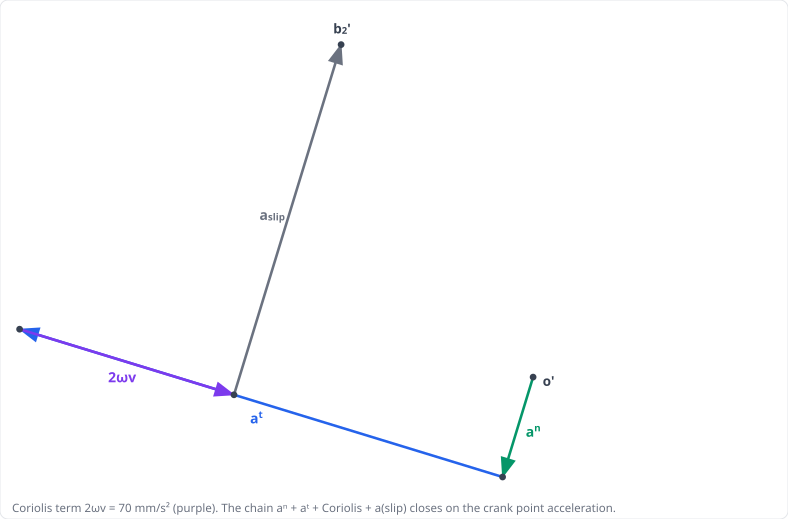
  </TailwindWrapper>

In this picture the blue tangential arrow runs to the far left point, and the purple Coriolis arrow comes back along the same line. Both are at right angles to the lever, and here they point in opposite directions.

### Step 3: Ram acceleration and analytical check

**Click to reveal the ram acceleration and confirmation**

<Steps>

1. **Acceleration of the driving point.** The point $P$ of the lever has a normal part $\omega_\text{lever}^2\,AP$ (towards $A$) and a tangential part $\alpha_\text{lever}\,AP$ (at right angles to the lever). They are at right angles, so the total is the diagonal:

   $$a_P = AP\sqrt{\omega_\text{lever}^4 + \alpha_\text{lever}^2} = 450\sqrt{0.399^4 + 0.77^2} \approx 354 \text{ mm/s}^2$$ ✅

2. **You cannot leave out the Coriolis part.** At $70 \text{ mm/s}^2$ it is a large share of the polygon. Without it the tangential part is wrong, and so are $\alpha_\text{lever}$, the ram acceleration and the inertia forces. Every mechanism with a block or pin that slides in a moving slot needs it: this shaper, a Whitworth drive, a Geneva indexing mechanism. ✅

3. **Analytical confirmation.** Write the loop $\vec r_{AB} = \vec r_{AC} + \vec r_{CB}$ and differentiate it twice, with the distance $AB$ as a length that changes. The same four parts appear: the second derivative of $AB$ is the slip acceleration, and the term $2\,\dot{(AB)}\,\omega_\text{lever}$ is the Coriolis part. The numbers agree with the polygon. ✅

</Steps>

## Summary and Next Steps

<InArticleAd />

:::tip[Instrument it]
A shaking force reaches you as vibration, and you can measure it. Fix a MEMS accelerometer (a small chip that measures acceleration) to the machine frame near the bearings: an ADXL345 for a first look, or the wider-band ADXL1002 to see the secondary part. Add a Hall sensor for the crank angle, so that each peak has a position. An [ESP32 or STM32](/education/sensor-actuator-interfacing-stm32/) samples both, and it can [flag a balance problem on siliconwit.io](https://siliconwit.io) before the mounts crack.
:::

### Acceleration results at a glance

| Mechanism | What you solve for | Key relation | Simulator |
|-----------|--------------------|--------------|-----------|
| Slider-crank | piston acceleration | $a_P = -r\omega^2(\cos\theta + \tfrac{r}{l}\cos 2\theta)$ | [siwit.co/CSM](https://siwit.co/CSM) |
| Four-bar | $\alpha_3$, $\alpha_4$ | acceleration loop (linear) | [siwit.co/FBL](https://siwit.co/FBL) |
| Scissor lift | platform acceleration | $a = nL(\cos\theta\,\ddot\theta - \sin\theta\,\dot\theta^2)$ | [siwit.co/SLM](https://siwit.co/SLM) |
| Slider-crank | shaking force | primary $+$ secondary harmonics | [siwit.co/CSM](https://siwit.co/CSM) |
| Quick-return (shaper) | Coriolis, ram acceleration | $a^{c} = 2\,\omega\,v_\text{slip}$ | drawing and calculation |

Next, [Cam-Follower Systems and Motion Programming](/education/planar-mechanics/cam-follower-systems-motion-programming/) turns the problem round. You state the motion you want, and you design the cam surface that produces it.

<InArticleAd />
<PlanarMechanicsComments />
<TawkWidget />
<Copyright />
