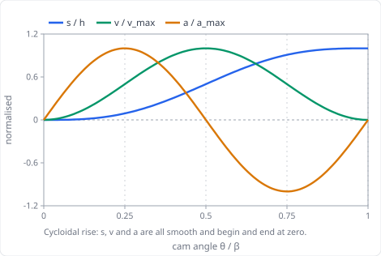
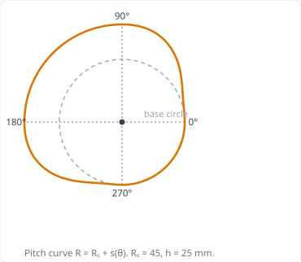
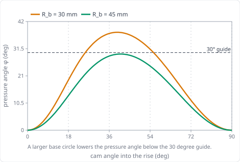

import PlanarMechanicsComments from '../../../../components/planar-mechanics/PlanarMechanicsComments.astro';
import TawkWidget from '../../../../components/TawkWidget.astro';
import UniversalContentContributors from '../../../../components/UniversalContentContributors.astro';
import InArticleAd from '../../../../components/InArticleAd.astro';
import Copyright from '../../../../components/Copyright.astro';
import BionicText from '../../../../components/BionicText.astro';
import TailwindWrapper from '../../../../components/TailwindWrapper.jsx';
import { Tabs, TabItem } from '@astrojs/starlight/components';
import { Card, CardGrid, Badge, Steps, LinkButton, FileTree } from '@astrojs/starlight/components';

<UniversalContentContributors 
  contributors={frontmatter.contributors}
/>


A cam that is quiet at low speed can knock, wear and shake its machine at high speed. The cause is usually the motion that the designer chose, and not the metal. A cam is a shaped disc that turns, and a follower is the part that rests on its edge and moves up and down. With a cam you choose the motion of the follower first, and the shape of the cam follows from it. If the chosen motion has a sudden change of acceleration, the follower gets a hammer blow once in every turn. In this lesson you program the motion, draw the cam that produces it, and choose a cam size that does not jam the follower. #CamDesign #MotionProgramming #Cycloidal

## Learning Objectives

By the end of this lesson, you will be able to:

1. **Program** a follower motion with the SVAJ diagrams (displacement, velocity, acceleration, jerk)
2. **Compare** motion laws and explain why cycloidal motion is smooth where harmonic motion is not
3. **Lay out** the cam profile graphically by the inversion method
4. **Size** the base circle, the smallest circle of the cam, from the pressure angle

## Real-World System Problem: a motion you cannot make from a linkage

<InArticleAd />


An engine valve must open quickly, stay fully open while gas flows, then close, all within a fixed part of one turn of the crank. A packaging machine must move a film forward, wait while a print head works, then move it again. These motions contain a **dwell**: a part of the turn in which the output stays still. A linkage cannot hold still cleanly. A cam can, because its edge is a stored motion program that the follower reads as the cam turns.

```text
 lift s
 25 mm |          .-------------.
       |       .-'               '-.
       |    .-'                     '-.
  0 mm |---'                           '----------------
       +-----------+-----------+-----------+-----------+
       0          90          180         270         360
          rise        dwell        fall        dwell
                    cam angle (degrees)
```

This is the program of this lesson: the follower rises, waits, falls and waits again, once in each turn of the cam.

The cam touches the follower along one line, and all the force passes through that line. It is the **higher pair** of the [joint classification](/education/planar-mechanics/kinematic-joints-constraint-analysis/): a contact that rolls and slides. So the shape of the cam decides the motion, and also whether the follower is driven smoothly or hammered.

<div style={{ display: 'flex', justifyContent: 'center', width: '100%', margin: '1rem 0' }}>
  <TailwindWrapper>
	
  </TailwindWrapper>
</div>

### The cam design problem

> **Engineering Question:** Given the motion the follower must make (its rises, dwells, and returns), what surface produces it, and is that motion smooth enough to run at speed?

## Fundamental Theory: SVAJ and motion laws

<InArticleAd />


### The displacement diagram and the SVAJ family

A bus that starts with a jolt has not yet gone far or fast. What you feel is the acceleration arriving all at once. The rate at which acceleration changes is called **jerk**, and a cam designer must control it.

<Card title="S, V, A, J" icon="document">
Four diagrams describe a cam motion. Each is drawn against the cam angle $\theta$ (rad), and each is the slope of the one before it:

- **S**, displacement $s(\theta)$ in mm, the position of the follower
- **V**, velocity $v = ds/d\theta$ in mm/rad. Multiply by the cam speed $\omega$ (rad/s) for mm/s
- **A**, acceleration $a = d^2s/d\theta^2$ in mm/rad². Multiply by $\omega^2$ for mm/s²
- **J**, jerk $j = d^3s/d\theta^3$, the rate of change of acceleration. Multiply by $\omega^3$ for mm/s³

The **fundamental law of cam design**: for a cam that runs at speed, the displacement, the velocity and the acceleration must have **no step** anywhere in the turn, also where a rise or a fall meets a dwell. The force on the follower is its mass times its acceleration. So a step in acceleration is a step in force: a blow, with a jerk that is infinite for an instant.
</Card>

### Comparing the motion laws

A motion law is the formula chosen for the shape of a rise or a fall.

<Card title="Four motion laws for a rise of height h over angle β" icon="document">
For a rise of height $h$ (mm) over a cam angle $\beta$ (rad), the peak velocity is a pure number times $h/\beta$, and the peak acceleration is a pure number times $h/\beta^2$. These numbers are the **motion-law factors** $C_v$ and $C_a$. They depend only on the *law*, and not on the rise height, the rise angle or the cam speed.

$$v_\text{max} = C_v\,\frac{h}{\beta}, \qquad a_\text{max} = C_a\,\frac{h}{\beta^2}$$

| Motion law | $C_v$ | $C_a$ | Acceleration at the ends | Suitability |
|------------|:-----:|:-----:|--------------------------|-------------|
| Uniform (constant velocity) | $1.000$ | $\to\infty$ at the ends | infinite, because the velocity steps | only with rounded ends |
| Parabolic (constant accel) | $2.000$ | $4.000$ | steps to a finite value | low speed |
| Simple harmonic (SHM) | $\pi/2 = 1.571$ | $\pi^2/2 = 4.935$ | steps where it meets a dwell | moderate speed |
| Cycloidal | $2.000$ | $2\pi = 6.283$ | zero at both ends | high speed, smoothest |

Cycloidal motion has the **highest finite peak acceleration** of the four, and it is still the best for high speed. Its acceleration **starts and ends at zero**, so it meets a dwell with no step. Simple harmonic motion looks smooth, but its acceleration is a cosine, which is at full value at both ends. Where the rise meets a dwell, the acceleration steps between zero and that full value.

:::tip[Read the units from the factor]
$C_v$ and $C_a$ have no units, so $C_v h/\beta$ is in mm per **radian** of cam angle and $C_a h/\beta^2$ is in mm per radian squared. Put $\beta$ in radians, never in degrees, before you divide. With the factor and the speed kept apart, one calculation serves every cam speed.
:::
</Card>

### Pressure angle and the base circle

Push a drawer straight in and it slides. Push it at an angle and it jams against its guides. A cam pushes its follower along the line at right angles to the cam surface at the contact point, and the follower can move only along its guide.

<Card title="Pressure angle" icon="document">
The **pressure angle** $\phi$ is the angle between the direction of the push and the direction in which the follower moves. For a follower that moves on a straight line through the cam centre (a radial translating follower), its tangent is the slope of the displacement diagram, in mm/rad, divided by the distance from the cam centre to the contact point, in mm:

$$\tan\phi = \frac{ds/d\theta}{R_b + s}$$

$R_b$ (mm) is the radius of the **base circle**, the smallest circle of the cam, on which the follower rests in its lowest position. With a large pressure angle most of the push goes sideways into the guide: the follower wears and can jam. The usual guide is $\phi \le 30\degree$ for a translating follower. The lower line of the formula shows the remedy: **a larger base circle lowers the pressure angle**, and makes the cam bigger.

For a **roller** follower, replace $R_b$ with the prime-circle radius $R_p = R_b + R_r$, where $R_r$ is the roller radius, because the geometry follows the path of the roller centre.

**Where the maximum is.** The slope $ds/d\theta$ is largest at mid-rise, and the lower line still grows there, so the true maximum of $\phi$ is a little *before* mid-rise. The value at mid-rise is close enough for design and can be found by hand. For a cycloidal rise, $s = h/2$ and $ds/d\theta = 2h/\beta$ at mid-rise:

$$\tan\phi_\text{max} \approx \frac{2h/\beta}{R_b + h/2}$$

For the cams of this lesson this is between half a degree and one degree below the true peak, so keep a small margin under $30\degree$. Solved for the base circle, it gives the size that a limit $\phi_\text{allow}$ requires:

$$R_b \ge \frac{2h/\beta}{\tan\phi_\text{allow}} - \frac{h}{2}$$
</Card>

## Application 1: Program the motion and draw the SVAJ diagram

<InArticleAd />


You program a rise and draw its displacement, velocity and acceleration to scale. The work follows the [draw, solve, simulate](/education/planar-mechanics/position-analysis-planar-linkages/#methods-of-kinematic-analysis) order of the linkage lessons.

<Card title="Simulator and hands-on lab" icon="rocket">
<div style={{ display: 'flex', justifyContent: 'center', width: '100%', margin: '0.25rem 0 1rem' }}>
  <LinkButton href="/product-development/cam-follower-mechanism-simulator/" target="_blank" variant="primary" icon="rocket" iconPlacement="start">Open the Cam and Follower Simulator</LinkButton>
</div>

**Hands-on lab:** Continue in the [Cam and Follower Experiments](/education/mechanism-design-simulation/cam-follower-experiments/) lab ([siwit.co/CFM](https://siwit.co/CFM)), which plots this SVAJ chain and compares the motion laws. Build the cam as a part in the [Cam and Follower Mechanism](/education/parametric-mechanical-cad-freecad/cam-and-follower-mechanism/) CAD lesson; for pure simple-harmonic follower motion, see the [Scotch-Yoke Mechanism](/education/parametric-mechanical-cad-freecad/scotch-yoke-mechanism/).
</Card>

:::note[System Problem Statement]
- **Configuration:** Radial translating follower, rise-dwell-fall-dwell cam
- **Task:** Program a cycloidal rise and draw its S, V, A diagrams
- **Specification:** rise $h = 25$ mm over $\beta = 90\degree$, then dwell $90\degree$, cycloidal fall $90\degree$, dwell $90\degree$
- **Input:** constant cam speed $\omega = 30$ rad/s (about $287 \text{ rev/min}$)

**Key Question:** Which motion law gives the rise with no step of acceleration at the dwells, and what are its peak velocity and acceleration?
:::

### Step 1: Draw the displacement diagram (S, V, A)

Plot the three curves to scale against the cam angle. Choose a vertical scale for each (for example $1 \text{ cm} = 5 \text{ mm}$ of lift for $s$). The shapes are what matter.

<details>
<summary>**Click to reveal the cycloidal motion equations and diagram**</summary>

<Steps>

1. **Displacement** of the cycloidal rise. It is a straight ramp, $h\theta/\beta$, with one sine wave subtracted, which makes the start and the end gentle:

   $$s = h\left[\frac{\theta}{\beta} - \frac{1}{2\pi}\sin\frac{2\pi\theta}{\beta}\right]$$ ✅

2. **Velocity and acceleration** for each radian of cam angle, the first and second slopes of $s$:

   $$v = \frac{h}{\beta}\left[1 - \cos\frac{2\pi\theta}{\beta}\right], \qquad a = \frac{2\pi h}{\beta^2}\sin\frac{2\pi\theta}{\beta}$$ ✅

3. **Read the diagram.** Against $\theta/\beta$, the displacement runs smoothly from $0$ to $h$. The velocity is a single hump that starts and ends at zero. The acceleration is one full sine wave that **also starts and ends at zero**, so the rise meets the dwells on each side with no step. ✅

</Steps>

<div style={{ display: 'flex', justifyContent: 'center', width: '100%', margin: '1.25rem 0' }}>
  <TailwindWrapper>
	
  </TailwindWrapper>
</div>

The note printed inside this picture says that all three curves begin and end at zero. The velocity and the acceleration do. The displacement begins at zero and ends at $h$.

</details>

### Step 2: Find the peak velocity and acceleration

<details>
<summary>**Click to reveal the peaks and the comparison with SHM**</summary>

<Steps>

1. **Convert the rise angle to radians first.** $\beta = 90\degree = \pi/2 = 1.5708$ rad. Every factor formula divides by $\beta$, and a rise angle left in degrees is the most common error here. ✅

2. **Write the factors** for the cycloidal law: $C_v = 2.000$ and $C_a = 2\pi = 6.283$. ✅

3. **Peak velocity for each radian of cam angle**, at mid-rise ($\theta = \beta/2$):

   $$v_\text{max} = C_v\frac{h}{\beta} = \frac{2 \times 25 \text{ mm}}{1.5708 \text{ rad}} = 31.8 \text{ mm/rad}$$ ✅

4. **Peak acceleration for each radian squared**, at the quarter points of the rise:

   $$a_\text{max} = C_a\frac{h}{\beta^2} = \frac{6.283 \times 25 \text{ mm}}{(1.5708 \text{ rad})^2} = 63.7 \text{ mm/rad}^2$$ ✅

5. **Convert to real units at the cam speed** $\omega = 30$ rad/s. The values above depend on the geometry alone. The speed enters only here:

   $$v_\text{max} = 31.8 \times 30 = 955 \text{ mm/s} = 0.955 \text{ m/s}$$

   $$a_\text{max} = 63.7 \times 30^2 = 57{,}300 \text{ mm/s}^2 = 57.3 \text{ m/s}^2$$ ✅

6. **Check the size of the answer.** $57.3 \text{ m/s}^2$ is about $5.8$ times the acceleration of gravity. A follower of mass $0.2$ kg needs $0.2 \times 57.3 \approx 11.5$ N for this acceleration alone, before any spring or load force. At twice the cam speed it needs four times as much, so acceleration, and not velocity, limits the speed of a cam. ✅

7. **Compare with simple harmonic motion.** SHM over the same rise has a peak of $a_\text{max} = \pi^2 h/(2\beta^2) = 50.0 \text{ mm/rad}^2$, lower than cycloidal. But the SHM acceleration is a cosine, at full value at the start of the rise. Where the dwell ends it steps from $0$ to $50 \text{ mm/rad}^2$ in an instant: the hammer blow. The cycloidal law accepts a higher peak to have no step, which is the right choice for a high-speed cam. ✅

</Steps>

</details>

### Step 3: Verify in the simulator

<details>
<summary>**Click to reveal the simulator check**</summary>

<Steps>

1. **Set it up, and set a speed.** Open the simulator ([siwit.co/CFM](https://siwit.co/CFM)). Choose a cycloidal rise of $h = 25$ mm over $\beta = 90\degree$ with a knife-edge follower, and set the cam speed to **290 rpm**, the nearest step to $\omega = 30$ rad/s. That gives $\omega = 30.4$ rad/s. ✅

2. **Expect real units.** The readouts are **Peak velocity (at speed)** in mm/s and **Peak acceleration** in $\text{mm/s}^2$. The values of Step 2 for each radian do not appear on the screen. Multiply them by $\omega$ and $\omega^2$ first: ✅

   | Quantity | Geometry only | Panel reads at 290 rpm |
   |---|---|---|
   | Peak velocity | $31.8$ mm/rad | $967$ mm/s |
   | Peak acceleration | $63.7 \text{ mm/rad}^2$ | $58{,}700 \text{ mm/s}^2$ |

   Move the speed slider. The panel numbers change, and the values for each radian do not. ✅

3. **Find the place of each peak.** On the diagram of Step 1, the velocity peaks at mid-rise ($\theta/\beta = 0.5$) and the acceleration at the quarter points ($0.25$ and $0.75$). The acceleration is zero at both ends of the rise, so the panel reports **Fundamental law** as obeyed. ✅

4. **Break the law on purpose.** Change the rise to simple harmonic. The peak acceleration falls to about $50 \text{ mm/rad}^2$, *lower* than cycloidal. But the acceleration now steps where the rise meets the dwell, and the panel reports the violation. The peak is lower and the cam is worse: the step harms a high-speed follower, not the size of the peak. ✅

</Steps>

</details>

:::note[Engineering Insight]
Choose the motion law before you draw any cam shape, because the law decides the forces. The Scotch-yoke linked above produces pure SHM, and it shows the difference: smooth in the middle, with a step of acceleration at each end if a dwell follows.
:::

## Application 2: Lay out the cam profile

<InArticleAd />


With the motion programmed, you draw the cam profile by **inversion**: imagine that the cam stands still and the follower walks round it. At each cam angle the follower is at the distance $s(\theta)$ outside the base circle, and the line through all those points is the cam profile.

<Card title="Build it and explore" icon="rocket">
The [Cam and Follower Simulator](/product-development/cam-follower-mechanism-simulator/) draws this pitch curve and cam profile as you set the program, so you can check your hand drawing against it. Then make the profile in CAD with the [Cam and Follower Mechanism](/education/parametric-mechanical-cad-freecad/cam-and-follower-mechanism/) lesson, which builds it from the same motion program.
</Card>

:::note[System Problem Statement]
- **Configuration:** Radial translating follower, the rise-dwell-fall-dwell program of Application 1
- **Task:** Draw the pitch curve of the cam by inversion
- **Geometry:** base circle $R_b = 45$ mm, rise $h = 25$ mm
:::

### Step 1: Lay out the pitch curve by inversion

<details>
<summary>**Click to reveal the inversion construction**</summary>

<Steps>

1. **Draw the base circle** of radius $R_b = 45$ mm and mark the cam centre. Choose a length scale and mark it (for example $1 \text{ cm} = 20 \text{ mm}$). ✅

2. **Divide the cam angle** into steps (every $30\degree$, say), measured **against** the rotation of the cam. In the inversion the follower travels backward round a cam that stands still. ✅

3. **Mark the displacement.** At each angle, read $s(\theta)$ from the displacement diagram of Application 1 and mark a point at that distance outside the base circle, on the line from the centre. During the rise the radius grows from $R_b$ to $R_b + h$. During the dwell it stays. During the fall it returns. ✅

4. **Join the points** with a smooth curve. This is the **pitch curve**, the path of the follower centre. For a roller follower, the real cam surface lies inside the pitch curve by the roller radius. ✅

</Steps>

<div style={{ display: 'flex', justifyContent: 'center', width: '100%', margin: '1.25rem 0' }}>
  <TailwindWrapper>
	
  </TailwindWrapper>
</div>

The note printed inside this picture writes the base-circle radius as $R_s$. It is the $R_b$ of this lesson, $45$ mm.

</details>

### Step 2: Read the profile

<details>
<summary>**Click to reveal what the profile shows**</summary>

<Steps>

1. **Pitch radius.** The radius of the curve at any angle is $R = R_b + s(\theta)$. It is $R_b = 45$ mm through the low dwell and $R_b + h = 45 + 25 = 70$ mm through the high dwell. ✅

2. **The dwells are circular arcs.** Where the follower stays still, the curve is an arc of constant radius about the cam centre. The rise and the fall are the shaped parts between the two arcs. ✅

3. **Roller offset.** The standard method is to draw the pitch curve first and then move inward by the roller radius. The CAD model does the same when it sweeps the roller round the program. ✅

4. **The offset is not always possible.** $\rho$ is the radius of curvature, the radius of the circle that fits the curve at one point. Where the pitch curve bulges outward and the roller radius $r_r$ comes near $\rho$, the roller cuts into the surface on both sides, and the cam no longer gives the programmed motion. This is **undercutting**. The usual rule is $\rho_{min} > 1.5\,r_r$. Step 3 checks it. ✅

</Steps>

</details>

### Step 3: Verify in the simulator

<details>
<summary>**Click to reveal the profile and undercutting check**</summary>

<Steps>

1. **Build the same cam.** Open the simulator ([siwit.co/CFM](https://siwit.co/CFM)), choose **cycloidal** for the rise and the fall, and set the program of Application 1: lift $25$ mm, rise $90\degree$, dwell $90\degree$, fall $90\degree$, dwell $90\degree$, base radius $45$ mm. Tick **Show pitch curve**. ✅

2. **Check the two radii you drew.** The pitch curve is at a constant $45$ mm through the low dwell and a constant $70$ mm through the high dwell, the numbers of Step 2. ✅

3. **See the roller offset.** Set the follower type to **Roller** and increase the roller radius from $10$ mm. The cam surface moves inward from the pitch curve by the roller radius, the offset that you apply by hand. ✅

4. **Increase it until it fails.** Read **Min radius of curvature**: for this program it is about $36$ mm. Raise the roller radius and compare it with $\rho_{min}$, until the **Undercut** result reports that the profile cannot be used. A $10$ mm roller is safe here ($\rho_{min}/r_r \approx 3.6$), $20$ mm still works, and $30$ mm does not. ✅

   Do this once on purpose, because the pitch curve that you drew does not show undercutting. A hand drawing can give a profile that no roller of the chosen size can follow. ✅

</Steps>

</details>

:::note[Engineering Insight]
The cam profile is the displacement diagram wrapped round a circle.
:::

## Application 3: Size the base circle from the pressure angle

<InArticleAd />


With a base circle that is too small, the pressure angle grows until the follower jams. This check decides the size of the cam.

:::note[System Problem Statement]
- **Configuration:** Radial translating follower, cycloidal rise $h = 25$ mm over $\beta = 90\degree$
- **Task:** Check the pressure angle and choose a base circle that keeps it within the guide
:::

### Step 1: Plot the pressure angle and iterate

<details>
<summary>**Click to reveal the pressure-angle check**</summary>

<Steps>

1. **Check the first guess by hand.** Use the mid-rise form $\tan\phi_\text{max} \approx (2h/\beta)/(R_b + h/2)$, with $2h/\beta = 31.8$ mm/rad from Application 1 and $h/2 = 12.5$ mm. At $R_b = 30$ mm:

   $$\tan\phi_\text{max} \approx \frac{31.8}{30 + 12.5} = 0.749 \;\Rightarrow\; \phi_\text{max} \approx 36.8\degree$$

   A calculation at every point of the rise gives $37.8\degree$, so the hand estimate is about a degree low, as expected. Both are well above the $30\degree$ guide, and the follower would jam. ✅

2. **Size the base circle directly.** Solve the same form for $\phi_\text{allow} = 30\degree$:

   $$R_b \ge \frac{31.8}{\tan 30\degree} - 12.5 = 55.1 - 12.5 = 42.6 \text{ mm}$$

   The hand form is about a degree low, so round up from $42.6$ mm. ✅

3. **Confirm the chosen size.** At $R_b = 45$ mm the hand form gives $\phi_\text{max} \approx 29.0\degree$ and the calculation at every point gives $29.4\degree$, just inside the guide. This is why Application 2 used $R_b = 45$ mm. ✅

4. **Read the cost** from the plot below. The larger base circle brings the whole pressure-angle curve under the $30\degree$ line, and the cam is larger. Each added millimetre lowers the angle less than the one before, so a much larger base circle gains little. ✅

</Steps>

<div style={{ display: 'flex', justifyContent: 'center', width: '100%', margin: '1.25rem 0' }}>
  <TailwindWrapper>
	
  </TailwindWrapper>
</div>

</details>

### Step 2: Verify in the simulator

<details>
<summary>**Click to reveal the pressure-angle check**</summary>

<Steps>

1. **Open the simulator** ([siwit.co/CFM](https://siwit.co/CFM)) with the cycloidal rise and a knife-edge follower. Set the base radius to $30$ mm and read the pressure-angle chart: the peak is about $37.8\degree$, above the $30\degree$ guide line. ✅

2. **Enlarge the base circle.** Raise the base radius to $45$ mm. The peak pressure angle falls to about $29.4\degree$, just under the guide, as the hand calculation found. ✅

</Steps>

</details>

:::note[Engineering Insight]
A faster rise (smaller $\beta$) or a higher lift (larger $h$) makes the profile steeper and raises the pressure angle, so the base circle must grow.
:::

## Summary and Next Steps

<InArticleAd />


### Cam design at a glance

| Quantity | Relation |
|----------|----------|
| Cycloidal displacement | $s = h[\theta/\beta - \tfrac{1}{2\pi}\sin(2\pi\theta/\beta)]$ |
| Motion-law factors | $v_\text{max} = C_v h/\beta$, &nbsp; $a_\text{max} = C_a h/\beta^2$ &nbsp; ($\beta$ in radians) |
| Factors: cycloidal / SHM / parabolic | $C_v = 2.000$ / $1.571$ / $2.000$; &nbsp; $C_a = 6.283$ / $4.935$ / $4.000$ |
| Peaks at cam speed $\omega$ | $v_\text{max}\times\omega$ ($\text{mm/s}$), &nbsp; $a_\text{max}\times\omega^2$ ($\text{mm/s}^2$) |
| Pressure angle | $\tan\phi = (ds/d\theta)/(R_b + s)$; roller: use $R_p = R_b + R_r$ |
| Max pressure angle (cycloidal) | $\tan\phi_\text{max} \approx (2h/\beta)/(R_b + h/2)$, slightly low |
| Base circle for a given $\phi_\text{allow}$ | $R_b \ge (2h/\beta)/\tan\phi_\text{allow} - h/2$ |
| Pitch-curve radius | $R = R_b + s(\theta)$ |

### Where to go from here

The **[Cam and Follower Mechanism Simulator](/product-development/cam-follower-mechanism-simulator/)** does the analysis of this lesson as you change the program. The [Cam and Follower Experiments](/education/mechanism-design-simulation/cam-follower-experiments/) give exercises for it, and the [Cam and Follower Mechanism](/education/parametric-mechanical-cad-freecad/cam-and-follower-mechanism/) CAD lesson turns the profile into a solid part.

Next, [Force Analysis and Mechanism Synthesis](/education/planar-mechanics/force-analysis-mechanism-synthesis/) returns to the linkages: you find the forces at the joints, and then you design a mechanism to meet a target.


<InArticleAd />
<PlanarMechanicsComments />
<TawkWidget />
<Copyright />
