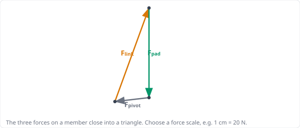
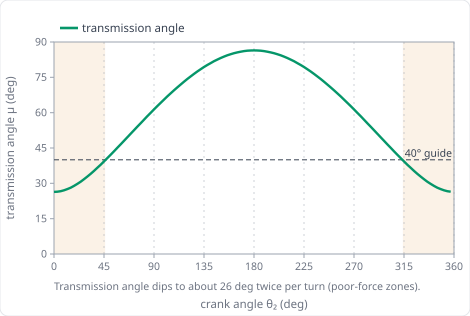
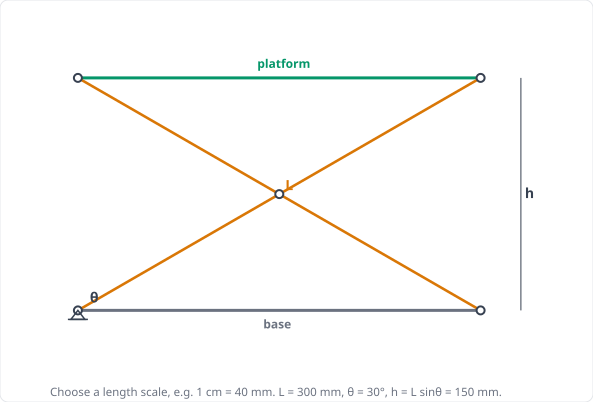
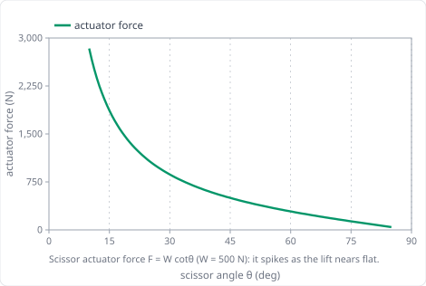
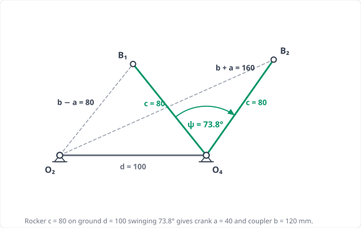

import PlanarMechanicsComments from '../../../../components/planar-mechanics/PlanarMechanicsComments.astro';
import TawkWidget from '../../../../components/TawkWidget.astro';
import UniversalContentContributors from '../../../../components/UniversalContentContributors.astro';
import InArticleAd from '../../../../components/InArticleAd.astro';
import Copyright from '../../../../components/Copyright.astro';
import BionicText from '../../../../components/BionicText.astro';
import TailwindWrapper from '../../../../components/TailwindWrapper.jsx';
import { Tabs, TabItem } from '@astrojs/starlight/components';
import { Card, CardGrid, Badge, Steps, LinkButton, FileTree } from '@astrojs/starlight/components';

<UniversalContentContributors 
  contributors={frontmatter.contributors}
/>

A clamp lets the part move while the tool cuts. A lift cannot raise its load from its lowest position. A pin shears. In each case the motion was right, and nobody calculated the force. In this lesson you find the forces at the joints of a mechanism, you judge how well a linkage passes force, and you check that the pins and links are strong enough. Then you run the process backward, which is called synthesis: you choose a mechanism and its dimensions to meet a target. #ForceAnalysis #TransmissionAngle #MechanismSynthesis

## Learning Objectives

By the end of this lesson, you will be able to:

1. **Find** the forces at the joints (the joint reactions) with free-body diagrams and force polygons
2. **Relate** mechanical advantage, the output force divided by the input force, to the velocity ratio through virtual work
3. **Judge** how well a linkage passes force with the transmission angle, and size links and pins for stress
4. **Synthesise** a mechanism, choosing its type and dimensions, to meet a force and motion target

## Real-World System Problem: from motion to metal

<InArticleAd />

A toggle clamp on a machining fixture must hold a part down with several hundred newtons. A hand applies the force, and the clamp must hold with no effort while the tool cuts. What hand force gives the clamping force? What loads do the pins and links then carry? Are they strong enough? The same questions decide the hydraulic cylinder of a scissor lift.

### The force problem

> **Engineering Question:** For a given input force or torque, what force appears at the output, what reactions load each joint, and are the links and pins strong enough?

## Fundamental Theory: statics on a mechanism

<InArticleAd />

This lesson is a **static** force analysis (statics is the balance of forces on a body at rest): the mechanism is held still in one position, and the forces on each part must balance. A **dynamic** force analysis adds the inertia forces of the [acceleration analysis](/education/planar-mechanics/acceleration-analysis-dynamic-forces/) to the same balance.

### Free-body diagrams and the force polygon

A free-body diagram is a drawing of one part alone, with every force that acts on it.

<Card title="The force polygon" icon="document">
The forces on a link at rest sum to zero. Draw them to scale as arrows, each starting where the last one ended, and they **close into a polygon**: the last arrow ends where the first began. Two special cases do most of the work:

- A **two-force member** has forces at only two joints and no other load. Its force acts **along the line that joins the two joints**. The coupler of a four-bar and the main link of a toggle clamp are two-force members.
- A **three-force member** has three forces. Their lines must meet at one point, and the three arrows close into a **force triangle**. With the directions of all three and the size of one, you measure the other two from the triangle.

</Card>

### Mechanical advantage by virtual work

With a long spanner on a tight nut, your hand moves far with a small force and the nut turns a little with a large force. No mechanism gives more work out than work in, so what it gains in force it loses in distance, and in speed.

<Card title="Force ratio is the reciprocal of the velocity ratio" icon="document">
Power is force times velocity, $P = Fv$ (W, with $F$ in N and $v$ in m/s), or torque times angular velocity, $P = T\omega$ ($T$ in N·m, $\omega$ in rad/s). In an ideal mechanism, one with no friction, the power in equals the power out:

$$F_\text{in}\,v_\text{in} = F_\text{out}\,v_\text{out} \quad\Rightarrow\quad \text{MA} = \frac{F_\text{out}}{F_\text{in}} = \frac{v_\text{in}}{v_\text{out}}$$

The **mechanical advantage** MA is the output force divided by the input force. It equals the input speed divided by the output speed, the **reciprocal of the velocity ratio** from the [velocity analysis](/education/planar-mechanics/velocity-analysis-instantaneous-centers/). Where the output almost stops while the input still moves, as at a toggle position, the mechanical advantage is very large.

The method is called virtual work because it compares the work of the two forces over a very small imagined movement. Friction takes some of the force, so the ideal value is multiplied by an efficiency $\eta$ smaller than 1.
</Card>

### Transmission angle and stress

<Card title="Transmission angle and allowable stress" icon="document">
The **transmission angle** $\mu$ is the angle between the coupler and the follower at their joint. A door pushed at right angles to its face turns with all of the push; pushed along its face toward the hinge, it does not move. In the same way, only the part of the coupler force at right angles to the follower turns it: the force times $\sin\mu$. So $\mu$ near $90\degree$ passes force well, and $\mu$ near $0\degree$ or $180\degree$ passes almost none. The usual guide is $\mu \ge 40\degree$ through the whole motion.

When the force $F$ (N) at a joint is known, check the pin and the link. **Stress** is force divided by the area that carries it. In N/mm² it has the same value as in MPa.

**The pin, in shear.** The joint force tries to cut the pin across its section, as scissors cut. The shear stress $\tau$ is the force divided by the cut area $A_s$, and $d$ (mm) is the pin diameter:

$$\tau = \frac{F}{A_s}, \qquad A_s = \frac{\pi d^2}{4} \ \text{(single shear)}, \qquad A_s = 2\times\frac{\pi d^2}{4} \ \text{(double shear)}$$

Count the cut planes first. A pin through two overlapping plates is cut on **one** plane. A pin in a fork (a clevis), held on both sides, is cut on **two**, which halves the stress. When a question does not say, assume single shear: it gives the higher stress, so the result is on the safe side.

**The link, in bending.** A rectangular link has thickness $t$ and width $w$ (mm), with $w$ in the plane of bending. A force $F$ at a distance $L$ (mm) bends it with the moment $M = FL$ (N·mm). The bending stress $\sigma$ is largest at the edge, at the distance $c$ from the middle of the section. $I$ (mm⁴) is the second moment of area of the section:

$$\sigma = \frac{Mc}{I} = \frac{M}{Z}, \qquad I = \frac{t w^3}{12}, \qquad c = \frac{w}{2}, \qquad Z = \frac{I}{c} = \frac{t w^2}{6} \;\Rightarrow\; \sigma = \frac{6FL}{t w^2}$$

The width $w$ is **squared** in the result: twice the width in the bending plane gives a quarter of the stress. A ruler shows it. It bends easily when it lies flat, and hardly at all on its edge.

:::caution[Do not check a shear stress against a tensile allowable]
The yield strength $\sigma_y$, the stress at which the metal starts to deform permanently, is measured in **tension**. Do not compare it directly with a shear stress. Convert it first. The maximum-shear-stress theory (Tresca) gives the yield stress in shear as

$$\tau_y = 0.5\,\sigma_y \qquad\text{(von Mises gives the less conservative } 0.577\,\sigma_y\text{)}$$

Check each part against its **own** limit. The safety factor $N$ is the strength divided by the actual stress:

$$N_\text{pin} = \frac{\tau_y}{\tau}, \qquad N_\text{link} = \frac{\sigma_y}{\sigma}$$

The design passes only if **both** are larger than the required $N$. The part with the **lowest** safety factor governs: it fails first. Name it in your answer.
:::
</Card>

## Application 1: Toggle-clamp force amplification and sizing

<InArticleAd />

A toggle clamp has two links that come almost into one straight line as the handle closes. The position where they are exactly in line is called dead centre. The clamp rests a little past it, which is why it stays locked. The work follows the [graphical method](/education/planar-mechanics/position-analysis-planar-linkages/#methods-of-kinematic-analysis) of the earlier lessons: draw to scale, solve, and confirm in the simulator.

<Card title="Simulator and hands-on lab" icon="rocket">

  <LinkButton href="/product-development/toggle-clamp-mechanism-simulator/" target="_blank" variant="primary" icon="rocket" iconPlacement="start">Open the Toggle Clamp Simulator</LinkButton>

**Hands-on lab:** Continue in the [Toggle Clamp Experiments](/education/mechanism-design-simulation/toggle-clamp-experiments/) lab ([siwit.co/TCM](https://siwit.co/TCM)). Experiments 2 and 4 cover force amplification and pin/link stress sizing.
</Card>

:::note[System Problem Statement]
- **Configuration:** Over-centre toggle clamp (a four-bar), resting just past dead centre
- **Task:** Find the clamping force from the hand force, then check the pins and links
- **Force data:** hand force $F_h = 100$ N, lock margin $\alpha = 5\degree$ (the angle of the links past dead centre), efficiency $\eta = 0.75$
- **Sizing data:** pin diameter $d = 8$ mm, link thickness $t = 6$ mm and width $w = 20$ mm, moment arm $L_\text{arm} = 40$ mm, yield strength $350$ MPa, required safety factor $N = 2$
:::

### Step 1: Force polygon for the clamp arm

The main link joins the handle to the clamp arm. The clamp arm turns on the fixed pivot $O_4$ and presses its pad on the workpiece.

**Click to reveal the force-polygon construction**

<Steps>

1. **Identify the members.** The main link is a two-force member, so its force acts along its own line. The clamp arm has three forces: the push of the main link at one joint, the reaction of the workpiece on the pad, and the reaction of the pivot at $O_4$. ✅

2. **Draw the triangle.** Choose a force scale and mark it (for example $1 \text{ cm} = 20 \text{ N}$). Draw the known main-link force. From its end draw the direction of the pad reaction. The pivot reaction closes the triangle. Measure the sides: they are the pad force and the pivot force. ✅

3. **The over-centre amplification.** From the geometry, the ideal force ratio of the toggle is $\text{MA} = \dfrac{1}{2\tan\alpha}$, where $\alpha$ is the angle of the links from the dead-centre line. The smaller the angle, the larger the amplification. ✅

</Steps>

  <TailwindWrapper>
	
  </TailwindWrapper>

### Step 2: Clamping force

**Click to reveal the clamping force**

<Steps>

1. **Mechanical advantage** at the $5\degree$ lock margin. Take the ideal geometry and multiply by the efficiency:

   $$\text{MA} = \frac{\eta}{2\tan\alpha} = \frac{0.75}{2\tan 5\degree} = 4.3$$

   In two stages: $\text{MA}_\text{ideal} = 1/(2\tan 5\degree) = 1/(2 \times 0.0875) = 5.72$ and $\text{MA}_\text{real} = 0.75 \times 5.72 = 4.3$. ✅

2. **Clamping force.** Multiply the hand force by the mechanical advantage:

   $$F_\text{clamp} = \text{MA}\times F_h = 4.3 \times 100 \text{ N} = 430 \text{ N}$$ ✅

   The closer the rest position is to dead centre, the larger this force. It is the over-centre design of the mobility and velocity lessons, seen as force.

</Steps>

### Step 3: Pin and link stresses

**Click to reveal the stress checks**

<Steps>

1. **Pin shear.** Near the joints the forces inside the clamp are larger than the pad force. Take $800$ N for the force on the link and its pin, and the single-shear case, which is on the safe side:

   $$A_s = \frac{\pi (8 \text{ mm})^2}{4} = 50.3 \text{ mm}^2, \qquad \tau_\text{pin} = \frac{800 \text{ N}}{50.3 \text{ mm}^2} = 15.9 \text{ MPa}$$ ✅

2. **Pin safety factor**, against the yield stress in *shear*, not in tension:

   $$\tau_y = 0.5 \times 350 = 175 \text{ MPa}, \qquad N_\text{pin} = \frac{175}{15.9} = 11.0$$ ✅

   In double shear the stress is half, $7.96$ MPa, and $N_\text{pin}$ is twice as large, $22$. ✅

3. **Link bending stress**, with $M = FL_\text{arm} = 800 \text{ N} \times 40 \text{ mm} = 32{,}000 \text{ N·mm}$:

   $$\sigma_\text{link} = \frac{6 F L_\text{arm}}{t w^2} = \frac{6 \times 800 \times 40}{6 \times 20^2} = 80 \text{ MPa}$$

   The same result from $Mc/I$: $I = 6 \times 20^3/12 = 4000 \text{ mm}^4$ and $c = 10 \text{ mm}$, so $\sigma = 32{,}000 \times 10/4000 = 80 \text{ MPa}$. ✅

4. **Link safety factor** and the result:

   $$N_\text{link} = \frac{350}{80} = 4.4$$

   Both parts are above the required $N = 2$, so the design passes. The **link in bending governs** at $N = 4.4$, against $11.0$ for the pin: the link would bend before the pin sheared. To save weight, make the pin smaller. To raise the clamping force, strengthen the link first. ✅

</Steps>

### Step 4: Verify in the simulator

**Click to reveal the simulator check**

<Steps>

1. **Open the simulator** ([siwit.co/TCM](https://siwit.co/TCM)) and set the hand force, lock margin, efficiency, and the pin and link sizes. ✅

2. **Make the lock margin smaller.** The clamping force rises steeply as the links come near dead centre. Then read the pin shear stress and the link bending stress, each with its pass or fail result against the limit. They agree with the hand calculation. ✅

</Steps>

:::note[Engineering Insight]
The toggle clamp uses the whole course: a four-bar with one degree of freedom ([mobility](/education/planar-mechanics/kinematic-joints-constraint-analysis/)), placed near dead centre ([position](/education/planar-mechanics/position-analysis-planar-linkages/)), where the velocity ratio goes to zero ([velocity](/education/planar-mechanics/velocity-analysis-instantaneous-centers/)) and the clamping force is large.
:::

## Application 2: Four-bar transmission angle

<InArticleAd />

The transmission angle shows where in its turn a four-bar passes force well, and where it wastes force.

<Card title="Simulator and hands-on lab" icon="rocket">

  <LinkButton href="/product-development/four-bar-linkage-simulator/" target="_blank" variant="primary" icon="rocket" iconPlacement="start">Open the Four-Bar Linkage Simulator</LinkButton>

**Hands-on lab:** Continue in the [Four-Bar Linkage Experiments](/education/mechanism-design-simulation/four-bar-linkage-experiments/) lab ([siwit.co/FBL](https://siwit.co/FBL)). Experiment 2 maps the transmission angle and mechanism quality.
</Card>

:::note[System Problem Statement]
- **Configuration:** Crank-rocker four-bar (the standard four-bar geometry)
- **Task:** Find the transmission angle over a full turn of the crank, and the zones where force passes badly
- **Link lengths:** crank $a = 40$, coupler $b = 120$, follower $c = 80$, ground $d = 100$ mm
:::

### Step 1: Plot the transmission angle

**Click to reveal the transmission-angle behaviour**

<Steps>

1. **Measure $\mu$** as the angle between the coupler and the follower at joint $B$, taken as the value between $0\degree$ and $90\degree$. At a crank angle of $\theta_2 = 120\degree$ it is $\mu = 74\degree$, which is very good. ✅

2. **Turn the crank through a full turn.** $\mu$ rises to about $86\degree$ and falls to about $26\degree$. The part of the turn below the $40\degree$ guide is the **poor-force zone**: there a large coupler force gives only a small useful push on the follower. ✅

3. **What the designer does.** If that zone is inside the working stroke, change the link lengths (Application 4) or move the heavy work to the part of the turn where $\mu$ is large. ✅

</Steps>

  <TailwindWrapper>
	
  </TailwindWrapper>

The note printed inside this picture says that the angle dips twice in each turn. It dips once. The two shaded bands join at $\theta_2 = 0\degree$ and are one zone.

### Step 2: Turn the angle into a force

The coupler is a two-force member, so it pushes on the follower along its own line. Only the part of that push at right angles to the follower turns it.

**Click to reveal what the transmission angle costs in force**

<Steps>

1. **Split the coupler force at the joint.** The coupler force $F_{34}$ (N) arrives at $B$ at the angle $\mu$ to the follower: ✅

   $$F_\perp = F_{34}\sin\mu \quad (\text{drives the follower}), \qquad F_\parallel = F_{34}\cos\mu \quad (\text{pushes into the bearing})$$

   The output torque is the driving part times the follower length $c$: $T_4 = F_{34}\,c\sin\mu$. So the angle acts only through $\sin\mu$. ✅

2. **Compare the best instant with the worst.** At $\theta_2 = 120\degree$, $\mu = 74.3\degree$ and $\sin\mu = 0.963$: almost the whole coupler force turns the follower. At the worst instant, $\mu = 26.4\degree$ and $\sin\mu = 0.445$. For the **same output torque** you need ✅

   $$\frac{F_{34,\text{worst}}}{F_{34,\text{best}}} = \frac{0.963}{0.445} = 2.2$$

   That is more than twice the coupler force, and more than twice the pin and link stresses, for no added useful work. ✅

3. **Find where the rest goes.** At $\mu = 26.4\degree$, $\cos\mu = 0.896$, so nearly **90% of the coupler force pushes along the follower into its bearing**. It does no work. It only wears the pin and bends the link. ✅

4. **Read the guide as a statement about force.** The rule $\mu \ge 40\degree$ means $\sin\mu \ge 0.64$: at least about two thirds of the coupler force drives the follower. This linkage is below that line for about a quarter of every turn, which is acceptable only if the working stroke is outside that zone. ✅

</Steps>

### Step 3: Verify in the simulator

**Click to reveal the simulator check**

<Steps>

1. **Set it up.** Open the simulator ([siwit.co/FBL](https://siwit.co/FBL)) and set $a = 40$, $b = 120$, $c = 80$, $d = 100$. The transmission angle is in degrees, so no conversion is needed. ✅

2. **Compare the two readouts.** The panel reports **Min &micro;** and **Max &micro;**: ✅

   $$\text{Min } \mu = 26.4\degree \quad (\text{at } \theta_2 = 0\degree), \qquad \text{Max } \mu = 86.4\degree \quad (\text{at } \theta_2 = 180\degree)$$

3. **Find the poor-force zone on the axis.** The curve crosses the $40\degree$ guide at $\theta_2 = 46\degree$ and again at $314\degree$. The linkage is below the guide from $314\degree$ through zero to $46\degree$, which is $92\degree$ of $360\degree$: about **26% of every revolution**, shaded in the figure above. ✅

4. **Check against the mechanical advantage.** The **Minimum MA** readout is lowest at the crank angles where $\mu$ is lowest. Both measure the same loss: $\mu$ from the geometry, MA from the force ratio. ✅

</Steps>

## Application 3: Scissor-lift actuator force

<InArticleAd />

In a scissor lift the mechanical advantage works against the designer: the actuator force grows without limit as the platform comes near the floor. The actuator is the cylinder or screw that drives the lift.

<Card title="Simulator and hands-on lab" icon="rocket">

  <LinkButton href="/product-development/scissor-lift-mechanism-simulator/" target="_blank" variant="primary" icon="rocket" iconPlacement="start">Open the Scissor Lift Simulator</LinkButton>

**Hands-on lab:** Continue in the [Scissor Lift Experiments](/education/mechanism-design-simulation/scissor-lift-experiments/) lab ([siwit.co/SLM](https://siwit.co/SLM)). Experiment 1 plots the actuator force and Experiment 8 the link stress.
</Card>

:::note[System Problem Statement]
- **Configuration:** Single-stage scissor lift carrying load $W = 500$ N
- **Task:** Find how the actuator force depends on the angle $\theta$ of the arms above the base
:::

### Step 1: Draw the geometry the work balance rests on

Virtual work is quick when you know which two lengths change, and how. Both are on the space diagram, the scale drawing of the lift, so draw it first.

**Click to reveal the two lengths that matter**

<Steps>

1. **Draw the lift to scale** at one angle, say $\theta = 30\degree$. Choose and mark a length scale ($1 \text{ cm} = 50 \text{ mm}$ suits an arm length of $L = 300$ mm). ✅

   

     <TailwindWrapper>
   	
     </TailwindWrapper>
   

   The note printed inside this picture suggests a scale of $1 \text{ cm} = 40 \text{ mm}$. Either scale works.

2. **Mark the two lengths that change.** They are the platform height $h$ and the distance $x$ between the two base pins, which the actuator changes: ✅

   $$h = L\sin\theta \quad (\text{the load rises through this}), \qquad x = L\cos\theta \quad (\text{the actuator shortens this})$$

3. **They change in opposite directions.** When the platform rises ($\theta$ grows), $h$ grows and $x$ shrinks: the actuator pulls the base pins together as the load goes up. For this reason the result contains $\cot\theta$ and not $\tan\theta$. ✅

</Steps>

### Step 2: Actuator force by virtual work

**Click to reveal the actuator-force relation**

<Steps>

1. **Differentiate both lengths** with respect to the angle. This gives the small changes $\delta h$ and $\delta x$ for a small turn $\delta\theta$ of the arms: ✅

   $$\delta h = L\cos\theta\,\delta\theta, \qquad \delta x = -L\sin\theta\,\delta\theta$$

2. **Set the two amounts of work equal.** Work is force times distance. With no friction, the work of the actuator force $F_\text{act}$ equals the work of lifting the load $W$. The actuator shortens $x$ while the load rises, so both are positive: ✅

   $$F_\text{act}\,\lvert\delta x\rvert = W\,\delta h \;\Rightarrow\; F_\text{act}\,L\sin\theta\,\delta\theta = W\,L\cos\theta\,\delta\theta$$

3. **Cancel and read the result.** $L$ and $\delta\theta$ cancel, so the answer depends on the angle alone and not on the size of the lift: ✅

   $$F_\text{act} = W\cot\theta$$

   This holds for an actuator that lies horizontally between the base pins. A diagonal actuator has another geometry factor, and the simulator reports the value for each type. ✅

4. **Put in the numbers** for $W = 500$ N. At $\theta = 45\degree$, $F_\text{act} = 500 \times \cot 45\degree = 500$ N. At $30\degree$ it is $500 \times 1.732 = 866$ N. At $10\degree$ it is $500 \times 5.671 = 2836$ N. As the platform comes near the floor the force rises steeply. ✅

5. **What the designer does.** A scissor lift works over a limited range of angles, uses a diagonal actuator to lower the force at small angles, and never starts fully flat. ✅

</Steps>

  <TailwindWrapper>
	
  </TailwindWrapper>

### Step 3: Verify in the simulator

**Click to reveal the simulator check**

<Steps>

1. **Set it up and read four points from the chart.** Open the simulator ([siwit.co/SLM](https://siwit.co/SLM)). Set the platform load to $500$ N, the link mass to its lowest value ($0.1$ kg) and the actuator type to **Horizontal Base**. The check works in either joint arrangement: the actuator force is the same whether one base pin is fixed or both slide. The simulator adds half the weight of the arms to the load, so its readings are about $1$ N to $5$ N above the hand values: ✅

   | Scissor angle | $F = W\cot\theta$ | Chart reads |
   |:---:|:---:|:---:|
   | $75\degree$ | $0.27\,W$ | $134$ N |
   | $45\degree$ | $1.00\,W$ | $501$ N |
   | $30\degree$ | $1.73\,W$ | $868$ N |
   | $10\degree$ | $5.67\,W$ | $2841$ N |

   Remember the $45\degree$ row. There the actuator force equals the load, so the mechanical advantage is one. Below that angle the actuator must push harder than the load, and above it less hard. ✅

2. **Read Max Actuator Force.** This readout is not a property of the lift. It is the force at the *lowest* angle of the stroke you allow. Raise the minimum height and it falls at once, which is the cheapest design change here. ✅

3. **Change the actuator placement.** Set the actuator type to **Diagonal Base**. The small-angle end of the curve drops, because the geometry factor is no longer $\cot\theta$. This mounting makes work at small angles practical. ✅

4. **Check the link stress.** With the actuator force known, the stress in the arms follows as in Application 1. The lowest angle is the worst case for force and for stress, so a lift is rated from its lowest working height. ✅

</Steps>

## Application 4: Synthesise a four-bar for a target

<InArticleAd />

Analysis takes a mechanism and finds its behaviour. **Synthesis** takes a required behaviour and finds the mechanism.

<Card title="Simulator and hands-on lab" icon="rocket">

  <LinkButton href="/product-development/four-bar-linkage-simulator/" target="_blank" variant="primary" icon="rocket" iconPlacement="start">Open the Four-Bar Linkage Simulator</LinkButton>

**Hands-on lab:** Use the [Four-Bar Linkage Experiments](/education/mechanism-design-simulation/four-bar-linkage-experiments/) lab ([siwit.co/FBL](https://siwit.co/FBL)) to test each candidate set of link lengths against the target.
</Card>

:::note[System Problem Statement]
- **Task:** Design a crank-rocker: the crank turns all the way round and the output link, the rocker, swings back and forth through $\psi = 73.8\degree$. Keep $\mu \ge 40\degree$ through the whole turn
- **Fixed by the mounting:** ground $d = 100$ mm, and a first choice of rocker length $c = 80$ mm
- **To be found:** crank $a$ and coupler $b$

**Key Question:** Can one construction give both unknown links, and will the linkage that it gives pass force well?
:::

### Step 1: Type synthesis

Type synthesis is the choice of the kind of mechanism.

**Click to reveal the choice of mechanism family**

<Steps>

1. **Read the family from the task.** An input that turns all the way round and an output that swings mean a **crank-rocker** four-bar. A straight-line output would mean a slider-crank, and a clamping action a toggle. ✅

2. **Confirm that one input drives it.** The [mobility check](/education/planar-mechanics/kinematic-joints-constraint-analysis/) gives one degree of freedom for a four-bar, so one motor on the crank fixes the whole motion. ✅

</Steps>

### Step 2: Dimensional synthesis by limit positions

Dimensional synthesis is the choice of the link lengths. At each end of the rocker swing, a **limit position**, the crank and the coupler lie in one straight line. When they are folded over each other, the distance from $O_2$ to the rocker pin is $b - a$. When they are stretched out, it is $b + a$. So two distances measured from one drawing give both unknown links.

**Click to reveal the construction**

<Steps>

1. **Draw the frame.** Choose and mark a length scale, say $1 \text{ cm} = 20 \text{ mm}$. Draw the ground $O_2O_4 = 100$ mm. ✅

2. **Draw the rocker at both ends of its swing.** Draw the rocker $c = 80$ mm from $O_4$ in its two limit positions $O_4B_1$ and $O_4B_2$, with the required $\psi = 73.8\degree$ between them. Where the swing lies relative to the ground is **your choice**. Here the line midway between the two positions is at $91.8\degree$ to the ground line. ✅

3. **Measure the two distances** from the crank centre to each end position of the rocker pin: ✅

   $$O_2B_1 = 80 \text{ mm} = b - a, \qquad O_2B_2 = 160 \text{ mm} = b + a$$

4. **Solve the pair.** Half the difference is the crank, and half the sum is the coupler: ✅

   $$a = \frac{O_2B_2 - O_2B_1}{2} = \frac{160 - 80}{2} = 40 \text{ mm}, \qquad b = \frac{O_2B_2 + O_2B_1}{2} = \frac{160 + 80}{2} = 120 \text{ mm}$$

</Steps>

  <TailwindWrapper>
	
  </TailwindWrapper>

### Step 3: Test the candidate, and watch it fail

Link lengths that give the motion are only a candidate. They must pass every analysis in this course before they are a design.

**Click to reveal the checks on the first attempt**

<Steps>

1. **Grashof, so that the crank can turn all the way round.** The Grashof condition compares the shortest plus the longest link with the other two: $40 + 120 = 160 < 80 + 100 = 180$. It passes. The shortest link is the crank and it is next to the ground, so the linkage is a **crank-rocker**, as required. ✅

2. **Swing, to confirm the construction.** The position analysis over a full turn gives a rocker swing of $73.8\degree$, the target. The motion requirement is met. ✅

3. **Transmission angle: this check fails.** These are the link lengths of Application 2, where $\mu$ fell to $26.4\degree$ and was below the $40\degree$ guide for about a **quarter of every turn**. From Step 2 of that application, nearly $90\%$ of the coupler force then goes into the bearings.

   This is the usual result of a first synthesis, and not a mistake in the construction. The limit-position method controls the *motion*. It says nothing about how well the linkage passes *force*. ✅

</Steps>

### Step 4: Refine, and test again

**Click to reveal one turn of the design loop**

<Steps>

1. **Find what is free to change.** The mounting fixes the ground $d$, and the swing $\psi$ is the requirement. The rocker length $c$ and the place of the swing remain, and both change $a$ and $b$ through the same construction. ✅

2. **Shorten the rocker and move the swing.** Repeat Step 2 with $c = 60$ mm and the midway line at $115\degree$. The two distances measure $55$ and $127$ mm, so ✅

   $$a = 36 \text{ mm}, \qquad b = 91 \text{ mm}$$

3. **Run every check again.** Grashof still passes ($36 + 100 = 136 < 60 + 91 = 151$), and the linkage is still a crank-rocker. The rocker swing is $74.0\degree$, within a fifth of a degree of the target. The lowest transmission angle is now $44.5\degree$: ✅

   $$\mu_{min} = 44.5\degree \;>\; 40\degree \quad \text{for the whole revolution}$$

   The linkage is never below the guide, against $26\%$ of the turn before. The motion is the same and the force is far better. ✅

4. **See the loop.** Synthesis is to propose, analyse and refine until every check passes. The analysis methods of the earlier lessons are the checks. ✅

</Steps>

### Step 5: Verify the whole design

**Click to reveal the final verification**

<Steps>

1. **Check the swing by a second route.** Enter the refined lengths in the simulator ([siwit.co/FBL](https://siwit.co/FBL)) and read the **Oscillation** result, the total swing of the rocker. It shows about $74\degree$. ✅

2. **Compare the two candidates.** Enter $a=40$, $b=120$, $c=80$, $d=100$ and read the minimum transmission angle. Then enter the refined $a=36$, $b=91$, $c=60$, $d=100$ (the length sliders move in steps of 1 mm). The minimum rises from about $26\degree$ to about $45\degree$, and the curve no longer crosses the guide. ✅

3. **Run the full sequence on the design that passed.** Mobility, position, velocity and mechanical advantage, acceleration and inertia loads, then joint forces and pin and link stresses as in Application 1. A design is finished only when all of them pass. ✅

4. **Take it to CAD.** The link lengths and limit positions become the sketch constraints of a real part in the [Parametric Mechanical CAD with FreeCAD](/education/parametric-mechanical-cad-freecad/) course. ✅

</Steps>

:::tip[Instrument it]
Put a load cell, or a pin fitted with a strain gauge, in the joint with the highest force. Put a current sensor (an ACS712 in line, or an INA219 on the supply) on the drive motor, because the motor current follows the torque that the linkage needs. Read them with an [ESP32 or STM32](/education/sensor-actuator-interfacing-stm32/), [stream the readings](/education/iot-systems/), and let siliconwit.io [warn when a joint force rises past its rating](https://siliconwit.io).
:::

## Summary and Course Conclusion

<InArticleAd />

### Force results at a glance

| Mechanism | What you solve for | Key relation | Simulator |
|-----------|--------------------|--------------|-----------|
| Toggle clamp | clamping force, stresses | $\text{MA} = \eta/(2\tan\alpha)$ | [siwit.co/TCM](https://siwit.co/TCM) |
| Four-bar | transmission angle | $\mu$ between coupler and follower | [siwit.co/FBL](https://siwit.co/FBL) |
| Scissor lift | actuator force | $F = W\cot\theta$ | [siwit.co/SLM](https://siwit.co/SLM) |
| Crank-slider | crank torque | $T = F\,(ds/d\theta)$ | [siwit.co/CSM](https://siwit.co/CSM) |

### The course in one thread

You asked six questions of the mechanisms in this course: can it move, where are its links, how fast do they move, how hard do they accelerate, how is a motion programmed with a cam, and what forces pass through it. Each result was drawn, calculated and checked in a simulator.

<InArticleAd />
<PlanarMechanicsComments />
<TawkWidget />
<Copyright />
