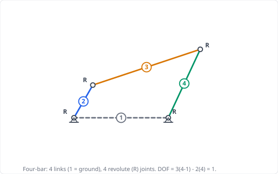
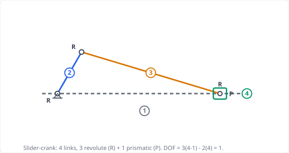
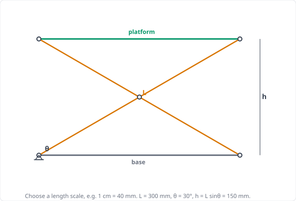
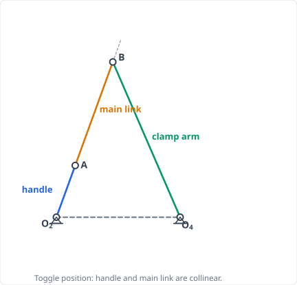

import PlanarMechanicsComments from '../../../../components/planar-mechanics/PlanarMechanicsComments.astro';
import TawkWidget from '../../../../components/TawkWidget.astro';
import UniversalContentContributors from '../../../../components/UniversalContentContributors.astro';
import InArticleAd from '../../../../components/InArticleAd.astro';
import Copyright from '../../../../components/Copyright.astro';
import BionicText from '../../../../components/BionicText.astro';
import TailwindWrapper from '../../../../components/TailwindWrapper.jsx';
import { Tabs, TabItem } from '@astrojs/starlight/components';
import { Card, CardGrid, Badge, Steps, LinkButton, FileTree } from '@astrojs/starlight/components';

<UniversalContentContributors 
  contributors={frontmatter.contributors}
/>

A mechanism with too few freedoms of motion locks solid. A mechanism with too many moves in ways that no motor controls. Both faults are usually found after the parts are made, when they are expensive to correct. This lesson gives you a count that finds them on paper. You will name the kinds of joint, count the degrees of freedom (the independent motions a mechanism has) with the Kutzbach-Grübler equation, meet a case where the equation gives the wrong answer, and check every result on four mechanisms that you can drive in a simulator. #Kinematics #DOF #GrublersEquation

## Learning Objectives

By the end of this lesson, you will be able to:

1. **Identify** different types of kinematic joints and their constraint properties
2. **Calculate** degrees of freedom using the Kutzbach-Grübler equation for planar mechanisms
3. **Diagnose** redundant constraints when the equation disagrees with physical mobility
4. **Verify** mechanism mobility against interactive simulators for four-bar, slider-crank, scissor-lift, and toggle-clamp mechanisms

## Real-World System Problem: Modular Robotic Arm Assembly System

<InArticleAd />

A factory wants one robot arm that can be rebuilt for different work: electronic parts this week, car parts the next. The answer is a **modular arm**, made of joint modules that fit together in different orders. The risk is in the rebuilding. Add the wrong joint and the arm either locks solid or moves in a way that no motor controls.

### System challenge: joint selection for reconfigurable robots

Before the arm is built, the designer must answer three questions:

- How many joints does the task need?
- Which kind of joint gives each motion?
- Does the arm have exactly the freedom to move that was intended, no more and no less?

> **Engineering Question:** Given any arrangement of links and joints, how do we predict whether it will move, how many motors it needs, and whether our prediction can be trusted?

### Why constraint analysis matters

A wrong count shows itself in one of four ways:

- **Lock-up.** Too many constraints leave nothing free to move. You wanted a mechanism and you built a structure.
- **Uncontrolled motion.** Too few constraints leave a motion that no motor commands.
- **Binding and broken parts.** An over-constrained assembly fits together only while its parts are loose, and it jams when they are made accurately.
- **Wasted cost.** Motors and controllers drive motions that the task never needed.

## Fundamental Theory: Kinematic joints and constraints

<InArticleAd />

### What are kinematic joints?

A machine is made of **links**, rigid parts that do not bend, connected by joints. A door and its frame are two links. The hinge is the joint.

<Card title="Joint definition" icon="document">
A **kinematic joint** (also called a kinematic pair) connects two links. It allows some relative motions, blocks the others, and carries force from one link to the other.

- The motions a joint allows are its **degrees of freedom** (DOF).
- The motions it blocks are its **constraints**.

A body that moves in a flat plane can do three things: move along X, move along Y, and turn. So for every planar joint, $\text{allowed} + \text{blocked} = 3$.
</Card>

Joints come in two families. A **lower pair** blocks two of the three motions and allows one. A **higher pair** blocks only one and allows two. The tabs show the two lower pairs of planar machines and one higher pair.

### Classification of planar kinematic joints

<Tabs>
  <TabItem label="Revolute Joint (R)">

<Card title="Revolute (Pin) Joint" icon="document">

  <TailwindWrapper>
	
  </TailwindWrapper>

A revolute joint is a pin or a hinge. It allows turning and nothing else.

**Motion Allowed:** Rotation about the axis perpendicular to the plane (the pin)
**Motion Constrained:** Translation in both in-plane directions
**Degrees of Freedom:** 1 &nbsp; | &nbsp; **Constraints:** 2

| Planar motion | Permitted? |
|---------------|:----------:|
| X-translation | No |
| Y-translation | No |
| Z-rotation | Yes ✅ |

**This is a *lower pair*** (the two parts touch over a surface, 2 constraints).

**Applications:** Robot shoulder and elbow joints, door hinges, motor shaft connections, every pin in a four-bar linkage.
</Card>

  </TabItem>
  <TabItem label="Prismatic Joint (P)">

<Card title="Prismatic (Slider) Joint" icon="document">

  <TailwindWrapper>
	
  </TailwindWrapper>

A prismatic joint is a slider on a straight guide. It allows sliding along one line and nothing else.

**Motion Allowed:** Translation along one in-plane axis
**Motion Constrained:** Translation perpendicular to that axis, and rotation
**Degrees of Freedom:** 1 &nbsp; | &nbsp; **Constraints:** 2

| Planar motion | Permitted? |
|---------------|:----------:|
| X-translation (along slide) | Yes ✅ |
| Y-translation | No |
| Z-rotation | No |

**This is a *lower pair*** (the two parts touch over a surface, 2 constraints).

**Applications:** Linear actuators, hydraulic cylinders, the piston of an engine, telescoping mechanisms, sliding doors.
</Card>

  </TabItem>
  <TabItem label="Higher Pair (Half Joint)">

<Card title="Higher Pair: Cam or Gear Contact" icon="document">

  <TailwindWrapper>
	
  </TailwindWrapper>

A **cam** is a disc with a shaped edge. As it turns, the edge pushes a second part, the **follower**, up and down. The two parts touch along a line or at a point, not over a surface. That kind of joint is a **higher pair**. At the contact the parts can **roll** and **slip** at the same time, so the joint removes only one freedom: the follower cannot move into the cam or away from it. Two gear teeth in mesh behave in the same way.

**Motion Allowed:** Rolling (rotation) + slipping (translation along the surface)
**Motion Constrained:** Translation at right angles to the surface (the parts must stay in contact)
**Degrees of Freedom:** 2 &nbsp; | &nbsp; **Constraints:** 1

| Planar motion | Permitted? |
|---------------|:----------:|
| Translation along the surface (slip) | Yes ✅ |
| Translation at right angles to the surface | No |
| Z-rotation (roll) | Yes ✅ |

**This is a *higher pair*** (line or point contact, only 1 constraint). In the Kutzbach-Grübler equation it is counted as $j_2$.

**Applications:** [Cam-follower systems](/education/planar-mechanics/cam-follower-systems-motion-programming/), gear-tooth contact, wheel rolling on a surface, ball bearings.
</Card>

  </TabItem>
</Tabs>

### Degrees of freedom fundamentals

A mechanism has $n$ links, and **one of them is the fixed ground**, the frame that does not move. So $n-1$ links can move. Before any joint is added, each has 3 DOF, which gives $3(n-1)$ freedoms in all. Each joint then removes some.

### The Kutzbach-Grübler equation

In words: start with three freedoms for each moving link. Take away two for each lower pair and one for each higher pair. What remains is the **mobility** $M$, the number of degrees of freedom of the whole mechanism.

<Card title="Kutzbach-Grübler equation for planar mechanisms" icon="document">

$$M = \text{DOF} = 3(n-1) - 2j_1 - j_2$$

**Where** (all three are plain counts, with no unit):
- $n$ = number of links, **including the ground**
- $j_1$ = number of **lower pairs** (revolute or prismatic, each removes 2 freedoms)
- $j_2$ = number of **higher pairs** (cam or gear contact, each removes 1 freedom)

Textbooks write the result as $M$ or as DOF. This course uses both.

**Count before you substitute.** Write the three counts as a list first:

| Count | Rule |
|-------|------|
| $n$ | every rigid body, **plus the frame as one link**, however many places it is bolted down |
| $j_1$ | every revolute **and** every prismatic joint, since both remove 2 freedoms |
| $j_2$ | every rolling or sliding **contact**: cam on follower, gear tooth on gear tooth |

Two mistakes cause most wrong answers. If you forget the frame, the answer is exactly $3$ too low. If **three** links meet at one pin, that pin is not one joint: $k$ links on one pin make $k-1$ joints.
</Card>

:::tip[Interpreting the result]
- **$\text{DOF} > 0$**: a *mechanism*. It moves, and it needs this many independent inputs (motors or actuators).
- **$\text{DOF} = 1$**: a mechanism with one input, the most common design target.
- **$\text{DOF} = 0$**: a *structure*. Nothing moves.
- **$\text{DOF} < 0$**: *over-constrained*. It has more constraints than it needs, and it may bind unless special geometry helps (see Application 3).
:::

### Counting a higher pair: three worked cases

Three of the four mechanisms in this lesson have no higher pair, so for them $j_2 = 0$. These three short counts use the term, because a cam or gear contact is easy to count wrongly.

<Card title="Case 1: Cam with a knife-edge translating follower" icon="document">
The follower ends in a sharp edge that rests on the cam, and it slides in a straight guide.

**Links** ($n = 3$): frame, cam, follower.
**Lower pairs** ($j_1 = 2$): cam-to-frame revolute, follower-in-guide prismatic.
**Higher pairs** ($j_2 = 1$): the knife edge touching the cam surface. It is a *contact*, not a pin, so it removes only 1 freedom: the follower cannot enter the cam, but it is free to slide along the edge.

$$M = 3(3-1) - 2(2) - 1 = 6 - 4 - 1 = 1$$

One degree of freedom, one actuator: turn the cam and every other part follows.
</Card>

<Card title="Case 2: The same cam with a roller follower" icon="document">
A roller on the end of the follower adds a link and a pin:

**Links** ($n = 4$): frame, cam, roller, follower. &nbsp; **Lower pairs** ($j_1 = 3$): cam-to-frame revolute, roller-to-follower revolute, follower-in-guide prismatic. &nbsp; **Higher pairs** ($j_2 = 1$): roller rolling on the cam surface.

$$M = 3(4-1) - 2(3) - 1 = 9 - 6 - 1 = 2$$

Two, not one. The equation is not wrong: the roller can spin about its own pin without moving the follower at all. That is a **passive degree of freedom**, a freedom that moves no output. The mechanism still needs only **one** actuator. Report it as $M = 2$ with one passive freedom, so the useful mobility is 1.
</Card>

<Card title="Case 3: A simple gear pair" icon="document">
**Links** ($n = 3$): frame, gear 1, gear 2. &nbsp; **Lower pairs** ($j_1 = 2$): each gear pinned to the frame. &nbsp; **Higher pairs** ($j_2 = 1$): the meshing teeth.

$$M = 3(3-1) - 2(2) - 1 = 1$$

One input turns both gears at a fixed ratio. If the two gears were joined by a pin at the contact point, that joint would be a lower pair and $M$ would fall to $0$, a structure. One constraint is the whole difference between a contact ($j_2$) and a pin ($j_1$).
</Card>

### Systematic joint analysis process

Every application in this lesson follows the same four steps: count the links (with the ground), sort the joints into $j_1$ and $j_2$, apply the equation, and compare the result with how the real mechanism moves. Three cases can make the equation and the mechanism disagree.

:::caution[Where the equation can mislead you]
1. **Redundant constraints**, two constraints that block the same motion, can make the DOF negative for a mechanism that moves freely (the scissor lift in Application 3).
2. **Passive degrees of freedom** (a roller that spins without moving the output) make the count too high.
3. **Singular configurations**, single positions where the output stops for an instant, change how the mechanism behaves at that position without changing its DOF (the toggle clamp in Application 4).
:::

## Application 1: Four-bar linkage (the workhorse of planar mechanisms)

<InArticleAd />

A four-bar linkage is four rigid links joined by four pins into a closed loop, with one link fixed. Windshield wipers, car suspensions and robot grippers use it. We count its mobility, then drive it in the simulator to confirm that one input controls the whole loop.

<Card title="Simulator and hands-on lab" icon="rocket">

  <LinkButton href="/product-development/four-bar-linkage-simulator/" target="_blank" variant="primary" icon="rocket" iconPlacement="start">Open the Four-Bar Linkage Simulator</LinkButton>

**Hands-on lab:** Practice with this mechanism in the [Four-Bar Linkage Experiments](/education/mechanism-design-simulation/four-bar-linkage-experiments/) lab. Start with Experiment 1, where one crank input drives the whole linkage.
</Card>

:::note[System Problem Statement]
- **Configuration:** Crank-rocker four-bar linkage (a diverter arm on a packaging line). In a crank-rocker, one link turns fully and the output link swings back and forth.
- **Task:** Determine the mobility and the number of motors required
- **Link lengths:** crank $a = 40$ mm, coupler $b = 120$ mm, follower (rocker) $c = 80$ mm, ground $d = 100$ mm

**What we need to calculate:**
1. **Number of links** including ground
2. **Joint types and counts** ($j_1$, $j_2$)
3. **Mobility** from the Kutzbach-Grübler equation
4. **Verification** that a single crank input determines the whole linkage

**Key Question:** How many independent inputs does a four-bar linkage need?
:::

<Card title="Equivalent system model" icon="document">
**The four links:**
- **Link 1**: ground (the fixed bar of length $d$)
- **Link 2**: crank (the input link, of length $a$, which the motor turns)
- **Link 3**: coupler (the link of length $b$ that joins the crank to the follower and touches no fixed point)
- **Link 4**: follower, also called the rocker (the output link, of length $c$)

**The four joints** are all pin (revolute) connections: ground-crank ($O_2$), crank-coupler ($A$), coupler-follower ($B$), follower-ground ($O_4$).
</Card>

### Step 1: Count links and joints

**Click to reveal the link and joint inventory**

<Steps>

1. **Count links (include ground):**

   $$n = 4 \quad (\text{ground} + \text{crank} + \text{coupler} + \text{follower})$$ ✅

2. **Classify the joints:**

   All four connections are pin joints, so they are revolute lower pairs:

   $$j_1 = 4 \quad (\text{4 revolute joints}), \qquad j_2 = 0 \quad (\text{no higher pairs})$$ ✅

</Steps>

  <TailwindWrapper>
	
  </TailwindWrapper>

### Step 2: Apply the Kutzbach-Grübler equation

**Click to reveal the mobility calculation**

<Steps>

1. **Substitute into the equation.** Three moving links give $3 \times 3 = 9$ freedoms, and four pins remove $2 \times 4 = 8$:

   $$\text{DOF} = 3(n-1) - 2j_1 - j_2$$

   $$\text{DOF} = 3(4-1) - 2(4) - 0$$ ✅

   $$\text{DOF} = 9 - 8 = 1 \text{ DOF}$$ ✅

2. **Interpret the result:**

   - The linkage has **mobility 1**: one input fixes the position of every link.
   - **Motors required: 1**, applied at the crank ($O_2$).
   - Once the crank angle is set, the geometry alone decides the coupler and follower angles. You calculate them in the [position analysis](/education/planar-mechanics/position-analysis-planar-linkages/). ✅

</Steps>

### Step 3: Verify in the simulator

**Click to reveal the simulator verification**

<Steps>

1. **Open the** [Four-Bar Linkage Simulator](/product-development/four-bar-linkage-simulator/) (short link [siwit.co/FBL](https://siwit.co/FBL)) and load the **Crank-Rocker (Grashof)** preset, or set $a = 40$, $b = 120$, $c = 80$, $d = 100$ mm. ✅

2. **Find the input:** the simulator has exactly one driving control, the crank angle. Move it from $0^\circ$ to $360^\circ$. ✅

3. **Confirm $M = 1$:** as you move that one control, every other value the simulator plots changes with it: the coupler angle $\theta_3$, the follower angle $\theta_4$, their angular velocities $\omega_3$ and $\omega_4$, and the path of a point on the coupler. There is no second control to set. ✅

4. **Connect to the equation:** one control that fixes the whole drawing is the physical meaning of $\text{DOF} = 1$. With 2 DOF, the simulator would need two independent controls to fix the position. ✅

</Steps>

:::note[Engineering Insight]
Four links and four revolute joints make the smallest closed loop with mobility 1. Remove a joint and it falls apart. Add a constraint and it locks.
:::

## Application 2: Slider-crank mechanism (replacing a pin with a slider)

<InArticleAd />

The slider-crank changes rotation into motion along a straight line. Every piston engine, pump and compressor has one. It looks different from the four-bar, but its mobility is the same, and the reason shows how joint counting works.

<Card title="Simulator and hands-on lab" icon="rocket">

  <LinkButton href="/product-development/crank-slider-mechanism-simulator/" target="_blank" variant="primary" icon="rocket" iconPlacement="start">Open the Crank-Slider Simulator</LinkButton>

**Hands-on lab:** Practice with this mechanism in the [Crank-Slider Experiments](/education/mechanism-design-simulation/crank-slider-experiments/) lab. In Experiment 1 you drive the one crank input and watch the piston.
</Card>

:::note[System Problem Statement]
- **Configuration:** In-line slider-crank (an engine or a piston compressor). In-line means the line of the piston passes through the crank pivot.
- **Task:** Determine mobility and compare it to the four-bar linkage
- **Typical geometry:** crank $r = 50$ mm, connecting rod $l = 150$ mm, offset $e = 0$ (the offset is the distance from the crank pivot to the line of the piston)

**What we need to calculate:**
1. **Links and joints**, identifying the one prismatic joint
2. **Mobility** from the Kutzbach-Grübler equation
3. **Why** replacing a revolute joint by a prismatic joint leaves mobility unchanged

**Key Question:** Why does the slider-crank need exactly one input, as the four-bar does?
:::

<Card title="Equivalent system model" icon="document">
**The four links:**
- **Link 1**: engine block (ground)
- **Link 2**: crank (input)
- **Link 3**: connecting rod (coupler)
- **Link 4**: piston, the slider (output)

**The four joints:**
- **3 revolute joints**: crank-frame ($O_2$), crank-rod, rod-piston
- **1 prismatic joint**: piston sliding in the cylinder
</Card>

### Step 1: Count links and joints

**Click to reveal the link and joint inventory**

<Steps>

1. **Count links (include ground):**

   $$n = 4 \quad (\text{frame} + \text{crank} + \text{connecting rod} + \text{piston})$$ ✅

2. **Classify the joints:**

   Three pin joints plus one sliding joint, all lower pairs:

   $$j_1 = 4 \quad (\text{3 revolute} + \text{1 prismatic}), \qquad j_2 = 0$$ ✅

   A prismatic joint is a lower pair, as a revolute joint is. Both remove 2 planar freedoms, so both are counted in $j_1$.

</Steps>

  <TailwindWrapper>
	
  </TailwindWrapper>

### Step 2: Apply the Kutzbach-Grübler equation

**Click to reveal the mobility calculation**

<Steps>

1. **Substitute** $n = 4$, $j_1 = 4$, $j_2 = 0$:

   $$\text{DOF} = 3(4-1) - 2(4) - 0 = 9 - 8 = 1 \text{ DOF}$$ ✅

2. **Compare to the four-bar:** the mobility is the same. The only change from Application 1 is that a prismatic joint replaced one revolute joint. Both are lower pairs that remove 2 freedoms each, so the count does not change. ✅

</Steps>

### Step 3: The "revolute at infinity" insight and simulator check

**Click to reveal the geometric interpretation and verification**

<Steps>

1. **A slider is a pin on a link of endless length.** Imagine the rocker $c$ of the four-bar growing longer and longer. Its tip moves on an arc that becomes flatter and flatter. In the limit the arc is a straight line, and the pin has become a slider. So the slider-crank is the four-bar with its follower made endlessly long, and the mobility stays the same. ✅

2. **Open the** [Crank-Slider Mechanism Simulator](/product-development/crank-slider-mechanism-simulator/) (short link [siwit.co/CSM](https://siwit.co/CSM)) and set $r = 50$, $l = 150$, $e = 0$. ✅

3. **Confirm $M = 1$:** the only driving input is the crank angle. The piston displacement, velocity and acceleration that the simulator plots all follow from that one input. ✅

4. **Try the offset:** set $e \neq 0$. The piston now takes longer in one direction than in the other (the quick-return effect), but the mobility is **still 1**. A change of dimensions changes the path, never the joint count. ✅

</Steps>

:::note[Engineering Insight]
A designer can replace a turning part by a sliding part (a pinned rocker by a hydraulic cylinder, for example) and the number of degrees of freedom does not change. You use this when you size actuators in the [force analysis](/education/planar-mechanics/force-analysis-mechanism-synthesis/).
:::

## Application 3: Scissor lift (when the equation lies: Grübler's paradox)

<InArticleAd />

So far the equation has agreed with the real mechanism. The scissor lift is the standard case where it does not: the lift **moves with one degree of freedom**, but the plain Kutzbach-Grübler count is **negative**. You need to recognise this case and know how to resolve it.

<Card title="Simulator and hands-on lab" icon="rocket">

  <LinkButton href="/product-development/scissor-lift-mechanism-simulator/" target="_blank" variant="primary" icon="rocket" iconPlacement="start">Open the Scissor Lift Simulator</LinkButton>

**Hands-on lab:** Practice with this mechanism in the [Scissor Lift Experiments](/education/mechanism-design-simulation/scissor-lift-experiments/) lab. In Experiment 1 you raise the platform with one actuator input and see that it stays horizontal.
</Card>

:::note[System Problem Statement]
- **Configuration:** Single-stage symmetric scissor lift (a warehouse work platform)
- **Task:** Compute the raw mobility (the count straight from the equation), compare it to the observed motion, and explain the difference
- **Model:** the base, the platform, and two identical scissor frames, one on each side of the platform, each made of two crossed arms. The hydraulic actuator only drives the freedom that exists, so it is not counted as a link.

**What we need to calculate:**
1. **Raw mobility** from the Kutzbach-Grübler equation
2. **Observed mobility** (how the real lift moves)
3. **The number of redundant constraints** that explains the difference
4. **Verification** in the simulator

**Key Question:** The equation predicts that the platform cannot move, but warehouse lifts rise on one cylinder. Which is right, and why?
:::

<Card title="Equivalent system model" icon="document">
**The six links:**
- **Link 1**: base (ground)
- **Link 2**: arm A of the near frame
- **Link 3**: arm B of the near frame
- **Link 4**: platform
- **Links 5 and 6**: arms A and B of the far frame, the same size as links 2 and 3 and directly behind them in this view

**The five joints of each frame:**
- **Center pivot:** revolute joint where arms A and B cross
- **Arm A to base:** revolute (pinned)
- **Arm B to base:** roller in a straight track on the base
- **Arm A to platform:** roller in a straight track under the platform
- **Arm B to platform:** revolute (pinned)

A roller in a track is **not** a prismatic joint. The arm end can move along the track, and the arm can also turn about the roller, so the joint permits 2 freedoms and removes only 1. It is counted in $j_2$, like the cam contact. A true prismatic joint would stop the arm from turning, and the lift could not move at all.

So each frame has 3 revolute joints and 2 roller joints, and the two frames together give $j_1 = 6$ and $j_2 = 4$.
</Card>

  <TailwindWrapper>
	
  </TailwindWrapper>

The drawing marks only the fixed base pin, at the bottom left. The two rollers are the arm ends on the right. The scale and angle in its caption are not used in this count.

### Step 1: Apply the equation naively

**Click to reveal the raw mobility calculation**

<Steps>

1. **Inventory:**

   $$n = 6, \qquad j_1 = 6 \ (\text{3R per frame}), \qquad j_2 = 4 \ (\text{2 rollers per frame})$$ ✅

2. **Substitute.** Five moving links give 15 freedoms. Six lower pairs remove 12 and four rollers remove 4:

   $$\text{DOF} = 3(6-1) - 2(6) - 4 = 15 - 12 - 4 = -1 \text{ DOF}$$ ✅

3. **Read the result as it stands:** $\text{DOF} = -1$ predicts an **over-constrained structure** that should not move at all. ✅

</Steps>

### Step 2: Compare with physical reality

**Click to reveal the contradiction**

<Steps>

1. **A real scissor lift moves.** One hydraulic cylinder raises and lowers the platform, and the platform stays horizontal. That is a mechanism with **1 DOF**, not a structure with $-1$. ✅

2. **The contradiction:**

   $$\text{DOF}_{\text{equation}} = -1 \qquad \text{but} \qquad \text{DOF}_{\text{observed}} = +1$$

   The equation is wrong by 2. This difference is **Grübler's paradox**. ✅

</Steps>

### Step 3: Reconcile with redundant constraints

**Click to reveal the resolution**

<Steps>

1. **The cause: redundant constraints.** The Kutzbach-Grübler equation assumes that every joint blocks a motion that no other joint blocks. The scissor lift breaks that assumption, because the far frame is an exact copy of the near frame.

   One frame alone, with the base and the platform, has $n = 4$, $j_1 = 3$, $j_2 = 2$, so $M = 3(4-1) - 2(3) - 2 = 1$. It already gives the full motion. The second frame asks for the same motion **a second time**, so some of its constraints repeat what is already fixed and do no new work. ✅

2. **Count the repeats.** Let $r$ be the number of redundant constraints. Each one was subtracted without need, so add it back:

   $$\text{DOF}_{\text{actual}} = 3(n-1) - 2j_1 - j_2 + r$$ ✅

   Put in the observed mobility of 1 and the raw count of $-1$:

   $$1 = -1 + r \quad \Rightarrow \quad r = 2 \text{ redundant constraints}$$ ✅

3. **Where the 2 come from:** the far frame adds 2 links, so $6$ new freedoms, and 5 joints that remove $2(3) + 2 = 8$. Six of those constraints tie the two new arms to the motion that the near frame already allows. The other two ask for conditions that are already met, because the arms have the same length and are pinned at the same points. So those two remove no freedom. ✅

</Steps>

### Step 4: Verify in the simulator

**Click to reveal the simulator verification**

<Steps>

1. **Open the** [Scissor Lift Mechanism Simulator](/product-development/scissor-lift-mechanism-simulator/) (short link [siwit.co/SLM](https://siwit.co/SLM)). ✅

2. **Confirm a single input:** the simulator drives the lift with exactly one variable (the actuator length, which fixes the scissor angle $\theta$). One input, one degree of freedom. ✅

3. **Confirm the platform stays horizontal** at every height. Equal arms pinned at their midpoints give this with one frame alone. So the far frame asks the platform for the same height and the same level position as the near frame, and its request is redundant. That is why the raw equation counted too many constraints. ✅

4. **Conclusion:** observed mobility = 1. It agrees with the corrected calculation, not with the raw $-1$. ✅

</Steps>

:::note[Engineering Insight]
When the equation disagrees with a mechanism that you can build and move, look for copied or parallel members before you look for an arithmetic mistake. Designers use redundancy on purpose: the second frame keeps the platform stiff against tilting and side loads. The price is accuracy. If the two frames are not made alike, the redundant constraints work against each other and the lift binds.
:::

## Application 4: Toggle clamp (mobility vs. the singular configuration)

<InArticleAd />

A toggle clamp holds a workpiece with a large force from a light push of the hand, and it stays clamped when you let go. It is a four-bar with 1 DOF, but at one position it behaves very differently. This application separates the *mobility* of the whole mechanism from its *behavior at one position*.

<Card title="Simulator and hands-on lab" icon="rocket">

  <LinkButton href="/product-development/toggle-clamp-mechanism-simulator/" target="_blank" variant="primary" icon="rocket" iconPlacement="start">Open the Toggle Clamp Simulator</LinkButton>

**Hands-on lab:** Practice with this mechanism in the [Toggle Clamp Experiments](/education/mechanism-design-simulation/toggle-clamp-experiments/) lab. Experiment 1 (top-dead-centre and self-locking) is about the position studied here.
</Card>

:::note[System Problem Statement]
- **Configuration:** Over-center toggle clamp (it holds a part down on a machine table)
- **Task:** Determine mobility, then explain self-locking without changing the DOF count
- **Position of interest:** the "toggle" position, where two of the links form one straight line. There the clamping force rises sharply and the clamp locks itself.

**What we need to calculate:**
1. **Links and joints**
2. **Mobility** from the Kutzbach-Grübler equation
3. **Why self-locking belongs to one position and is not a change in mobility**

**Key Question:** If the clamp has only one degree of freedom at every position, what happens at the toggle position that makes it lock?
:::

<Card title="Equivalent system model" icon="document">
**The four links:**
- **Link 1**: clamp base (ground)
- **Link 2**: handle (input)
- **Link 3**: main link (coupler)
- **Link 4**: clamp arm carrying the pad (output)

**The four joints:** all revolute pins: handle-base ($O_2$), handle-main link ($A$), main link-clamp arm ($B$), clamp arm-base ($O_4$).

The links and joints are connected in the same way as the four-bar in Application 1.
</Card>

  <TailwindWrapper>
	
  </TailwindWrapper>

### Step 1: Confirm mobility

**Click to reveal the mobility calculation**

<Steps>

1. **Inventory:**

   $$n = 4, \qquad j_1 = 4 \ (\text{4 revolute}), \qquad j_2 = 0$$ ✅

2. **Substitute:**

   $$\text{DOF} = 3(4-1) - 2(4) - 0 = 9 - 8 = 1 \text{ DOF}$$ ✅

3. **Interpretation:** the toggle clamp is a four-bar linkage. One input (the handle) fixes the position of every link, as in Application 1. ✅

</Steps>

### Step 2: What happens at top-dead-center

**Click to reveal the singular-configuration analysis**

<Steps>

1. **The toggle position:** the handle link and the main link become **collinear**, which means they lie on one straight line. This position is called top-dead-center. Here the handle can move while the pad almost does not move. ✅

2. **What changes, and what does not:**
   - The **mobility stays 1**. No joint was added or removed.
   - The **velocity ratio**, the speed of the output divided by the speed of the input, falls to zero at this instant. The **mechanical advantage**, the output force divided by the input force, is the inverse of that ratio, so it rises without limit: a small handle force gives a very large clamping force. ✅

3. **Self-locking:** at rest the clamp sits slightly past top-dead-center. A force from the clamped part pushes the linkage further past that position, against a stop, and cannot open it. The clamp holds with no force on the handle. A position like this, where the output stops for an instant, is a **singular configuration**. It belongs to one position and does not change the degree-of-freedom count. ✅

</Steps>

### Step 3: Verify in the simulator

**Click to reveal the simulator verification**

<Steps>

1. **Open the** [Toggle Clamp Mechanism Simulator](/product-development/toggle-clamp-mechanism-simulator/) (short link [siwit.co/TCM](https://siwit.co/TCM)). ✅

2. **Confirm a single input:** the handle angle $\theta_h$ is the only driver. One input, one degree of freedom, as the equation says. ✅

3. **Drive the handle toward top-dead-center** and watch the mechanical-advantage plot. It rises steeply as the two links come into line, and the mechanism has not gained a degree of freedom. ✅

4. **Conclusion:** the mobility is 1 over the whole motion. The large force comes from the geometry at one position. ✅

</Steps>

:::note[Engineering Insight]
The Kutzbach-Grübler equation tells you *how many* inputs a mechanism needs. It does not tell you *how it passes force at a given position*. That is the work of the [velocity analysis](/education/planar-mechanics/velocity-analysis-instantaneous-centers/) and the [force analysis](/education/planar-mechanics/force-analysis-mechanism-synthesis/). Self-locking clamps, riveters and crushers all work at a toggle position.
:::

## Design Application: Modular serial robot arm

<InArticleAd />

The four mechanisms above are **closed chains**: their links form loops. The modular robot arm of the opening problem is an **open chain**, a row of links with a free end that carries the tool. Open chains follow a simpler rule: the degrees of freedom **add**.

### Open-chain rule: series joints add

<Card title="Why serial joints add their DOF" icon="document">
A chain of $m$ joints in a row has $n = m + 1$ links. If each joint is a lower pair, the Kutzbach-Grübler equation becomes a plain sum:

$$\text{DOF} = 3(n-1) - 2j_1 = 3(m) - 2(m) = m$$

**Each joint in the row adds exactly one degree of freedom.** This is why robot arms are described by their number of joints: a "6-axis" robot has 6 DOF.
</Card>

<Tabs>
  <TabItem label="2-DOF Arm">

**Configuration:** ground + upper arm + forearm, joined by 2 revolute joints (shoulder, elbow).

$$n = 3, \quad j_1 = 2 \quad \Rightarrow \quad \text{DOF} = 3(3-1) - 2(2) = 6 - 4 = 2$$ ✅

**Capability:** places the tool at any point that the arm can reach in the plane. Needs 2 motors.

  </TabItem>
  <TabItem label="3-DOF Arm">

**Configuration:** ground + 3 moving links, joined by 3 revolute joints (shoulder, elbow, wrist).

$$n = 4, \quad j_1 = 3 \quad \Rightarrow \quad \text{DOF} = 3(4-1) - 2(3) = 9 - 6 = 3$$ ✅

**Capability:** places the tool at a point *and* sets the angle of the tool. Needs 3 motors.

  </TabItem>
  <TabItem label="Hybrid R-R-P Arm">

**Configuration:** ground + 2 rotating links + 1 sliding link, joined by 2 revolute + 1 prismatic joint.

$$n = 4, \quad j_1 = 3 \quad \Rightarrow \quad \text{DOF} = 3(4-1) - 2(3) = 9 - 6 = 3$$ ✅

**Capability:** two turning joints and one joint that extends in a straight line, so the arm reaches a region of a different shape. It has the same DOF as the arm with three revolute joints, because the prismatic joint is also a lower pair.

  </TabItem>
  <TabItem label="6-DOF Industrial Arm">

**Configuration:** ground + 6 moving links, 6 revolute joints in series (the standard industrial robot, shaped like a human arm).

$$n = 7, \quad j_1 = 6 \quad \Rightarrow \quad \text{DOF} = 3(7-1) - 2(6) = 18 - 12 = 6$$ ✅

**Capability:** full control of position and angle. Needs 6 servo motors, one for each joint.

*(In three dimensions the count is the spatial Grübler equation $F = 6(n-1) - \sum c_i$. See the Spatial Mechanics course.)*

  </TabItem>
</Tabs>

:::tip[Open chain and closed chain, in one line]
**Open chains add one DOF with each joint** and reach a large region. **Closed chains** (Applications 1 to 4) reach less, but they are stiffer and they repeat one path exactly.
:::

## Design Guidelines for Joint Selection

<InArticleAd />

| Joint | Use it for | What it costs |
|-------|-----------|---------------|
| Revolute (R) | turning motion in a small space | each joint reaches a limited region and needs a rotary actuator |
| Prismatic (P) | motion along a straight line, long reach, large forces | more space, and a linear actuator |
| Higher pair (cam, gear) | a motion that must follow a set timing ([cam design](/education/planar-mechanics/cam-follower-systems-motion-programming/)), or a change of speed and torque | high stress at the line of contact, so it needs lubrication and hard surfaces |

### DOF optimization strategy

<Steps>
1. **Start from the task.** List the motions that the tool must make and the smallest DOF that gives them. Each freedom that is not needed costs a motor and a controller.

2. **Plan one actuator for each degree of freedom.**

3. **Verify before building.** Compute the mobility, then confirm it in a simulation, with most care where members are copied or parallel.
</Steps>

## Summary and next steps

<InArticleAd />

### Key concepts

1. **Joint types:** revolute and prismatic joints are lower pairs (1 DOF, 2 constraints). Cam and gear contacts are higher pairs (2 DOF, 1 constraint).
2. **Kutzbach-Grübler equation:** $\text{DOF} = 3(n-1) - 2j_1 - j_2$ for any planar mechanism.
3. **Grübler's paradox:** redundant constraints make the raw count too low. The scissor lift moves with 1 DOF, and its raw count is $-1$.
4. **Mobility and singular configuration:** the DOF belongs to the whole mechanism. Self-locking (the toggle clamp) belongs to one position and does not change the DOF.
5. **Open and closed chains:** joints in a row add DOF. Closed loops remove it.

### The four mechanisms at a glance

| Mechanism | $n$ | $j_1$ | $j_2$ | Raw DOF | Actual DOF | Simulator |
|-----------|:---:|:-----:|:-----:|:-------:|:----------:|-----------|
| Four-bar linkage | 4 | 4 | 0 | 1 | 1 | [siwit.co/FBL](https://siwit.co/FBL) |
| Slider-crank | 4 | 4 | 0 | 1 | 1 | [siwit.co/CSM](https://siwit.co/CSM) |
| Scissor lift (two frames) | 6 | 6 | 4 | $-1$ | 1 (2 redundant) | [siwit.co/SLM](https://siwit.co/SLM) |
| Toggle clamp | 4 | 4 | 0 | 1 | 1 | [siwit.co/TCM](https://siwit.co/TCM) |

Next, [Position Analysis of Planar Linkages](/education/planar-mechanics/position-analysis-planar-linkages/) takes the same four-bar linkage and finds the exact position of every link for a given crank angle. The velocity, acceleration and force analyses are all built on those positions.

<InArticleAd />
<PlanarMechanicsComments />
<TawkWidget />
<Copyright />
