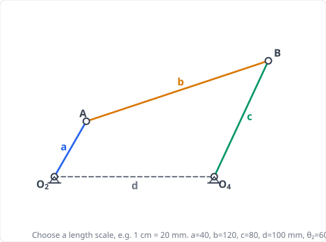
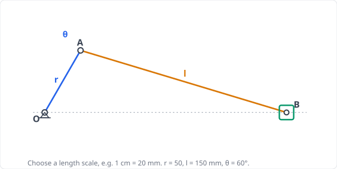
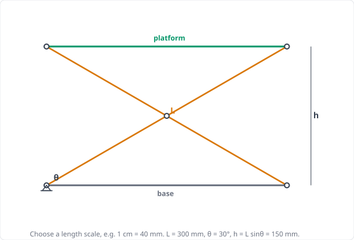
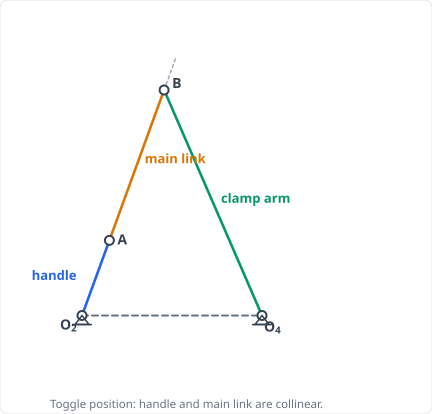
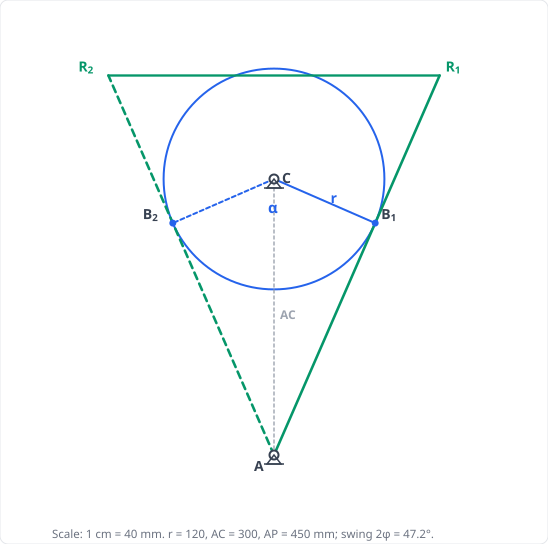

import PlanarMechanicsComments from '../../../../components/planar-mechanics/PlanarMechanicsComments.astro';
import TawkWidget from '../../../../components/TawkWidget.astro';
import UniversalContentContributors from '../../../../components/UniversalContentContributors.astro';
import InArticleAd from '../../../../components/InArticleAd.astro';
import Copyright from '../../../../components/Copyright.astro';
import BionicText from '../../../../components/BionicText.astro';
import TailwindWrapper from '../../../../components/TailwindWrapper.jsx';
import { Tabs, TabItem } from '@astrojs/starlight/components';
import { Card, CardGrid, Badge, Steps, LinkButton, FileTree } from '@astrojs/starlight/components';

<UniversalContentContributors 
  contributors={frontmatter.contributors}
/>


A windshield wiper that strikes the edge of the glass and a piston that touches a valve have the same cause: the link lengths were chosen before anyone calculated where the output goes. A mechanism with one degree of freedom has one input, but that fact does not say where the input puts the output. Position analysis does. For a given crank angle it finds the angle and the place of every other link, and the velocity, acceleration and force analyses are all built on its results. In this lesson you write the loop equation for each mechanism, solve it exactly, and check the answer in a simulator. #PositionAnalysis #VectorLoops #Freudenstein

## Learning Objectives

By the end of this lesson, you will be able to:

1. **Formulate** the vector loop equation for any closed planar linkage
2. **Solve** the four-bar position problem in closed form with the Freudenstein equation
3. **Classify** mechanisms with the Grashof condition and handle open and crossed assembly modes
4. **Locate** coupler-point paths and limit (dead-center) positions, verifying each against a simulator

## Real-World System Problem: Predicting Where the Output Goes

<InArticleAd />


A windshield wiper must sweep a set arc and stop before the edge of the glass. An engine piston must reach the top of its travel at a known crank angle. A scissor-lift platform must reach a target height. In each case the designer chooses the link lengths and must then predict, before any part is made, where the output is for every position of the input.

### The position problem

> **Engineering Question:** Given the input link angle, what are the angles and coordinates of every other link?

For an open chain such as a robot arm, the answer is direct: add the links one after another. In a closed chain (the four mechanisms of this course) the links form a loop, and the last link must end exactly where the first began. That condition is called **loop closure**, and it is what we solve.

### Why position analysis comes first

Velocity is the rate of change of position, and acceleration is the rate of change of velocity, so neither can be found before the positions. The positions also show whether the output reaches its target, whether links collide, and where the output stops and reverses.

## Methods of Kinematic Analysis

<InArticleAd />


Position, velocity and acceleration are each found by **two methods**, graphical and analytical, and then **confirmed in a simulator**. The methods answer the same question in different ways, so each checks the others. The lessons on [velocity](/education/planar-mechanics/velocity-analysis-instantaneous-centers/) and [acceleration](/education/planar-mechanics/acceleration-analysis-dynamic-forces/) use the same set on the same mechanisms.

<CardGrid>
  <Card title="Graphical (drawing-instrument) method" icon="pencil">
  Draw the mechanism to scale on paper and measure the answer. Position comes from arcs drawn with a **compass**. Velocity and acceleration come from **polygons**, closed figures made of arrows, drawn with a **set square** and measured with a **scale rule** and a **protractor**. The method always works, but it gives one instant at a time, and only to a few percent.
  </Card>
  <Card title="Analytical (vector-loop) method" icon="document">
  Write loop closure as equations, $\sum \vec{r}_i = 0$, and solve them. For the position of a four-bar the solution is the Freudenstein equation. For velocity and acceleration you differentiate the *same* loop. The result is exact, and it can be calculated at every angle of a full turn.
  </Card>
  <Card title="Simulator (confirm and lab)" icon="rocket">
  The simulators of this course solve the loop by computer and animate the whole cycle. Every worked example ends with the same answer read in the simulator. A simulator is only as good as the values you enter, so it confirms the two methods and does not replace them.
  </Card>
  <Card title="Instantaneous centers (worth knowing)" icon="puzzle">
  A check for velocity only. At each instant a moving link turns about one point, its instantaneous center. Find that point and a velocity ratio follows with no equations. No such point exists for acceleration, so the course uses it as a check and builds on the polygon and the loop.
  </Card>
</CardGrid>

### How the methods fit together

Use them in order: **draw, solve, simulate**. The drawing shows the mechanism and gives a quick answer at one instant. The equations make that answer exact and give the whole cycle. The simulator animates the motion and confirms both. When all three agree, you can trust the result. When they disagree, one of them contains a mistake, and you have found it early.

:::note[The draughtsman's drawing set]
The graphical method needs four instruments: a **scale rule** (to mark lengths at a chosen scale, for example 1 cm = 20 mm), a **compass** (to draw arcs and carry lengths), two **set squares** (to draw lines at right angles) and a **protractor** (to set and read angles). Choose a scale and write it on the drawing first, because every length you measure later depends on it.
:::

### How close is close enough?

You measure $50.2$ mm/s on a polygon and then calculate $50.84$ mm/s. Is that agreement or a mistake? You cannot say without a stated tolerance. These are the errors that drawing by hand brings.

| Source of error | Typical size | How to reduce it |
|---|---|---|
| Scale rule reading | $\pm 0.5$ mm on the page | choose a scale that fills the page |
| Protractor reading | $\pm 0.5\degree$ | construct perpendiculars with a set square, not a protractor |
| Compass slip | $\pm 0.5$ mm | sharp lead, re-check the opening against the rule |
| Line thickness | $\pm 0.3$ mm | 0.3 mm pencil, hard grade |
| Arcs that cross at a very small angle | no limit | draw again at a different instant |
| **Combined, carefully drawn** | **1 to 2 percent** | |
| **Combined, hurried** | **5 to 10 percent** | |

:::tip[The acceptance rule]
Agreement between drawing and calculation **within 2 percent** confirms both. Between **2 and 5 percent**, draw again before you doubt the algebra. **Beyond 5 percent**, one of them contains a real error: check the **directions** first, then the **scale**, then the arithmetic.

By this rule, $50.2$ against $50.84$ differs by $1.3\%$. That is a pass.
:::

The drawing also finds what algebra hides: a wrong sign still gives a believable number, but it gives a drawing that is plainly wrong.

## Fundamental Theory: The vector loop method

<InArticleAd />


### Links as vectors that close a loop

<Card title="Vector loop principle" icon="document">
Treat each link as a vector, an arrow from one joint to the next. Walk along the arrows around a closed loop and you return to the start, so the arrows add to zero:

$$\sum_{i} \vec{r}_i = 0$$

An arrow of length $r$ at angle $\theta$ reaches $r\cos\theta$ along x and $r\sin\theta$ along y. So one loop gives two ordinary equations, one for x and one for y.
</Card>

The method is the same for every linkage: label the links as vectors, write the loop sum, split it into x and y, mark which values are known, and solve. The four-bar gives two equations in two unknown angles. The slider-crank gives two equations in one unknown angle and one unknown distance.

### The four-bar loop in component form

We use the link names of the simulator: $a$ is the crank (the input link), $b$ the coupler (the link that joins the crank to the follower), $c$ the follower (the output link) and $d$ the ground (the fixed link). All four are lengths in mm. Put the origin at the crank pivot $O_2$ and the ground along the positive x-axis. Measure every angle counterclockwise from the x-axis.

Call the far end of the coupler $B$. There are two ways to walk from $O_2$ to $B$: along the crank $a$ and then the coupler $b$, or along the ground $d$ and then the follower $c$. Both must end at the same point.

<Card title="Four-bar vector loop" icon="document">

$$\vec{a} + \vec{b} - \vec{c} - \vec{d} = 0$$

**X-component:**

$$a\cos\theta_2 + b\cos\theta_3 - c\cos\theta_4 - d = 0$$

**Y-component:**

$$a\sin\theta_2 + b\sin\theta_3 - c\sin\theta_4 = 0$$

**Known:** the link lengths $a, b, c, d$ and the crank angle $\theta_2$.
**Unknown:** the coupler angle $\theta_3$ and the follower angle $\theta_4$.
</Card>

The unknown angles sit inside sines and cosines, so the two equations cannot be solved by simple rearrangement. Application 1 solves them exactly, with no trial and error.

## Application 1: Four-bar position by the Freudenstein equation

<InArticleAd />


This is the main worked example of the lesson.

<Card title="Simulator and hands-on lab" icon="rocket">
<div style={{ display: 'flex', justifyContent: 'center', width: '100%', margin: '0.25rem 0 1rem' }}>
  <LinkButton href="/product-development/four-bar-linkage-simulator/" target="_blank" variant="primary" icon="rocket" iconPlacement="start">Open the Four-Bar Linkage Simulator</LinkButton>
</div>

**Hands-on lab:** Continue in the [Four-Bar Linkage Experiments](/education/mechanism-design-simulation/four-bar-linkage-experiments/) lab. Experiment 5 (coupler-curve exploration) extends the position analysis below to the path traced by a coupler point.
</Card>

:::note[System Problem Statement]
- **Configuration:** Crank-rocker four-bar: the crank turns fully and the follower swings back and forth (the default geometry at [siwit.co/FBL](https://siwit.co/FBL))
- **Task:** Find the coupler and follower angles for a given crank angle, from a formula
- **Link lengths:** crank $a = 40$ mm, coupler $b = 120$ mm, follower $c = 80$ mm, ground $d = 100$ mm
- **Input:** crank angle $\theta_2 = 60^\circ$

**What we need to calculate:**
1. The constants of the Freudenstein equation
2. The follower angle $\theta_4$
3. The coupler angle $\theta_3$
4. The two **assembly modes**, open and crossed: the two ways in which the same four links can be joined

**Key Question:** Given only the four link lengths and the crank angle, how do we compute the exact output angle without trial and error?
:::

### Step 1: Draw the space diagram and measure

A space diagram is a scale drawing of the mechanism at one instant. The [graphical method](#methods-of-kinematic-analysis) finds the position from it with no equations, and the result checks the algebra that follows. The idea is this. The coupler has a fixed length $b$, so joint $B$ is on a circle of radius $b$ about $A$. The follower has a fixed length $c$, so $B$ is also on a circle of radius $c$ about $O_4$. Joint $B$ is where the two circles cross.

<details>
<summary>**Click to reveal the graphical position solution (arc-intersection)**</summary>

<Steps>

1. **Choose and note a scale.** Pick a length scale that fills the page, say **1 cm = 20 mm**, and write it on the drawing. Mark every length with the scale rule at this scale. ✅

2. **Ground and crank.** Draw the ground $O_2O_4 = d = 100$ mm horizontally. With a **protractor** set $\theta_2 = 60\degree$ at $O_2$ and mark the crank $O_2A = a = 40$ mm with the scale rule. Point $A$ is the crank pin. ✅

3. **Cross the coupler and follower arcs.** Open the **compass** to the coupler length $b = 120$ mm and draw an arc with its centre at $A$. Set it to the follower length $c = 80$ mm and draw an arc with its centre at $O_4$. The arcs cross at **two** points, the two assembly modes. Take the upper crossing (the *open* mode) as joint $B$. The lower crossing is the *crossed* mode. ✅

4. **Measure the unknowns.** Draw $AB$ (coupler) and $O_4B$ (follower), then read their angles from the horizontal with the **protractor**: $\theta_3 \approx 18\degree$ and $\theta_4 \approx 65\degree$. ✅

</Steps>

<div style={{ display: 'flex', justifyContent: 'center', width: '100%', margin: '1.25rem 0' }}>
  <TailwindWrapper>
	
  </TailwindWrapper>
</div>

</details>

The drawing gives each angle to about $\pm1\degree$. That is enough to find a large error and to tell the two assembly modes apart. The Freudenstein solution that follows gives $\theta_3 = 18.4\degree$ and $\theta_4 = 64.9\degree$.

### Step 2: Eliminate the coupler angle

The two loop equations hold two unknown angles. This step removes $\theta_3$, so that one equation with only $\theta_4$ remains.

<details>
<summary>**Click to reveal the elimination of $\theta_3$**</summary>

<Steps>

1. **Put the coupler terms alone on the left** of both component equations:

   $$b\cos\theta_3 = d + c\cos\theta_4 - a\cos\theta_2$$
   $$b\sin\theta_3 = c\sin\theta_4 - a\sin\theta_2$$ ✅

2. **Square both equations and add.** Because $\cos^2\theta_3 + \sin^2\theta_3 = 1$, the left sides add to $b^2$ and the coupler angle $\theta_3$ disappears:

   $$b^2 = a^2 + c^2 + d^2 + 2cd\cos\theta_4 - 2ad\cos\theta_2 - 2ac\cos(\theta_4 - \theta_2)$$ ✅

</Steps>

</details>

### Step 3: Form the Freudenstein equation

<details>
<summary>**Click to reveal the Freudenstein constants**</summary>

<Steps>

1. **Divide through by $2ac$** and group the constant terms. The result is the **Freudenstein equation**, which links the crank angle $\theta_2$ to the follower angle $\theta_4$ through three constants:

   $$K_1\cos\theta_4 - K_2\cos\theta_2 + K_3 = \cos(\theta_4 - \theta_2)$$ ✅

2. **Define the three constants** from the link lengths only. Each is a length divided by a length, so it has no unit:

   $$K_1 = \frac{d}{a}, \qquad K_2 = \frac{d}{c}, \qquad K_3 = \frac{a^2 - b^2 + c^2 + d^2}{2ac}$$ ✅

3. **Evaluate** for $a=40$, $b=120$, $c=80$, $d=100$ (all in mm):

   $$K_1 = \frac{100}{40} = 2.500, \quad K_2 = \frac{100}{80} = 1.250, \quad K_3 = \frac{1600 - 14400 + 6400 + 10000}{2(40)(80)} = \frac{3600}{6400} = 0.5625$$ ✅

</Steps>

</details>

### Step 4: Solve for the follower angle

<details>
<summary>**Click to reveal the closed-form solution for $\theta_4$**</summary>

<Steps>

1. **Expand** $\cos(\theta_4 - \theta_2)$ and write $t = \tan(\theta_4/2)$. With this substitution $\sin\theta_4$ and $\cos\theta_4$ become fractions in $t$, and the equation becomes an ordinary quadratic $A t^2 + B t + C = 0$ with:

   $$A = \cos\theta_2 - K_1 - K_2\cos\theta_2 + K_3$$
   $$B = -2\sin\theta_2$$
   $$C = K_1 - (K_2 + 1)\cos\theta_2 + K_3$$ ✅

2. **Evaluate** at $\theta_2 = 60^\circ$ ($\cos 60^\circ = 0.500$, $\sin 60^\circ = 0.866$):

   $$A = 0.500 - 2.500 - 1.250(0.500) + 0.5625 = -2.0625$$
   $$B = -2(0.866) = -1.732$$
   $$C = 2.500 - (2.250)(0.500) + 0.5625 = 1.9375$$ ✅

3. **Solve the quadratic.** The two roots give the two assembly modes:

   $$\theta_4 = 2\arctan\!\left(\frac{-B \mp \sqrt{B^2 - 4AC}}{2A}\right)$$

   $$B^2 - 4AC = 3.000 - 4(-2.0625)(1.9375) = 18.98, \qquad \sqrt{18.98} = 4.357$$ ✅

4. **Open mode** (minus sign):

   $$\theta_4 = 2\arctan\!\left(\frac{1.732 - 4.357}{-4.125}\right) = 2\arctan(0.6364) = 64.9^\circ$$ ✅

   The plus sign gives the crossed mode.

</Steps>

</details>

### Step 5: Solve for the coupler angle

<details>
<summary>**Click to reveal the closed-form solution for $\theta_3$**</summary>

<Steps>

1. **Eliminate $\theta_4$ this time** (square and add the follower terms). This gives a second equation of the same form, now in $\theta_3$, with two new constants:

   $$K_4 = \frac{d}{b}, \qquad K_5 = \frac{c^2 - d^2 - a^2 - b^2}{2ab}$$

   $$K_4 = \frac{100}{120} = 0.8333, \qquad K_5 = \frac{6400 - 10000 - 1600 - 14400}{2(40)(120)} = \frac{-19600}{9600} = -2.0417$$ ✅

   :::caution[Two sets of constants]
   $K_2$ and $K_3$ belong only to the solution for the **follower** angle $\theta_4$. $K_4$ and $K_5$ belong only to the solution for the **coupler** angle $\theta_3$. $K_1 = d/a$ is used in **both**. The names look alike, so check that you never put a constant of one set into the quadratic of the other.
   :::

2. **Quadratic coefficients** at $\theta_2 = 60^\circ$:

   $$D = \cos\theta_2 - K_1 + K_4\cos\theta_2 + K_5 = -3.625$$
   $$E = -2\sin\theta_2 = -1.732$$
   $$F = K_1 + (K_4 - 1)\cos\theta_2 + K_5 = 0.375$$ ✅

3. **Solve** (open mode, minus sign):

   $$\theta_3 = 2\arctan\!\left(\frac{-E - \sqrt{E^2 - 4DF}}{2D}\right) = 2\arctan(0.1617) = 18.4^\circ$$ ✅

   :::caution[The mode sign must match in both solutions]
   The minus sign here is the **same** choice that gave $\theta_4 = 64.9\degree$ in Step 4. A real linkage is assembled in one mode, so take both angles from that mode: minus with minus for open, plus with plus for crossed.

   If you mix them, the two angles describe a linkage that does not exist, and the arithmetic gives no warning. Only the check in the next step finds it.
   :::

4. **Put the angles back into the loop equations.** Do this at the end of every position solution ($\theta_2=60^\circ$, $\theta_3=18.4^\circ$, $\theta_4=64.9^\circ$, lengths in mm):

   $$40\cos 60^\circ + 120\cos 18.4^\circ - 80\cos 64.9^\circ - 100 = 20 + 113.9 - 33.9 - 100 \approx 0$$
   $$40\sin 60^\circ + 120\sin 18.4^\circ - 80\sin 64.9^\circ = 34.6 + 37.8 - 72.5 \approx 0$$ ✅

   Each sum should be a fraction of a millimetre, against link lengths of tens of millimetres. If one is a few millimetres or more, look for these three causes: two different assembly modes, an angle in degrees where radians were needed, or a wrong sign in a quadratic coefficient. **The loop closes or it does not**, and the check takes fifteen seconds. ✅

</Steps>

</details>

### Step 6: Sweep the crank and verify in the simulator

<details>
<summary>**Click to reveal the full-rotation table and verification**</summary>

<Steps>

1. **Repeat the solution** for crank angles across a full turn (open mode). A short Python script does the work: ✅

   ```python
   import numpy as np

   def four_bar_position(a, b, c, d, theta2_deg, mode="open"):
       """Closed-form four-bar position. a=crank, b=coupler, c=follower, d=ground."""
       t2 = np.radians(theta2_deg)
       K1, K2 = d/a, d/c
       K3 = (a**2 - b**2 + c**2 + d**2) / (2*a*c)
       A = np.cos(t2) - K1 - K2*np.cos(t2) + K3
       B = -2*np.sin(t2)
       C = K1 - (K2 + 1)*np.cos(t2) + K3
       s = -1 if mode == "open" else 1
       t4 = 2*np.arctan2(-B + s*np.sqrt(B**2 - 4*A*C), 2*A)

       K4 = d/b
       K5 = (c**2 - d**2 - a**2 - b**2) / (2*a*b)
       D = np.cos(t2) - K1 + K4*np.cos(t2) + K5
       E = -2*np.sin(t2)
       F = K1 + (K4 - 1)*np.cos(t2) + K5
       t3 = 2*np.arctan2(-E + s*np.sqrt(E**2 - 4*D*F), 2*D)
       return np.degrees(t3) % 360, np.degrees(t4) % 360

   for th2 in range(0, 121, 30):
       th3, th4 = four_bar_position(40, 120, 80, 100, th2)
       print(f"theta2={th2:3d}  theta3={th3:6.1f}  theta4={th4:6.1f}")
   ```

2. **Results** (open mode): ✅

   | Crank $\theta_2$ | Coupler $\theta_3$ | Follower $\theta_4$ |
   |:---:|:---:|:---:|
   | $0^\circ$ | $36.3^\circ$ | $62.7^\circ$ |
   | $30^\circ$ | $22.4^\circ$ | $55.3^\circ$ |
   | $60^\circ$ | $18.4^\circ$ | $64.9^\circ$ |
   | $90^\circ$ | $18.9^\circ$ | $80.3^\circ$ |
   | $120^\circ$ | $22.0^\circ$ | $96.3^\circ$ |

3. **Verify in the simulator.** Set $a=40$, $b=120$, $c=80$, $d=100$, choose the **Open** assembly, and drive the crank to each angle. The values of $\theta_3$ and $\theta_4$ that the simulator reports agree with the table. ✅

</Steps>

</details>

:::note[Engineering Insight]
The Freudenstein equation turns the four-bar position problem into three constants and one quadratic, with no trial and error. Mechanism software, and our simulator, use it for that reason.

The two roots of the quadratic are the **open** and **crossed** assembly modes. A real linkage stays in the mode in which it was assembled. The [velocity analysis](/education/planar-mechanics/velocity-analysis-instantaneous-centers/) differentiates the same two loop equations to find velocities.
:::

## Theory: Grashof classification

<InArticleAd />


Can the crank of a four-bar turn a full circle, or will it stop part of the way? If a motor is to drive it, you must know before you build. The **Grashof condition** answers from the link lengths alone, with no position solved.

<Card title="The Grashof condition" icon="document">
In words: add the shortest link to the longest. If that sum is not more than the sum of the other two, at least one link can turn fully.

Let $s$ be the shortest link, $l$ the longest, and $p, q$ the other two (all in mm). The linkage is **Grashof** when:

$$s + l \le p + q$$

For our four-bar, $s = 40$ mm (crank), $l = 120$ mm (coupler), and $p + q = 80 + 100 = 180$ mm. Since $40 + 120 = 160 \le 180$, it is Grashof. The shortest link is the crank, so it is a **crank-rocker**: the crank turns fully and the follower rocks.
</Card>

<Tabs>
  <TabItem label="Grashof (s + l < p + q)">

  At least one link makes a full turn. Which one depends on where the shortest link is:

  - **Shortest link is the crank or follower:** crank-rocker (the shortest link turns fully, the opposite one rocks)
  - **Shortest link is the ground:** double-crank (crank and follower both turn fully)
  - **Shortest link is the coupler:** double-rocker (crank and follower both rock, the coupler turns fully)

  </TabItem>
  <TabItem label="Non-Grashof (s + l > p + q)">

  No link can make a full turn. The mechanism is a **triple-rocker**: every moving link only swings. Use it when the motion must stay within limits.

  </TabItem>
  <TabItem label="Change-point (s + l = p + q)">

  All four links can lie on one straight line. The **parallelogram linkage** is the usual example: it keeps the coupler parallel to the ground, but at the position where the links are in line (the change point) it can pass into the crossed mode. A design must prevent that.

  </TabItem>
</Tabs>

:::tip[Verify in the simulator]
Load the presets of the four-bar simulator ([siwit.co/FBL](https://siwit.co/FBL)) in turn: **Crank-Rocker**, **Double-Crank**, **Double-Rocker**, **Triple-Rocker** and **Parallelogram**. For each one, drive the crank and look at which links turn fully and which only rock. Then check the link lengths against the case above.
:::

## Application 2: Slider-crank position

<InArticleAd />


The slider-crank loop has one unknown angle (the connecting rod) and one unknown distance (the slider position). Its solution is one formula, with no quadratic.

<Card title="Simulator and hands-on lab" icon="rocket">
<div style={{ display: 'flex', justifyContent: 'center', width: '100%', margin: '0.25rem 0 1rem' }}>
  <LinkButton href="/product-development/crank-slider-mechanism-simulator/" target="_blank" variant="primary" icon="rocket" iconPlacement="start">Open the Crank-Slider Simulator</LinkButton>
</div>

**Hands-on lab:** Continue in the [Crank-Slider Experiments](/education/mechanism-design-simulation/crank-slider-experiments/) lab. Experiment 1 (baseline kinematic profile) plots the slider displacement you derive below across a full crank rotation.
</Card>

:::note[System Problem Statement]
- **Configuration:** In-line slider-crank (engine or compressor)
- **Task:** Find the slider position and connecting-rod angle for a given crank angle
- **Geometry:** crank $r = 50$ mm, connecting rod $l = 150$ mm, offset $e = 0$ (the offset is the distance from the crank pivot to the line on which the slider moves)
- **Input:** crank angle $\theta = 60^\circ$
:::

### Step 1: Draw the space diagram and measure

The [graphical method](#methods-of-kinematic-analysis) finds the piston with the drawing set alone. The crank pin $A$ is on a circle of radius $r$. The piston $B$ is on the centre-line, exactly one rod length $l$ from $A$. So an arc of radius $l$ about $A$ cuts the centre-line at the piston.

<details>
<summary>**Click to reveal the graphical position solution (rod-swing)**</summary>

<Steps>

1. **Choose and note a scale.** Pick a scale that fills the page, say **1 cm = 20 mm**, and mark it on the drawing. ✅

2. **Centre-line and crank.** Draw the slider centre-line through $O$. With the **protractor** set $\theta = 60\degree$ at $O$ and mark the crank $OA = r = 50$ mm with the scale rule. $A$ is the crank pin. ✅

3. **Swing the rod.** Open the **compass** to the rod length $l = 150$ mm, put its point on $A$, and cut the centre-line at $B$, the piston. ✅

4. **Measure.** With the scale rule the piston distance is $OB \approx 169$ mm. With the protractor the rod angle from the centre-line is $\phi \approx 17\degree$. ✅

</Steps>

<div style={{ display: 'flex', justifyContent: 'center', width: '100%', margin: '1.25rem 0' }}>
  <TailwindWrapper>
	
  </TailwindWrapper>
</div>

</details>

### Step 2: Write and solve the loop

<details>
<summary>**Click to reveal the slider-crank position solution**</summary>

<Steps>

1. **Loop in components.** The slider is on the x-axis at distance $s$ (mm) from the crank pivot. The crank is at angle $\theta$ above the axis and the rod slopes down at angle $\phi$. Along x, the crank and the rod together reach the slider. Along y, the rise of the crank less the fall of the rod is the offset $e$:

   $$r\cos\theta + l\cos\phi = s \qquad\text{(x)}$$
   $$r\sin\theta - l\sin\phi = e \qquad\text{(y)}$$ ✅

2. **Solve the y-equation for the rod angle** $\phi$:

   $$\sin\phi = \frac{r\sin\theta - e}{l} \quad\Rightarrow\quad \phi = \arcsin\!\left(\frac{r\sin\theta - e}{l}\right)$$ ✅

3. **Substitute into the x-equation** for the slider position, with $\cos\phi = \sqrt{1 - \sin^2\phi}$ to remove $\phi$:

   $$s = r\cos\theta + \sqrt{l^2 - (r\sin\theta - e)^2}$$ ✅

</Steps>

</details>

### Step 3: Evaluate and verify

<details>
<summary>**Click to reveal the numbers and simulator check**</summary>

<Steps>

1. **Rod angle** at $\theta = 60^\circ$, $e = 0$:

   $$\phi = \arcsin\!\left(\frac{50\sin 60^\circ}{150}\right) = \arcsin(0.2887) = 16.8^\circ$$ ✅

2. **Slider position:**

   $$s = 50\cos 60^\circ + \sqrt{150^2 - (50\sin 60^\circ)^2} = 25 + \sqrt{22500 - 1875} = 25 + 143.6 = 168.6 \text{ mm}$$ ✅

3. **Verify in the simulator.** Set $r=50$, $l=150$, $e=0$, drive the crank to $60^\circ$, and read the slider position and rod angle. They agree with $168.6$ mm and $16.8^\circ$. ✅

4. **Dead centers.** The slider is at an end of its travel when the crank and the rod lie on one straight line. These two positions are the dead centers, the **limit positions** of the slider. At $\theta = 0^\circ$, $s_\text{max} = r + l = 200$ mm (top-dead-center). At $\theta = 180^\circ$, $s_\text{min} = l - r = 100$ mm (bottom-dead-center). The stroke, the distance between them, is $2r = 100$ mm. ✅

</Steps>

</details>

:::note[Engineering Insight]
An offset $e$ that is not zero makes the forward and return strokes unequal. This is the quick-return effect, which the [velocity analysis](/education/planar-mechanics/velocity-analysis-instantaneous-centers/) measures.
:::

## Application 3: Scissor-lift position

<InArticleAd />


Not every position problem needs a loop equation. For the scissor lift, one right-angled triangle gives the answer.

<Card title="Simulator and hands-on lab" icon="rocket">
<div style={{ display: 'flex', justifyContent: 'center', width: '100%', margin: '0.25rem 0 1rem' }}>
  <LinkButton href="/product-development/scissor-lift-mechanism-simulator/" target="_blank" variant="primary" icon="rocket" iconPlacement="start">Open the Scissor Lift Simulator</LinkButton>
</div>

**Hands-on lab:** Continue in the [Scissor Lift Experiments](/education/mechanism-design-simulation/scissor-lift-experiments/) lab. Experiment 1 (baseline height and force profile) plots the platform height equation derived below.
</Card>

:::note[System Problem Statement]
- **Configuration:** Single-stage symmetric scissor lift
- **Task:** Find the platform height and the base spread for a given scissor angle
- **Geometry:** arm length $L = 300$ mm, stages $n = 1$ (a stage is one pair of crossed arms)
- **Input:** scissor angle $\theta = 30^\circ$, the angle between each arm and the base
:::

### Step 1: Draw the space diagram and measure

The [graphical method](#methods-of-kinematic-analysis) measures the platform height on a scale drawing of one scissor stage. The two arms are pinned to each other at their middles, so the platform rises as the arms swing up from the horizontal.

<details>
<summary>**Click to reveal the graphical position solution**</summary>

<Steps>

1. **Choose and note a scale.** A scissor arm is long, so pick a scale such as **1 cm = 40 mm** and mark it on the drawing. ✅

2. **Base and arms.** Draw the base line. With the **protractor** set $\theta = 30\degree$ and mark one arm of length $L = 300$ mm from the fixed bottom pin with the scale rule. Draw the crossing arm from the sliding bottom pin at the same angle. ✅

3. **Platform.** Join the two upper arm ends with the platform line, parallel to the base. ✅

4. **Measure.** With the scale rule the vertical gap between the base and the platform is $h \approx 150$ mm. ✅

</Steps>

<div style={{ display: 'flex', justifyContent: 'center', width: '100%', margin: '1.25rem 0' }}>
  <TailwindWrapper>
	
  </TailwindWrapper>
</div>

</details>

### Step 2: Height and spread from geometry

<details>
<summary>**Click to reveal the scissor-lift position relations**</summary>

<Steps>

1. **Each arm of length $L$** makes the angle $\theta$ with the base, so its top end is $L\sin\theta$ above its bottom end. That is the height of one stage. With $n$ stages, one on top of another, the platform height $h$ (mm) is:

   $$h = n\,L\sin\theta$$ ✅

2. **The spread $S$** (mm), the horizontal distance between the two ends of an arm, is:

   $$S = L\cos\theta$$ ✅

3. **Evaluate** at $L = 300$ mm, $n = 1$, $\theta = 30^\circ$:

   $$h = 1 \times 300 \times \sin 30^\circ = 150 \text{ mm}, \qquad S = 300\cos 30^\circ = 259.8 \text{ mm}$$ ✅

</Steps>

</details>

### Step 3: Verify and read the range

<details>
<summary>**Click to reveal the simulator check and limit positions**</summary>

<Steps>

1. **Verify in the simulator.** Set $L = 300$, one stage, and drive the angle to $30^\circ$. The reported platform height is $150$ mm. ✅

2. **Limit positions.** The height is greatest as $\theta \to 90^\circ$ (arms vertical, $h \to nL$) and least as $\theta \to 0^\circ$ (arms flat, $h \to 0$). Real lifts work in a smaller range, for example $10^\circ$ to $80^\circ$, because near the flat position the actuator force grows without limit. The [force analysis](/education/planar-mechanics/force-analysis-mechanism-synthesis/) derives this. ✅

3. **More stages.** Set $n = 2$ or $3$ in the simulator. The height is multiplied by $n$ for the same arm length, as $h = nL\sin\theta$ says. ✅

</Steps>

</details>

:::note[Engineering Insight]
For the scissor lift the closure relation is one line of trigonometry, but it does the same work as the loop equations of the four-bar. The [velocity analysis](/education/planar-mechanics/velocity-analysis-instantaneous-centers/) differentiates it to find the platform velocity, and the [acceleration analysis](/education/planar-mechanics/acceleration-analysis-dynamic-forces/) differentiates it again.
:::

## Application 4: Toggle-clamp limit position

<InArticleAd />


The toggle clamp is a four-bar, so its position at any handle angle comes from the Freudenstein method of Application 1. The question here is different: where is the **limit position**, also called the toggle position, at which the clamp locks itself?

<Card title="Simulator and hands-on lab" icon="rocket">
<div style={{ display: 'flex', justifyContent: 'center', width: '100%', margin: '0.25rem 0 1rem' }}>
  <LinkButton href="/product-development/toggle-clamp-mechanism-simulator/" target="_blank" variant="primary" icon="rocket" iconPlacement="start">Open the Toggle Clamp Simulator</LinkButton>
</div>

**Hands-on lab:** Continue in the [Toggle Clamp Experiments](/education/mechanism-design-simulation/toggle-clamp-experiments/) lab. Experiment 1 (top-dead-centre and self-locking) locates the limit position discussed here.
</Card>

:::note[System Problem Statement]
- **Configuration:** Over-center toggle clamp (a four-bar)
- **Task:** Find top-dead-center (TDC), the position where the handle link and the main link are collinear, which means they lie on one straight line
- **Concept:** at the limit position the output stops and reverses. There the clamp gives a very large force and locks itself.
:::

### Step 1: Draw the space diagram

The [graphical method](#methods-of-kinematic-analysis) finds the toggle position by drawing: swing the handle until the handle and the main link form one straight line.

<details>
<summary>**Click to reveal the toggle-position construction**</summary>

<Steps>

1. **Choose a scale and draw the skeleton.** Mark a scale (say **1 cm = 20 mm**) and draw the four links to scale with the scale rule and compass: ground $O_2O_4$, handle $O_2A$, main link $AB$, clamp arm $O_4B$. ✅

2. **Find top-dead-centre.** Swing the handle $O_2A$ until $O_2$, $A$ and $B$ are on one straight line. Check it with the straight edge of a set square. That is the toggle position. ✅

3. **Measure.** Read the handle angle at the toggle position with the protractor. The clamp is designed around this angle. ✅

</Steps>

<div style={{ display: 'flex', justifyContent: 'center', width: '100%', margin: '1.25rem 0' }}>
  <TailwindWrapper>
	
  </TailwindWrapper>
</div>

</details>

### Step 2: The collinear (toggle) condition

<details>
<summary>**Click to reveal the limit-position geometry**</summary>

<Steps>

1. **A four-bar is at a limit position** when two of its links lie on one straight line. For the toggle clamp, TDC is the handle angle at which the **handle link and the main link are collinear**. ✅

2. **Why this is a position-analysis result.** It comes from the geometry of the loop alone, with no forces: find the handle angle at which the two link vectors are parallel. The clamp is set to rest a few degrees past this angle. That small angle is the "lock margin". ✅

3. **Why it matters.** At the collinear position a small motion of the handle gives almost no motion of the pad. The [mobility analysis](/education/planar-mechanics/kinematic-joints-constraint-analysis/) called this a singular configuration. The [velocity analysis](/education/planar-mechanics/velocity-analysis-instantaneous-centers/) gives the ratio of the two speeds, and the [force analysis](/education/planar-mechanics/force-analysis-mechanism-synthesis/) gives the clamping force. ✅

</Steps>

</details>

### Step 3: Locate it in the simulator

<details>
<summary>**Click to reveal the simulator check**</summary>

<Steps>

1. **Open the simulator** and drive the handle slowly. The information panel reports the TDC handle angle, where the handle and the main link are in line. ✅

2. **Watch the pad.** Move the handle toward TDC in equal small steps. The pad moves less at each step, which shows that the output is close to a limit position. Past TDC by the lock margin, the clamp holds itself closed. ✅

</Steps>

</details>

:::note[Engineering Insight]
A designer finds the limit positions on paper first, so that the self-locking point is where it is wanted.
:::

## Theory: Coupler points and coupler curves

<InArticleAd />


Fix a point to the coupler, away from the line between its two joints. As the crank turns, the point follows a closed path called a **coupler curve**. With the right choice of point, one four-bar gives a path with a nearly straight part or a figure of eight. Walking machines and mixers use such paths.

<Card title="Coupler-point coordinates" icon="document">
Joint $A$ (crank-coupler) is at $x_A = a\cos\theta_2$, $y_A = a\sin\theta_2$. A coupler point $P$ is at a distance $r_P$ (mm) from $A$, on a line that makes a fixed angle $\gamma$ with the coupler line $AB$. So start at $A$ and move $r_P$ in the direction $\theta_3 + \gamma$:

$$x_P = x_A + r_P\cos(\theta_3 + \gamma)$$
$$y_P = y_A + r_P\sin(\theta_3 + \gamma)$$

The position analysis gives $\theta_3$ for each crank angle $\theta_2$, so a full turn of the crank gives the whole curve.
</Card>

:::tip[Verify in the simulator]
The four-bar simulator ([siwit.co/FBL](https://siwit.co/FBL)) plots the path of the coupler point. Change the link lengths and watch the curve change shape. Then calculate a few of its points with the two equations and your values of $\theta_3$. Experiment 5 in the four-bar lab does this.
:::

## Application 5: Quick-return position (a slider-crank inversion)

<InArticleAd />


A metal shaper cuts a flat surface with a single-point tool on a ram that moves back and forth. It cuts on the forward stroke only. So the ram should move slowly while it cuts and return quickly.

The drive that does this is the **crank-and-slotted-lever quick-return mechanism**. It has the same four links as the engine of Application 2, with a different link held fixed. A mechanism made in this way is called an **inversion**. The dimensions alone decide how much faster the return is than the cut.

<Card title="Hands-on lab" icon="rocket">
<div style={{ display: 'flex', justifyContent: 'center', width: '100%', margin: '0.25rem 0 1rem' }}>
  <LinkButton href="/product-development/crank-slider-mechanism-simulator/" target="_blank" variant="primary" icon="rocket" iconPlacement="start">Open the Crank-Slider Simulator</LinkButton>
</div>

**Hands-on lab:** This inversion has no simulator of its own. The quick-return *principle* is Experiment 2 of the [Crank-Slider Experiments](/education/mechanism-design-simulation/crank-slider-experiments/) lab: add an offset and the two strokes become unequal.
</Card>

:::note[System Problem Statement]
- **Configuration:** Crank-and-slotted-lever quick-return (the ram drive of a metal shaper). A long lever with a slot swings about a fixed pivot $A$, the fulcrum. A crank turns about a fixed centre $C$ above $A$. A block on the crank pin slides in the slot, so the turning crank swings the lever. The top of the lever, point $P$, drives the ram.
- **Task:** Find the swing of the lever, the crank angles for the cutting and return strokes, the time ratio, and the ram stroke
- **Geometry:** crank $r = 120$ mm, distance between the fixed centres $AC = 300$ mm, lever length to the driving point $AP = 450$ mm
- **Key feature:** the lever is at an end of its swing when the crank is perpendicular to it

**Key Question:** how much faster is the return stroke than the cutting stroke, and how long is the ram stroke?
:::

### Step 1: Draw the space diagram and measure

The block is always on the crank circle, and the lever always passes through the block. So the lever is furthest to one side when it only touches the circle, that is, when it is a tangent from the fulcrum $A$. A tangent is at right angles to the radius at the point of touch, so at each end of the swing the crank $CB$ is perpendicular to the lever $AB$.

<details>
<summary>**Click to reveal the graphical position solution (tangent extremes)**</summary>

<Steps>

1. **Choose and note a scale.** Pick a scale that fills the page, say **1 cm = 40 mm**, and mark it on the drawing. ✅

2. **Fixed centres.** Mark the fulcrum $A$, and directly above it the crank centre $C$ with $AC = 300$ mm to scale. The lever swings equally to each side of the line $AC$. ✅

3. **Crank circle.** Open the **compass** to $r = 120$ mm and draw the crank circle about $C$. ✅

4. **Extreme lever positions.** Draw the two tangents from $A$ to this circle. They touch it at $B_1$ and $B_2$. Extend each to the driving point at $AP = 450$ mm to get the two end positions $R_1$ and $R_2$. These two lines are the lever at the ends of its swing. ✅

5. **Measure.** With the **protractor**, the half-swing is $\varphi \approx 23.6\degree$ on each side of $AC$ (total swing about $47\degree$). The crank angle between $CB_1$ and $CB_2$ is about $133\degree$ on the side toward $A$ and about $227\degree$ on the far side. With the scale rule, the ram travel is $R_1R_2 \approx 360$ mm. ✅

</Steps>

<div style={{ display: 'flex', justifyContent: 'center', width: '100%', margin: '1.25rem 0' }}>
  <TailwindWrapper>
	
  </TailwindWrapper>
</div>

</details>

### Step 2: Solve the geometry

<details>
<summary>**Click to reveal the closed-form quick-return solution**</summary>

<Steps>

1. **Half-swing of the lever.** At each end of the swing the crank is perpendicular to the lever, so triangle $ACB$ has a right angle at the tangent point $B$. The half-swing $\varphi$ is the angle at $A$:

   $$\sin\varphi = \frac{r}{AC} = \frac{120 \text{ mm}}{300 \text{ mm}} = 0.4 \quad\Rightarrow\quad \varphi = 23.58\degree$$

   The lever swings $2\varphi = 47.16\degree$ in total. ✅

2. **Crank angles for the two strokes.** In the same triangle the angle at $C$ is $90\degree - \varphi$. So the crank turns through $2(90\degree - \varphi)$ on the side toward $A$ while the ram makes its **return**, and through the rest of the circle while it cuts:

   $$\alpha_\text{return} = 180\degree - 2\varphi = 132.84\degree, \qquad \alpha_\text{cutting} = 360\degree - \alpha_\text{return} = 227.16\degree$$ ✅

3. **Time ratio.** The crank turns at constant speed, so the times of the two strokes are in the ratio of these angles:

   $$\frac{\text{cutting time}}{\text{return time}} = \frac{\alpha_\text{cutting}}{\alpha_\text{return}} = \frac{227.16}{132.84} = 1.71$$

   The cut takes about $1.7$ times as long as the return. ✅

4. **Ram stroke.** The driving point $P$ swings through $\pm\varphi$ about $A$ at radius $AP$. The stroke is the straight distance between its two end positions:

   $$\text{stroke} = 2\,AP\sin\varphi = 2 \times 450 \text{ mm} \times 0.4 = 360 \text{ mm}$$ ✅

</Steps>

</details>

### Step 3: Confirm the principle

<details>
<summary>**Click to reveal the drawing-versus-calculation check and the simulator principle**</summary>

<Steps>

1. **Drawing against calculation.** The drawing gave about $133\degree$ and $227\degree$ for the crank angles and $360$ mm for the stroke. The trigonometry gives $132.84\degree$, $227.16\degree$ and $360$ mm. They agree within the drawing tolerance. ✅

2. **The principle in the simulator.** Open the crank-slider simulator and choose the **Quick-Return (offset)** preset (crank $60$, rod $120$, offset $50$ mm). The forward and return strokes take unequal times, with a time ratio of about $1.6$. The slotted lever of the shaper gives a larger ratio, because its fulcrum is close to the crank. ✅

</Steps>

</details>

:::note[Engineering Insight]
Metal is removed only on the cutting stroke, so the return should take as little time as possible. A centre distance $AC$ closer to the crank radius $r$ gives a larger half-swing $\varphi$, and so a longer stroke and a larger time ratio. The block slides along a lever that is turning, and that brings a new term into the acceleration, the [Coriolis](/education/planar-mechanics/acceleration-analysis-dynamic-forces/) term.
:::

## Design Guidelines for Position Analysis

<InArticleAd />


- **Classify before you solve.** The Grashof test tells you whether the input can turn fully, before any equation is solved.
- **Use one assembly mode.** Take every angle from the mode of the real linkage, and check that the mechanism never passes through a change point.
- **Solve the whole range.** Links collide and bind at the ends of the travel more often than in the middle.
- **Find the limit positions.** They set the ends of the stroke and the self-locking points.

## Summary and next steps

<InArticleAd />


### Key concepts

1. **Vector loop method:** the link vectors of a closed loop add to zero, which gives two equations for each loop.
2. **Freudenstein equation:** the four-bar position problem becomes three constants and one quadratic. Its two roots are the open and crossed modes.
3. **Slider-crank and scissor lift:** each has one formula for its position, and the formula also gives the dead centers and the height limits.
4. **Grashof classification:** the link lengths tell whether the mechanism is a crank-rocker, double-crank, double-rocker, triple-rocker or change-point linkage.
5. **Coupler curves and limit positions:** position analysis gives the path of a coupler point and the positions where the output reverses.

### Position solutions at a glance

| Mechanism | What you solve for | Closure relation | Simulator |
|-----------|--------------------|------------------|-----------|
| Four-bar | $\theta_3$, $\theta_4$ | Freudenstein quadratic | [siwit.co/FBL](https://siwit.co/FBL) |
| Slider-crank | $s$, $\phi$ | $s = r\cos\theta + \sqrt{l^2 - (r\sin\theta - e)^2}$ | [siwit.co/CSM](https://siwit.co/CSM) |
| Scissor lift | $h$, $S$ | $h = nL\sin\theta$ | [siwit.co/SLM](https://siwit.co/SLM) |
| Toggle clamp | handle angle, TDC | Freudenstein, collinear limit | [siwit.co/TCM](https://siwit.co/TCM) |
| Quick-return (shaper) | time ratio, stroke | $\sin\varphi = r/AC$, stroke $= 2\,AP\sin\varphi$ | drawing $+$ calc |

Next, [Velocity Analysis and Instantaneous Centers](/education/planar-mechanics/velocity-analysis-instantaneous-centers/) differentiates the loop equations solved here. The four-bar position equations become equations for the angular velocities $\omega_3$ and $\omega_4$, and the slider-crank position gives the piston velocity.


<InArticleAd />
<PlanarMechanicsComments />
<TawkWidget />
<Copyright />
