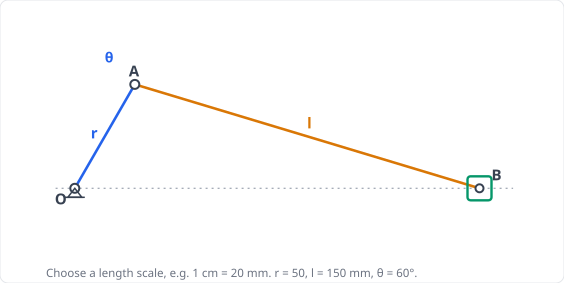
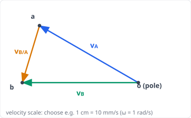
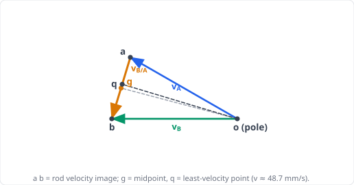
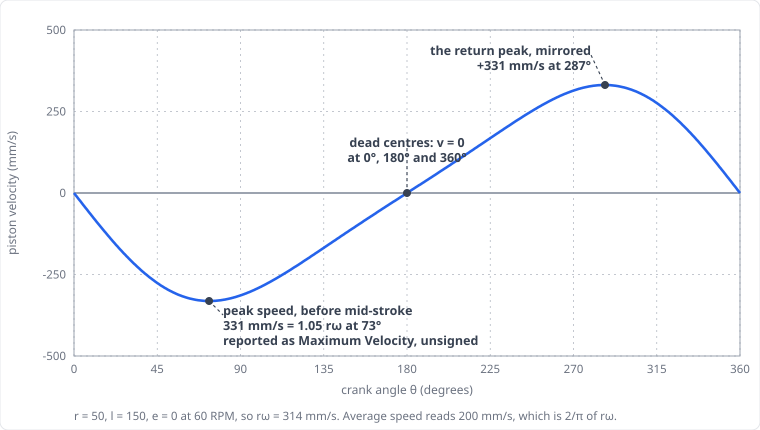
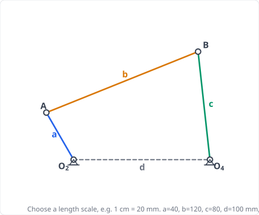
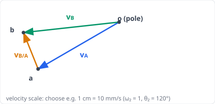
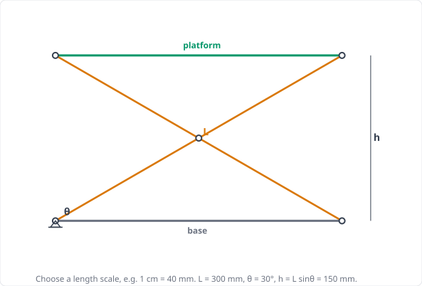
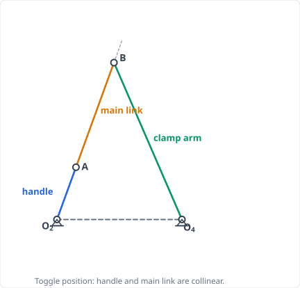
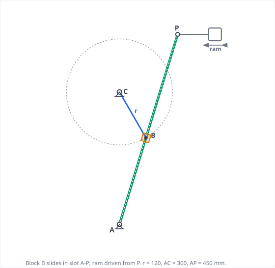
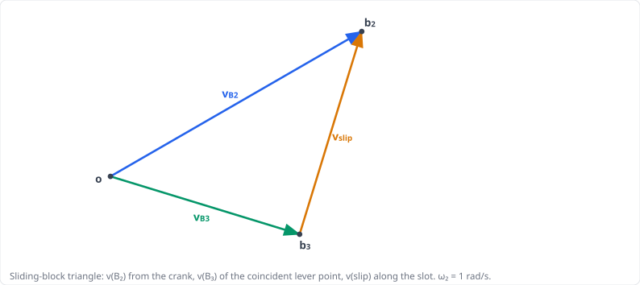

import PlanarMechanicsComments from '../../../../components/planar-mechanics/PlanarMechanicsComments.astro';
import TawkWidget from '../../../../components/TawkWidget.astro';
import UniversalContentContributors from '../../../../components/UniversalContentContributors.astro';
import InArticleAd from '../../../../components/InArticleAd.astro';
import Copyright from '../../../../components/Copyright.astro';
import BionicText from '../../../../components/BionicText.astro';
import TailwindWrapper from '../../../../components/TailwindWrapper.jsx';
import { Tabs, TabItem } from '@astrojs/starlight/components';
import { Card, CardGrid, Badge, Steps, LinkButton, FileTree } from '@astrojs/starlight/components';

<UniversalContentContributors 
  contributors={frontmatter.contributors}
/>


An engine can run smoothly and still wear one bearing early, because the speed of its piston is not steady. It rises to a sharp peak in every stroke, and the peak is not where most people expect it. Position analysis found where every link is for a given input angle. Velocity analysis finds how fast each link moves at that instant. In this lesson you first meet the idea that a moving link turns, for an instant, about one point. Then you draw the velocity polygon, confirm it by differentiating the loop equations, and read the velocity ratio, which gives the mechanical advantage. #VelocityAnalysis #VelocityPolygon #MechanicalAdvantage

## Learning Objectives

By the end of this lesson, you will be able to:

1. **Construct** the velocity polygon with the drawing set and measure the link velocities from it
2. **Differentiate** the vector loop to obtain the velocity equations, and solve for piston and angular velocities in closed form
3. **Read** the velocity ratio as mechanical advantage and verify every result in a simulator
4. **Recognise** the instantaneous center as a velocity shortcut, and know why the course builds on the polygon instead

## Real-World System Problem: Piston Velocity in Engines and Compressors

<InArticleAd />


The engine of a car, the compressor of an air conditioner and many pumps are slider-cranks. Each changes steady rotation into the back-and-forth motion of a piston. The piston starts each stroke at rest, rises to a peak speed, and comes to rest again. Where that peak is, and how large, decides the bearing loads, the oil that the bearings need, and the vibration of the machine. In a pump it also sets the flow.

### The velocity problem

> **Engineering Question:** Given the input link's angular velocity, how fast is every other point and link moving at this instant?

## Fundamental Theory: Velocity by differentiating the loop

<InArticleAd />


### The instantaneous center: one point that the whole link turns about

Watch a wheel roll along the ground without slipping. The point of the wheel that touches the ground does not slide, so for that instant it is at rest. The axle moves forward at a speed $v$, and the top of the wheel moves forward at $2v$. For that instant the whole wheel is turning about the point on the ground.

```text
              ────────►  2v  top
            ╭───╮
           ╱     ╲
          │   ●───┼───►  v   axle
           ╲     ╱
            ╰───╯
     ═════════●═════════  ground
              I   speed 0
```

Every rigid link that moves in a plane has such a point at each instant, even where no pin exists: the **instantaneous center** (IC). The speed of any point of the link is the angular velocity of the link times the distance of the point from the IC, at right angles to the line from the IC to the point.

$$v = \omega \times (\text{distance from the IC})$$

Here $v$ is a speed in mm/s, $\omega$ is the angular velocity of the link in rad/s, and the distance is in mm. The top of the wheel is twice as far from the ground point as the axle, so it moves twice as fast.

The IC is found from two points whose directions of motion are known: draw a line through each point at right angles to its velocity, and the IC is where the two lines cross. The IC moves as the mechanism moves, so it is true for one instant only. For that reason it gives velocities and cannot give accelerations.

### Two conventions to fix before any numbers

<Card title="Signs: counterclockwise is positive" icon="document">
As in the [position analysis](/education/planar-mechanics/position-analysis-planar-linkages/), **angles and angular velocities are positive counterclockwise**. Negative answers are common in velocity work, and each sign is a direction:

- $\omega_3 = -0.174$ rad/s means the coupler turns **clockwise** while the crank turns counterclockwise.
- A negative piston velocity $V_P$ means the piston moves **toward** the crankshaft, in the $-x$ direction.
</Card>

<Card title="Normalisation: why results are quoted as v/(rω)" icon="document">
The crank pin moves at the speed $r\omega$, the crank radius $r$ (mm) times the crank angular velocity $\omega$ (rad/s). Many velocities in this lesson are **normalised**: divided by $r\omega$. The result has no unit. It says how fast a point moves compared with the crank pin.

$$\frac{v}{r\omega} = 1.055 \quad\text{means}\quad v = 1.055 \times r\omega$$

A normalised result depends **only on the ratio $l/r$** of rod length to crank radius, so one table serves every engine of that proportion at every speed. To get a real velocity, multiply by $r\omega$: with $r = 50$ mm and $\omega = 100$ rad/s, $1.055$ becomes $1.055 \times 50 \times 100 = 5275$ mm/s $= 5.3$ m/s.

:::caution[Do not attach units to a normalised value]
A quoted $-1.055$ is **not** $-1.055$ mm/s. It is a ratio. Say what you divided by whenever you quote one. Accelerations are normalised in the same way, by $r\omega^2$.
:::
</Card>

### Differentiate the position loop

To differentiate with respect to time is to find the rate of change. The rate of change of an angle $\theta_i$ (rad) is the angular velocity $\omega_i$ (rad/s). The loop equations are true at every instant, so their rates of change must also add to zero.

<Card title="From position to velocity" icon="document">
**Position loop (x, y)** of the four-bar, with lengths $a, b, c, d$ in mm:

$$a\cos\theta_2 + b\cos\theta_3 - c\cos\theta_4 - d = 0$$
$$a\sin\theta_2 + b\sin\theta_3 - c\sin\theta_4 = 0$$

**Differentiate** (the ground $d$ is constant, and $\omega_i = \dot\theta_i$):

$$-a\omega_2\sin\theta_2 - b\omega_3\sin\theta_3 + c\omega_4\sin\theta_4 = 0$$
$$a\omega_2\cos\theta_2 + b\omega_3\cos\theta_3 - c\omega_4\cos\theta_4 = 0$$

The crank speed $\omega_2$ is given and the angles are known from the position analysis. The unknowns are the angular velocities $\omega_3$ of the coupler and $\omega_4$ of the follower.
</Card>

The position equations had the unknown angles inside sines and cosines. The velocity equations are **linear**: each unknown appears once, multiplied by a known number, so they are solved directly. The [acceleration analysis](/education/planar-mechanics/acceleration-analysis-dynamic-forces/) repeats the step.

### Ways to get the velocity

Velocity uses the same [methods](/education/planar-mechanics/position-analysis-planar-linkages/#methods-of-kinematic-analysis) as position, in the same order: **draw, solve, simulate**. The drawing is the **velocity polygon**: velocities drawn to scale as arrows, each starting where the last one ended, closing into a figure on which you measure the unknowns. The solution is the differentiated loop. The instantaneous center is a quick check on both.

:::note[Reading the notation, and the two direction rules]
**Relative velocity** is the velocity of one point as seen from another. The symbol $\vec V_{B/A}$ is read "**the velocity of $B$ relative to $A$**": how $B$ appears to move if you ride on $A$ and watch. The full velocity of $B$ is the velocity of $A$ plus this relative part:

$$\vec V_B = \vec V_A + \vec V_{B/A}$$

Two rules give the direction of every arrow in a velocity polygon:

- **Turning link.** If $A$ and $B$ are two points of the same rigid link, $\vec V_{B/A}$ is **perpendicular** to the line $AB$, and its size is $\omega \times AB$. A rigid link cannot stretch, so $B$ can only swing around $A$.
- **Sliding pair.** Where one part slides along another (a piston in its cylinder, a block in a slot), the sliding part of the velocity is **parallel** to the slide.
:::

:::note[Instantaneous centers: a shortcut we note, not a road we build on]
The instantaneous center gives **velocities only**. The velocity polygon goes further, because the same drawing method gives the acceleration polygon. So the course builds on the polygon and the loop.

A mechanism of $n$ links has $\tfrac{n(n-1)}{2}$ centers, one for each pair of links. **Kennedy's theorem** helps to find them: for any three links, their three instantaneous centers lie on one straight line.
:::

### Velocity ratio and mechanical advantage

<Card title="Velocity ratio" icon="document">
The **velocity ratio** of a mechanism is the output speed divided by the input speed. For a four-bar it is $\omega_4/\omega_2$.

An ideal mechanism loses no power, so the power that enters equals the power that leaves. Power is torque $T$ (N·m) times angular velocity $\omega$ (rad/s). So if the output turns more slowly than the input, its torque is larger in the same proportion:

$$\frac{T_\text{out}}{T_\text{in}} = \frac{\omega_\text{in}}{\omega_\text{out}}$$

This ratio is the **mechanical advantage**. The [force analysis](/education/planar-mechanics/force-analysis-mechanism-synthesis/) finds the same number from forces. When the output comes almost to rest (at a limit position), the velocity ratio is near zero and the mechanical advantage is very large.
</Card>

## Application 1: Piston velocity of the slider-crank

<InArticleAd />


This worked example starts from the slider position of the [position analysis](/education/planar-mechanics/position-analysis-planar-linkages/).

<Card title="Simulator and hands-on lab" icon="rocket">
<div style={{ display: 'flex', justifyContent: 'center', width: '100%', margin: '0.25rem 0 1rem' }}>
  <LinkButton href="/product-development/crank-slider-mechanism-simulator/" target="_blank" variant="primary" icon="rocket" iconPlacement="start">Open the Crank-Slider Simulator</LinkButton>
</div>

**Hands-on lab:** Continue in the [Crank-Slider Experiments](/education/mechanism-design-simulation/crank-slider-experiments/) lab ([siwit.co/CSM](https://siwit.co/CSM)). Experiment 1 plots this velocity curve. Experiment 2 shows how an offset makes the two strokes unequal.
</Card>

:::note[System Problem Statement]
- **Configuration:** In-line slider-crank (engine or compressor), offset $e = 0$
- **Task:** Find the piston velocity over a full turn of the crank and find its peak
- **Geometry:** crank $r = 50$ mm, connecting rod $l = 150$ mm ($l/r = 3$)
- **Input:** constant crank speed $\omega$ (rad/s)

**Key Question:** At what crank angle is the piston moving fastest, and how large is that peak compared with $r\omega$?
:::

### Step 1: Draw the space diagram

The space diagram is a scale drawing of the mechanism at one instant, here with the crank at $\theta = 60\degree$. Choose a length scale first (1 cm = 20 mm suits a page) and write it on the drawing.

<details>
<summary>**Click to reveal the space-diagram construction**</summary>

<Steps>

1. **Centre-line and pivot.** Draw the cylinder centre-line horizontally and mark the crank pivot $O$ on it. ✅

2. **Set the crank.** From $O$, draw $OA$ at $\theta = 60\degree$ above the centre-line, length $r = 50$ mm to scale. Point $A$ is the crank pin. ✅

3. **Swing the rod.** With centre $A$ and radius $l = 150$ mm, draw an arc that cuts the centre-line at $B$. The line $AB$ is the connecting rod and $B$ is the piston. ✅

4. **Measure.** The piston is $s \approx 169$ mm from $O$, as the position solution gave ($168.6$ mm). ✅

</Steps>

<div style={{ display: 'flex', justifyContent: 'center', width: '100%', margin: '1.25rem 0' }}>
  <TailwindWrapper>
	
  </TailwindWrapper>
</div>

</details>

### Step 2: Construct the velocity polygon

The velocity polygon solves $\vec V_B = \vec V_A + \vec V_{B/A}$ by drawing. We know all of $\vec V_A$, and only the directions of the other two. Two lines in known directions cross at one point, and that point gives both unknown sizes.

<details>
<summary>**Click to reveal the velocity-polygon construction**</summary>

<Steps>

1. **Crank-pin velocity.** Mark a point $o$, the **pole**. It stands for zero velocity, and every arrow from it is a true velocity. Choose a velocity scale. Draw $o\,a$ **perpendicular to the crank** $OA$, with length $v_A = r\omega$. With $\omega = 1$ rad/s, $v_A = 50 \text{ mm} \times 1 \text{ rad/s} = 50$ mm/s. ✅

2. **Direction of the piston velocity.** The piston slides along the centre-line, so $v_B$ is **horizontal**. Draw a faint line through the pole $o$ parallel to the slide. ✅

3. **Direction of the relative velocity.** $v_{B/A}$ is **perpendicular to the connecting rod** $AB$. From $a$, draw a faint line perpendicular to $AB$. ✅

4. **Close the polygon.** The two faint lines cross at point $b$. Then $o\,b = v_B$ is the piston velocity and $a\,b = v_{B/A}$ is the relative velocity. ✅

5. **Measure.** $|o\,b| \approx 50.8$ mm/s, so $V_P \approx 1.02\,r\omega$ at $\theta = 60\degree$. This agrees with the calculated value in Step 3 within the drawing tolerance. ✅

</Steps>

<div style={{ display: 'flex', justifyContent: 'center', width: '100%', margin: '1.25rem 0' }}>
  <TailwindWrapper>
	
  </TailwindWrapper>
</div>

</details>

### Step 3: Confirm by differentiation

<details>
<summary>**Click to reveal the closed-form piston velocity**</summary>

<Steps>

1. **Differentiate the slider position** ($e = 0$). The piston velocity $V_P$ (mm/s) is the rate of change of $s$. Use $\dot\theta = \omega$, and $\sqrt{l^2 - r^2\sin^2\theta} = l\cos\phi$, where $\phi$ is the rod angle. This result is **exact**:

   $$s = r\cos\theta + \sqrt{l^2 - r^2\sin^2\theta} \;\Rightarrow\; V_P = -r\omega\left(\sin\theta + \frac{r\sin\theta\cos\theta}{l\cos\phi}\right)$$ ✅

2. **Write it as harmonics.** The rod angle is small, so set $\cos\phi \approx 1$. This **approximate** form has two parts: a primary term that repeats once in each turn of the crank and a secondary term that repeats twice:

   $$V_P \approx -r\omega\left(\sin\theta + \frac{r}{2l}\sin 2\theta\right)$$

   The secondary term comes from the connecting rod. Engine balancing must deal with it. ✅

3. **Know which form you use, and say so.** The two differ slightly. At $\theta = 60\degree$ with $l/r = 3$:

   | Form | $V_P/(r\omega)$ |
   |---|:---:|
   | Exact | $-1.017$ |
   | Harmonic (approximate) | $-1.010$ |

   They are about $0.6\%$ apart, and more for a shorter rod. The tables in this lesson use the **exact** form, so a difference in the third digit probably means that you used the harmonic form. The harmonic form is for balancing work, where the two terms must be separated. ✅

4. **Tabulate** $V_P/(r\omega)$, from the exact form, for $l/r = 3$:

   | Crank $\theta$ | $V_P/(r\omega)$ |
   |:---:|:---:|
   | $0^\circ$ | $0.000$ |
   | $30^\circ$ | $-0.646$ |
   | $60^\circ$ | $-1.017$ |
   | $73^\circ$ | $\mathbf{-1.055}$ (peak) |
   | $90^\circ$ | $-1.000$ |
   | $120^\circ$ | $-0.715$ |
   | $180^\circ$ | $0.000$ |

   At $\theta = 60\degree$ the formula gives $V_P = -1.017\,r\omega = -1.017 \times 50$ mm/s $= -50.8$ mm/s, the size measured on the polygon. ✅

5. **The peak** is about $1.055\,r\omega$ near $\theta = 73\degree$, **not** at $90\degree$. The secondary term moves it earlier in the stroke. The drawing gives one instant. The formula gives the whole curve and the true maximum. ✅

</Steps>

</details>

### Step 4: Connecting-rod angular velocity

<details>
<summary>**Click to reveal the rod angular velocity**</summary>

<Steps>

1. **Differentiate the y-equation of the loop,** $r\sin\theta = l\sin\phi$. This gives the rate at which the rod angle $\phi$ changes:

   $$\dot\phi = \frac{r\omega\cos\theta}{l\cos\phi}$$

   The angle $\phi$ is measured below the centre-line, so in the counterclockwise-positive convention the rod angle is $\theta_3 = -\phi$. The angular velocity of the rod, $\omega_3$ (rad/s), therefore has the opposite sign:

   $$\omega_3 = -\frac{r\omega\cos\theta}{l\cos\phi}$$ ✅

2. **Evaluate at** $\theta = 60\degree$, with $r = 50$ mm, $l = 150$ mm, $\omega = 1$ rad/s:

   $$\phi = \arcsin\!\left(\tfrac{50}{150}\sin 60\degree\right) = 16.78\degree, \qquad \cos\phi = 0.9574$$

   $$\omega_3 = -\frac{50(1)(0.5)}{150(0.9574)} = -0.174 \text{ rad/s}$$ ✅

   **What the negative sign means:** the crank turns counterclockwise and the rod swings clockwise. Keep the sign. Because of it, the two rates add at the crank pin in Step 5. ✅

3. **Check the two ends.** At $\theta = 0\degree$: $|\omega_3| = (r/l)\omega = 0.333\,\omega$, the fastest the rod turns. At $\theta = 90\degree$: $\omega_3 = 0$. For that instant the rod does not turn at all, and every point of it has the same velocity. ✅

4. **A one-step check with the instantaneous center.** Point $A$ moves at right angles to the crank, so the rod's IC is on the line of the crank, extended. The piston $B$ moves horizontally, so the IC is also on the vertical line through $B$. The two lines cross $287.2$ mm from $A$ and $292.0$ mm from $B$. Then $\omega_3 = v_A / 287.2 = 50/287.2 = 0.174$ rad/s and $v_B = 0.174 \times 292.0 = 50.8$ mm/s, the same two results with no polygon. ✅

</Steps>

</details>

### Step 5: Points on the rod, and rubbing velocities at the pins

The polygon you drew answers two more questions. How fast does a chosen point of the rod move? The inertia of the rod depends on it. And how fast do the surfaces rub at each pin? The rubbing speed sets the **friction heat, the thickness of the oil film and the wear life** of each bearing.

<details>
<summary>**Click to reveal the velocity image and rubbing velocities**</summary>

<Steps>

1. **The rod's velocity image.** Every point of the rigid rod $AB$ has a matching point on the line $a\,b$ of the polygon, in the same proportion: a point one-third of the way from $A$ to $B$ is one-third of the way from $a$ to $b$. The line $a\,b$ is the **velocity image** of the rod. The velocity of any point is the arrow from the pole $o$ to its image. ✅

2. **Velocity of the rod's mid-point $G$.** The centre of mass is at the middle of $AB$, so its image $g$ is the middle of $a\,b$. Measuring $o\,g$ gives $v_G \approx 48.7$ mm/s. The [acceleration analysis](/education/planar-mechanics/acceleration-analysis-dynamic-forces/) needs this point for the inertia force of the rod. ✅

3. **The least-velocity point.** The slowest point of the rod is the one whose image is nearest to the pole: the foot of the **perpendicular** from $o$ onto the line $a\,b$ (point $q$). Here it is about $66$ mm from $A$, close to the mid-point, with $v_\text{min} \approx 48.7$ mm/s. At this instant the points of the rod differ little in speed, from $48.7$ mm/s near the middle to about $50.8$ mm/s at the piston. ✅

4. **Rubbing velocity at a pin.** The two links at a pin turn at different rates. The pin surface rubs at the *relative* angular velocity times the pin radius $r_p$ (mm):

   $$v_\text{rub} = r_p\,\lvert\omega_i - \omega_j\rvert$$

   **Put the angular velocities in with their signs, then take the size of the result.** If the two links turn in opposite directions, the subtraction adds their sizes. If they turn the same way, it takes one from the other. Do not decide "add or subtract" from a sketch.

   With $\omega_2 = +1$ rad/s (crank, counterclockwise), $\omega_3 = -0.174$ rad/s (rod, clockwise, from Step 4), $\omega_\text{frame} = 0$ and $\omega_\text{piston} = 0$ (the piston slides and does not turn):

   | Pin | Links joined | $\lvert\omega_i - \omega_j\rvert$ (rad/s) | $r_p$ (mm) | $v_\text{rub}$ (mm/s) |
   |---|---|:---:|:---:|:---:|
   | Main bearing $O$ | crank, frame | $\lvert +1 - 0\rvert = 1.000$ | 25 | 25.0 |
   | Crank pin $A$ | crank, rod | $\lvert +1 - (-0.174)\rvert = 1.174$ | 20 | 23.5 |
   | Gudgeon pin $B$ | rod, piston | $\lvert -0.174 - 0\rvert = 0.174$ | 15 | 2.6 |

   The crank and the rod turn in **opposite** directions, so the crank pin has the highest relative rate. The gudgeon pin (the pin that joins the rod to the piston) rubs slowest, because the piston does not turn and the rod turns slowly. Look at the last column: the main bearing rubs faster than the crank pin, because its radius is larger. **Radius and relative rate both count.** The rubbing velocity times the friction force at a pin is the power lost there. ✅

</Steps>

<div style={{ display: 'flex', justifyContent: 'center', width: '100%', margin: '1.25rem 0' }}>
  <TailwindWrapper>
	
  </TailwindWrapper>
</div>

</details>

### Step 6: Verify in the simulator

The results so far are multiples of $r\omega$, so they are true at any speed. The simulator plots mm/s, so first choose a speed.

<details>
<summary>**Click to reveal the simulator check**</summary>

<Steps>

1. **Set it up and choose a speed.** Open the simulator ([siwit.co/CSM](https://siwit.co/CSM)), set $r = 50$, $l = 150$, $e = 0$ and $60$ RPM (turns per minute). Then ✅

   $$\omega = \frac{2\pi(60)}{60} = 6.283 \text{ rad/s}, \qquad r\omega = 50(6.283) = 314 \text{ mm/s}$$

   Multiply any normalised result of this Application by $314$ mm/s to get the value on the panel. ✅

2. **Predict, then read.** ✅

   | Quantity | This lesson | Panel reads |
   |---|---|---|
   | Maximum Velocity | $1.05\,r\omega$ | $331$ mm/s |
   | Average Velocity | $0.637\,r\omega$ | $200$ mm/s |
   | RMS Velocity | $0.717\,r\omega$ | $225$ mm/s |

3. **The simulator reports speeds without a sign.** The fastest instant is at $\theta = 73\degree$, on the **inward** stroke, so the velocity there is negative. The panel shows its size, so **Maximum Velocity** reads $+331$ mm/s. ✅

4. **Check the average by hand.** The piston covers two strokes in each turn, so $4r = 200$ mm. At $60$ RPM that is one turn in each second, so the average speed is exactly $200$ mm/s. The formula agrees: $2/\pi \times 314 = 200$. ✅

5. **Confirm that the peak comes before mid-stroke.** Look for it at $73\degree$, not $90\degree$, with the return peak at $287\degree$. The cause is the finite length of the rod. ✅

</Steps>

The chart should look like this one, which has the same points marked:

<div style={{ display: 'flex', justifyContent: 'center', width: '100%', margin: '1.25rem 0' }}>
  <TailwindWrapper>
	
  </TailwindWrapper>
</div>

<Steps>

6. **Add an offset.** Set $e \ne 0$ and the forward and return peaks become unequal (the quick-return of Experiment 2). The mobility is still one. Only the velocity curve changes. ✅

</Steps>

</details>

:::note[Engineering Insight]
A longer rod (larger $l/r$) makes the secondary term smaller and moves the peak toward $90^\circ$. That is why engines with long rods run more smoothly.
:::

## Application 2: Angular velocities of the four-bar

<InArticleAd />


For the four-bar we draw the velocity polygon to find the angular velocities of the coupler and the follower. Then we confirm them with the velocity loop and read the velocity ratio.

<Card title="Simulator and hands-on lab" icon="rocket">
<div style={{ display: 'flex', justifyContent: 'center', width: '100%', margin: '0.25rem 0 1rem' }}>
  <LinkButton href="/product-development/four-bar-linkage-simulator/" target="_blank" variant="primary" icon="rocket" iconPlacement="start">Open the Four-Bar Linkage Simulator</LinkButton>
</div>

**Hands-on lab:** Continue in the [Four-Bar Linkage Experiments](/education/mechanism-design-simulation/four-bar-linkage-experiments/) lab ([siwit.co/FBL](https://siwit.co/FBL)). The angular-velocity charts there plot $\omega_3$ and $\omega_4$ against crank angle.
</Card>

:::note[System Problem Statement]
- **Configuration:** Crank-rocker four-bar
- **Task:** Find the angular velocities $\omega_3$ of the coupler and $\omega_4$ of the follower, and the velocity ratio, at one instant
- **Link lengths:** crank $a = 40$, coupler $b = 120$, follower $c = 80$, ground $d = 100$ mm
- **Input:** $\theta_2 = 120\degree$, where the polygon is a clear triangle, with $\theta_3 = 22.0\degree$ and $\theta_4 = 96.3\degree$ from the position analysis
:::

### Step 1: Draw the space diagram

Draw the four-bar to scale at $\theta_2 = 120\degree$ with the two arcs, as in the position analysis.

<details>
<summary>**Click to reveal the space-diagram construction**</summary>

<Steps>

1. **Ground and crank.** Draw the ground $O_2O_4 = d = 100$ mm horizontally. From $O_2$, draw the crank $O_2A$ at $\theta_2 = 120\degree$, length $a = 40$ mm. ✅

2. **Cross the arcs.** Draw an arc of radius $b = 120$ mm about $A$ and an arc of radius $c = 80$ mm about $O_4$. They cross at joint $B$, where the coupler meets the follower. The upper crossing is the open assembly. ✅

3. **Measure.** The coupler is at $\theta_3 \approx 22\degree$ and the follower at $\theta_4 \approx 96\degree$, as the position solution gave. ✅

</Steps>

<div style={{ display: 'flex', justifyContent: 'center', width: '100%', margin: '1.25rem 0' }}>
  <TailwindWrapper>
	
  </TailwindWrapper>
</div>

</details>

### Step 2: Construct the velocity polygon

<details>
<summary>**Click to reveal the velocity-polygon construction**</summary>

<Steps>

1. **Crank-pin velocity.** Mark a pole $o$ and choose a velocity scale. Draw $o\,a$ **perpendicular to the crank** $O_2A$, length $v_A = a\omega_2$. With $\omega_2 = 1$ rad/s, $v_A = 40 \text{ mm} \times 1 \text{ rad/s} = 40$ mm/s. ✅

2. **Direction of the follower velocity.** Point $B$ is on the follower, which turns about the fixed pivot $O_4$, so $B$ moves perpendicular to $O_4B$. Draw a faint line through the pole $o$ perpendicular to the follower. ✅

3. **Direction of the relative velocity.** $v_{B/A}$ is perpendicular to the coupler $AB$. From $a$, draw a faint line perpendicular to the coupler. ✅

4. **Close the polygon.** The two faint lines cross at $b$. Then $o\,b = v_B$ is the velocity of $B$ and $a\,b = v_{B/A}$ is the relative velocity. ✅

5. **Measure and convert.** $|o\,b| \approx 41$ mm/s and $|a\,b| \approx 17$ mm/s. Each is a speed on a circle, so divide by the radius:

   $$\omega_4 = \frac{v_B}{c} = \frac{41}{80} \approx 0.51 \text{ rad/s}, \qquad \omega_3 = \frac{v_{B/A}}{b} = \frac{17}{120} \approx 0.14 \text{ rad/s}$$ ✅

</Steps>

<div style={{ display: 'flex', justifyContent: 'center', width: '100%', margin: '1.25rem 0' }}>
  <TailwindWrapper>
	
  </TailwindWrapper>
</div>

</details>

### Step 3: Confirm by the velocity loop

<details>
<summary>**Click to reveal the closed-form angular velocities**</summary>

<Steps>

1. **Solve the two linear equations** of the differentiated loop for the two unknowns:

   $$\omega_3 = \frac{a\,\omega_2\sin(\theta_4 - \theta_2)}{b\,\sin(\theta_3 - \theta_4)}, \qquad \omega_4 = \frac{a\,\omega_2\sin(\theta_2 - \theta_3)}{c\,\sin(\theta_4 - \theta_3)}$$ ✅

2. **At $\theta_2 = 120\degree$** ($\theta_3 = 22.0\degree$, $\theta_4 = 96.3\degree$, $\omega_2 = 1$ rad/s, lengths in mm):

   $$\omega_3 = \frac{40(1)\sin(-23.7\degree)}{120\sin(-74.3\degree)} = \frac{-16.08}{-115.5}, \qquad \omega_4 = \frac{40(1)\sin(98.0\degree)}{80\sin(74.3\degree)} = \frac{39.61}{77.02}$$

   $$\frac{\omega_3}{\omega_2} = +0.139, \qquad \frac{\omega_4}{\omega_2} = +0.514$$ ✅

   These confirm the $0.14$ and $0.51$ measured on the polygon. Both are positive, so the coupler and the follower turn counterclockwise, as the crank does.

3. **Full profile** as the crank turns:

   | Crank $\theta_2$ | $\omega_3/\omega_2$ | $\omega_4/\omega_2$ |
   |:---:|:---:|:---:|
   | $30^\circ$ | $-0.262$ | $+0.122$ |
   | $60^\circ$ | $-0.040$ | $+0.457$ |
   | $90^\circ$ | $+0.064$ | $+0.539$ |
   | $120^\circ$ | $+0.139$ | $+0.514$ |

   At $\theta_2 = 60\degree$, the instant of the position analysis, $\omega_3 \approx 0$: the coupler almost does not turn, and its velocity triangle is too thin to measure well. That is why we drew the polygon at $120\degree$. ✅

</Steps>

</details>

### Step 4: Velocity ratio and mechanical advantage

<details>
<summary>**Click to reveal the mechanical advantage**</summary>

<Steps>

1. **Velocity ratio** at $\theta_2 = 120\degree$: the follower turns at $\omega_4/\omega_2 = 0.514$ of the crank speed. ✅

2. **Mechanical advantage** is the inverse:

   $$\text{MA} = \frac{\omega_2}{\omega_4} = \frac{1}{0.514} = 1.95$$ ✅

   In an ideal linkage the torque at the follower is about twice the torque on the crank at this instant. The value changes through the cycle and is large near the limit positions. The [force analysis](/education/planar-mechanics/force-analysis-mechanism-synthesis/) uses this.

</Steps>

</details>

:::note[Engineering Insight]
The instantaneous centers check both results in one step each. The coupler's center is where the line of the crank and the line of the follower cross. At $120\degree$ it is $286.8$ mm from $A$, so $\omega_3 = 40/286.8 = 0.139$ rad/s. For the velocity ratio, Kennedy's theorem puts the center shared by crank and follower where the coupler line $AB$ meets the ground line: $105.9$ mm from $O_2$ and $205.9$ mm from $O_4$, so $\omega_4/\omega_2 = 105.9/205.9 = 0.514$.
:::

## Application 3: Platform velocity of the scissor lift

<InArticleAd />


The height of the scissor lift was one line in the position analysis. Its velocity is the rate of change of that line.

<Card title="Simulator and hands-on lab" icon="rocket">
<div style={{ display: 'flex', justifyContent: 'center', width: '100%', margin: '0.25rem 0 1rem' }}>
  <LinkButton href="/product-development/scissor-lift-mechanism-simulator/" target="_blank" variant="primary" icon="rocket" iconPlacement="start">Open the Scissor Lift Simulator</LinkButton>
</div>

**Hands-on lab:** Continue in the [Scissor Lift Experiments](/education/mechanism-design-simulation/scissor-lift-experiments/) lab ([siwit.co/SLM](https://siwit.co/SLM)). The platform-velocity chart plots the relation derived here.
</Card>

:::note[System Problem Statement]
- **Configuration:** Single-stage scissor lift, arm $L = 300$ mm, $n = 1$
- **Task:** Relate the platform velocity (mm/s) to the rate $\dot\theta$ (rad/s) at which the scissor angle changes
- **Input:** scissor angle $\theta$, changing at the rate $\dot\theta$
:::

### Step 1: Draw the space diagram

Draw the scissor to scale at $\theta = 30\degree$.

<details>
<summary>**Click to reveal the space-diagram construction**</summary>

<Steps>

1. **Base and arms.** Draw the base horizontally. From the fixed bottom pin draw one arm of length $L = 300$ mm at $\theta = 30\degree$. Draw the second arm from the sliding bottom pin so that the two cross at their midpoints. ✅

2. **Platform.** Join the two upper arm ends with the platform line, which stays parallel to the base. ✅

3. **Measure.** The platform height is $h = L\sin\theta = 300\sin 30\degree = 150$ mm, as the position solution gave. ✅

</Steps>

<div style={{ display: 'flex', justifyContent: 'center', width: '100%', margin: '1.25rem 0' }}>
  <TailwindWrapper>
	
  </TailwindWrapper>
</div>

</details>

### Step 2: Differentiate the height

<details>
<summary>**Click to reveal the platform velocity**</summary>

<Steps>

1. **Take the rate of change of the platform height** $h = nL\sin\theta$. The rate of change of $\sin\theta$ is $\cos\theta$ times the rate of change of $\theta$:

   $$v_\text{platform} = \frac{dh}{dt} = nL\cos\theta\,\dot\theta$$ ✅

2. **Read what the formula says.** Near the flat position ($\theta \to 0^\circ$), $\cos\theta \to 1$, so the platform rises quickly for a given $\dot\theta$. Near the top ($\theta \to 90^\circ$), $\cos\theta \to 0$, so the platform velocity falls to zero while the arms still turn. The lift slows as it reaches full height. ✅

3. **The actuator side.** A constant actuator speed does not give a constant $\dot\theta$, because the actuator length and the angle are not in simple proportion. The velocity chart of the simulator shows the real platform velocity for the chosen actuator type. ✅

</Steps>

</details>

### Step 3: Verify in the simulator

<details>
<summary>**Click to reveal the simulator check**</summary>

<Steps>

1. **Open the simulator** ([siwit.co/SLM](https://siwit.co/SLM)), set $L = 300$, one stage, and run it at a fixed actuator speed. ✅

2. **Confirm** on the velocity chart that the platform velocity is largest at a low angle and falls toward zero near full height, as $v = nL\cos\theta\,\dot\theta$ says. ✅

</Steps>

</details>

:::note[Engineering Insight]
The same $\cos\theta$ appears in the [force analysis](/education/planar-mechanics/force-analysis-mechanism-synthesis/), where it makes the actuator force large at a low angle.
:::

## Application 4: Velocity ratio of the toggle clamp

<InArticleAd />


At the toggle position the velocity ratio of the clamp falls to zero. That is the cause of self-locking.

<Card title="Simulator and hands-on lab" icon="rocket">
<div style={{ display: 'flex', justifyContent: 'center', width: '100%', margin: '0.25rem 0 1rem' }}>
  <LinkButton href="/product-development/toggle-clamp-mechanism-simulator/" target="_blank" variant="primary" icon="rocket" iconPlacement="start">Open the Toggle Clamp Simulator</LinkButton>
</div>

**Hands-on lab:** Continue in the [Toggle Clamp Experiments](/education/mechanism-design-simulation/toggle-clamp-experiments/) lab ([siwit.co/TCM](https://siwit.co/TCM)). Experiment 1 shows the velocity ratio collapsing at top-dead-centre.
</Card>

:::note[System Problem Statement]
- **Configuration:** Over-center toggle clamp (a four-bar)
- **Task:** Show why the speed of the pad, for a given speed of the handle, is zero at the toggle position
- **Concept:** the limit position found by position analysis is where the velocity ratio is zero
:::

### Step 1: Draw the space diagram at the toggle position

Sketch the four links at top-dead-centre, the position where the handle and the main link form one straight line.

<details>
<summary>**Click to reveal the toggle-position construction**</summary>

<Steps>

1. **Ground and handle.** Draw the base line $O_2O_4$. From $O_2$ draw the handle to joint $A$. ✅

2. **Collinear main link.** Draw the main link from $A$ to $B$ in line with the handle, so that $O_2$, $A$ and $B$ are on one straight line. This is top-dead-centre. ✅

3. **Clamp arm.** Join $O_4$ to $B$. At this position, point $A$ moves at right angles to the main link $AB$. A rigid link passes on only motion along its own length, so $A$ gives no motion to $B$, and the pad stops. ✅

</Steps>

<div style={{ display: 'flex', justifyContent: 'center', width: '100%', margin: '1.25rem 0' }}>
  <TailwindWrapper>
	
  </TailwindWrapper>
</div>

</details>

### Step 2: Velocity ratio near the toggle

<details>
<summary>**Click to reveal the vanishing velocity ratio**</summary>

<Steps>

1. **Apply the four-bar velocity solution.** In the formula for $\omega_4$ of Application 2, the top line contains $\sin(\theta_2 - \theta_3)$. At top-dead-center the handle (link 2) and the main link (link 3) are in line, so $\theta_2 = \theta_3$ and the top line is zero. The bottom line is not zero. So $\omega_4 = 0$: the clamp arm and its pad stop for an instant while the handle still moves. ✅

2. **The consequence.** A velocity ratio near zero means that the **mechanical advantage is very large**:

   $$\text{MA} = \frac{1}{\text{velocity ratio}} \to \text{large}$$ ✅

   A small force on the handle gives a very large clamping force. This puts a number on the self-locking of the [mobility analysis](/education/planar-mechanics/kinematic-joints-constraint-analysis/).

3. **Mobility is unchanged.** The clamp has one degree of freedom at every position. What changes at the toggle is the velocity ratio at that instant, not the number of inputs. ✅

</Steps>

</details>

### Step 3: Verify in the simulator

<details>
<summary>**Click to reveal the simulator check**</summary>

<Steps>

1. **Open the simulator** ([siwit.co/TCM](https://siwit.co/TCM)) and drive the handle toward top-dead-center. ✅

2. **Watch the mechanical-advantage chart.** It rises steeply as the two links come into line, and the pad moves less for each equal step of the handle. Past the toggle by the lock margin, the clamp holds itself closed. ✅

</Steps>

</details>

:::note[Engineering Insight]
Toggle clamps, bolt cutters and rock crushers all work at this position on purpose. The [force analysis](/education/planar-mechanics/force-analysis-mechanism-synthesis/) turns the velocity ratio into the real clamping force.
:::

## Application 5: Ram velocity of the quick-return shaper

<InArticleAd />


The metal shaper of the [position analysis](/education/planar-mechanics/position-analysis-planar-linkages/#application-5-quick-return-position-a-slider-crank-inversion) drives its cutting ram through a **crank-and-slotted-lever** mechanism. It has a joint that the engine did not have: the crank pin carries a **block that slides inside the slotted lever** while the lever turns. In the velocity polygon this joint adds a slip arrow, the speed of the block along the slot.

<Card title="Hands-on lab" icon="rocket">
<div style={{ display: 'flex', justifyContent: 'center', width: '100%', margin: '0.25rem 0 1rem' }}>
  <LinkButton href="/product-development/crank-slider-mechanism-simulator/" target="_blank" variant="primary" icon="rocket" iconPlacement="start">Open the Crank-Slider Simulator</LinkButton>
</div>

**Hands-on lab:** This inversion has no simulator of its own, so the drawing and the calculation check each other. To see the quick-return *principle*, open the **Quick-Return (offset)** preset of the crank-slider simulator, then continue in the [Crank-Slider Experiments](/education/mechanism-design-simulation/crank-slider-experiments/) lab.
</Card>

:::note[System Problem Statement]
- **Configuration:** Crank-and-slotted-lever quick-return (shaper ram drive). The lever swings about the fixed fulcrum $A$, the crank turns about the fixed centre $C$, and the block $B$ on the crank pin slides in the slot of the lever. The lever end $P$ drives the ram.
- **Task:** Find the ram velocity, and the slip velocity of the block in the slot, at the instant drawn
- **Geometry:** crank $r = 120$ mm, centre distance $AC = 300$ mm, lever length $AP = 450$ mm
- **Input:** constant crank speed $\omega_2 = 1$ rad/s, crank $CB$ at $30^\circ$ from the line $CA$, an instant in the return stroke (block $205$ mm from the fulcrum $A$)
:::

### Step 1: Draw the space diagram

Draw the mechanism to scale at this instant, so that the polygon has true directions to copy.

<details>
<summary>**Click to reveal the space-diagram construction**</summary>

<Steps>

1. **Choose and note a scale**, say **1 cm = 40 mm**, and draw the fixed centres $A$ and $C$ with $AC = 300$ mm. ✅

2. **Crank and block.** Draw the crank $CB = r = 120$ mm at the given angle. $B$ is the sliding block. ✅

3. **Slotted lever.** Draw the lever from $A$ through $B$ and on to the driving point $P$ at $AP = 450$ mm. Measure the block distance $AB \approx 205$ mm and the lever angle. ✅

</Steps>

<div style={{ display: 'flex', justifyContent: 'center', width: '100%', margin: '1.25rem 0' }}>
  <TailwindWrapper>
	
  </TailwindWrapper>
</div>

</details>

### Step 2: Construct the velocity polygon

At the block there are two points in the same place at this instant: $B_2$ on the **crank** and $B_3$ on the **lever**. They have the same position but not the same velocity. The difference is the **slip**, the speed of the block along the slot: $\vec V_{B_2} = \vec V_{B_3} + \vec V_{B_2/B_3}$.

<details>
<summary>**Click to reveal the velocity-polygon construction**</summary>

<Steps>

1. **Velocity of the block on the crank.** Mark a pole $o$ and choose a velocity scale. Draw $o\,b_2$ **perpendicular to the crank** $CB$, length $v_{B_2} = r\omega_2 = 120 \text{ mm} \times 1 \text{ rad/s} = 120$ mm/s. ✅

2. **Direction of the lever point.** $B_3$ is a point of the turning lever, so $\vec V_{B_3}$ is **perpendicular to the lever** $AB$. Draw that direction through the pole $o$. ✅

3. **Direction of the slip.** The block slides along the slot, so $\vec V_{B_2/B_3}$ is **parallel to the lever** $AB$. Draw that direction through $b_2$. ✅

4. **Close the polygon.** The two lines meet at $b_3$. Then $o\,b_3 = v_{B_3}$, and $b_3\,b_2 = v_{B_2/B_3}$ is the slip. Measured: $v_{B_3} \approx 81.8$ mm/s and the slip $\approx 87.8$ mm/s. ✅

5. **Lever angular velocity.** $\omega_\text{lever} = \dfrac{v_{B_3}}{AB} = \dfrac{81.8}{205} \approx 0.399$ rad/s. ✅

</Steps>

<div style={{ display: 'flex', justifyContent: 'center', width: '100%', margin: '1.25rem 0' }}>
  <TailwindWrapper>
	
  </TailwindWrapper>
</div>

</details>

### Step 3: Ram velocity and analytical check

<details>
<summary>**Click to reveal the ram velocity and confirmation**</summary>

<Steps>

1. **From lever speed to ram speed.** The driving point $P$ is on the same lever, at $AP = 450$ mm from the fulcrum. Its velocity is **perpendicular to the lever**, with the size

   $$v_P = \omega_\text{lever} \times AP = 0.399 \times 450 \approx 179.6 \text{ mm/s}$$ ✅

2. **The ram takes the horizontal part.** The ram slides horizontally, and the lever is $17.0\degree$ from the vertical here. So the ram speed is $179.6\cos 17.0\degree$, about $172$ mm/s at this instant. ✅

3. **Analytical confirmation.** The velocity of the crank pin, $v_{B_2} = 120$ mm/s, is at right angles to the crank, and the crank is at $47.0\degree$ to the lever. So its part along the lever, the slip, is $120\sin 47.0\degree = 87.8$ mm/s. Its part across the lever is $120\cos 47.0\degree = 81.8$ mm/s, and $81.8 / 205 = 0.399$ rad/s. Both agree with the polygon. ✅

4. **Why it matters.** The block slides while the lever turns, and this adds a **Coriolis** term to its acceleration that the plain slider-crank does not have. The [acceleration analysis](/education/planar-mechanics/acceleration-analysis-dynamic-forces/) finds it. ✅

</Steps>

</details>

:::note[Engineering Insight]
The velocity of the block has two parts: one swings the lever and so drives the ram, and the other only slides the block along the slot. Near the ends of the swing almost all of it is slip, and the lever hardly moves. In the middle of a stroke most of it swings the lever, and the ram is fastest.
:::

## Programming Velocity Analysis

<InArticleAd />


Both worked formulas of this lesson take a few lines of Python.

```python
import numpy as np

def crank_slider_velocity(theta, r, l, omega):
    """Piston velocity for an in-line slider-crank (e = 0)."""
    phi = np.arcsin((r/l)*np.sin(theta))
    return -r*omega*(np.sin(theta) + (r*np.sin(theta)*np.cos(theta))/(l*np.cos(phi)))

def four_bar_omega(a, b, c, theta2, theta3, theta4, omega2):
    """Coupler and follower angular velocities from the velocity loop."""
    w3 = a*omega2*np.sin(theta4 - theta2) / (b*np.sin(theta3 - theta4))
    w4 = a*omega2*np.sin(theta2 - theta3) / (c*np.sin(theta4 - theta3))
    return w3, w4

# Slider-crank: locate the peak (l/r = 3)
r, l, omega = 0.050, 0.150, 1.0
th = np.linspace(0, 2*np.pi, 100000)
v = crank_slider_velocity(th, r, l, omega)
i = np.argmax(np.abs(v))
print(f"peak |Vp|/(r*omega) = {abs(v[i])/(r*omega):.3f} at {np.degrees(th[i]):.1f} deg")
# peak |Vp|/(r*omega) = 1.055 at 73.2 deg

# Four-bar at theta2 = 60 deg (positions from the position analysis)
w3, w4 = four_bar_omega(40, 120, 80,
                        np.radians(60), np.radians(18.4), np.radians(64.9), 1.0)
print(f"w3/w2 = {w3:.3f}, w4/w2 = {w4:.3f}")   # w3/w2 = -0.039, w4/w2 = 0.458 (rounded angles; exact angles give -0.040, 0.457)
```

## Design Guidelines for Velocity Analysis

<InArticleAd />


- **Find the real peak.** The greatest speed is not at mid-stroke, and parts must be sized for the true maximum.
- **Draw first, then confirm.** The polygon and the loop are two separate routes. When they agree, both are right.

## Summary and next steps

<InArticleAd />


### Key concepts

1. **Instantaneous center:** at each instant a link turns about one point, and the speed of any point of the link is $\omega$ times its distance from that point.
2. **Velocity polygon:** the relative velocity of two points of one link is perpendicular to the line that joins them. This is the main hand method.
3. **Velocity loop:** differentiating the position loop gives linear equations for the unknown velocities.
4. **Piston velocity:** the slider-crank peak is about $1.055\,r\omega$ near $73^\circ$ for $l/r = 3$, before mid-stroke, because of the secondary term.
5. **Mechanical advantage:** the inverse of the velocity ratio. It is large near limit positions, which is the cause of self-locking.

### Velocity results at a glance

| Mechanism | What you solve for | Key relation | Simulator |
|-----------|--------------------|--------------|-----------|
| Slider-crank | piston velocity $V_P$ | exact: $-r\omega\left(\sin\theta + \tfrac{r\sin\theta\cos\theta}{l\cos\phi}\right)$; &nbsp; approx: $-r\omega(\sin\theta + \tfrac{r}{2l}\sin 2\theta)$ | [siwit.co/CSM](https://siwit.co/CSM) |
| Slider-crank | rod angular velocity $\omega_3$ | $\omega_3 = -\dfrac{r\omega\cos\theta}{l\cos\phi}$ (negative: rod swings opposite the crank) | [siwit.co/CSM](https://siwit.co/CSM) |
| Any pin joint | rubbing velocity | $v_\text{rub} = r_p\lvert\omega_i - \omega_j\rvert$ (signed $\omega$, then modulus) | drawing $+$ calc |
| Four-bar | $\omega_3$, $\omega_4$ | velocity loop (linear) | [siwit.co/FBL](https://siwit.co/FBL) |
| Scissor lift | platform velocity | $v = nL\cos\theta\,\dot\theta$ | [siwit.co/SLM](https://siwit.co/SLM) |
| Toggle clamp | velocity ratio | $\to 0$ at the toggle | [siwit.co/TCM](https://siwit.co/TCM) |
| Quick-return (shaper) | ram velocity, slip | velocity polygon with slip vector | drawing $+$ calc |

Next, [Acceleration Analysis and Dynamic Forces](/education/planar-mechanics/acceleration-analysis-dynamic-forces/) differentiates once more. The velocity equations become acceleration equations, and the piston acceleration gives the inertia forces that shake an engine and load its bearings.


<InArticleAd />
<PlanarMechanicsComments />
<TawkWidget />
<Copyright />
